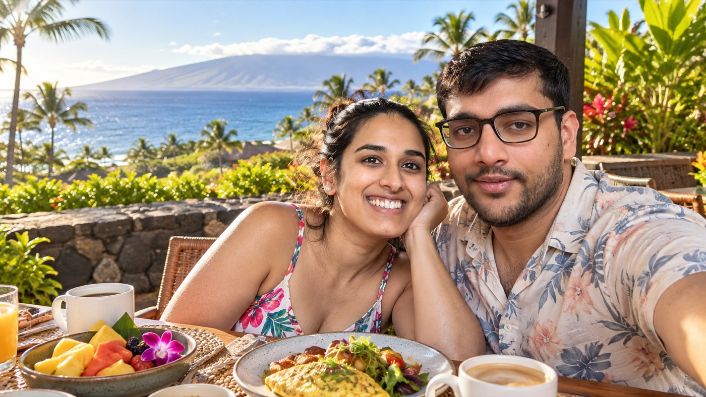
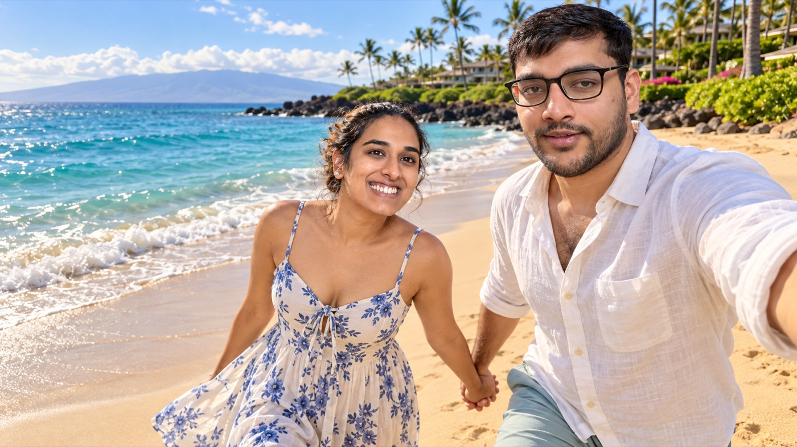
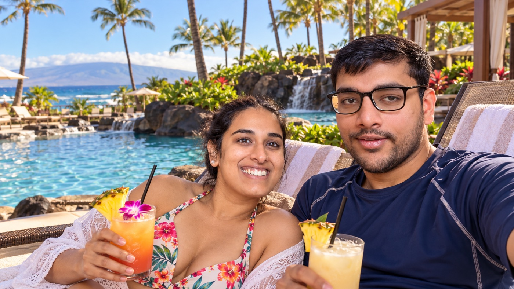
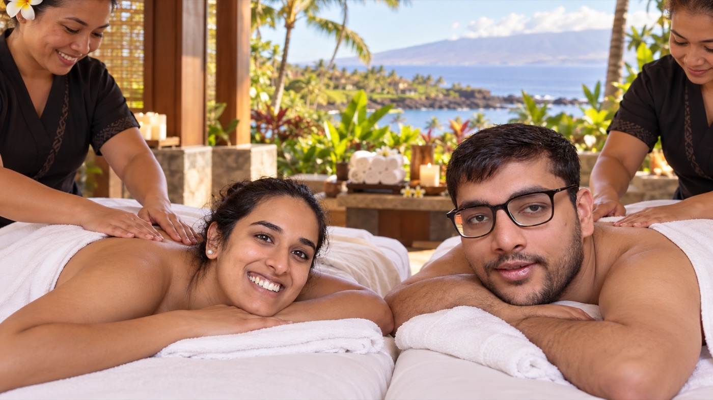
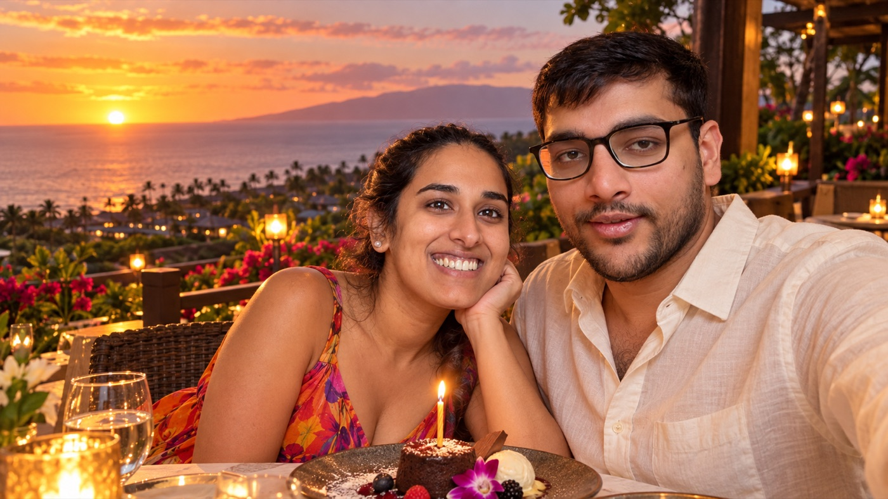

# 🎂 Birthday: Fri Nov 6, Maui

> Everything about Shivam's birthday in one place. Both of us, all day. **Chill daytime** (beach, pool, spa), **a really good dinner**, **a couple of drinks at a great bar**, then **a couple of hours of dancing**. No Hāna, no summit, no early check-ins.
> Base: Maui Coast Hotel, Kīhei (no car). Day plan also in [`itinerary.md`](itinerary.md).

   
   
  
   ☕ breakfast · 🏖️ beach · 🍹 pool · 💆 spa · 🎂 sunset dinner

## 📑 Contents

- [The day](#the-day)
- [💆 Spa](#-spa)
- [🍽️ Dinner](#dinner)
- [🍸 Drinks](#-drinks)
- [🪩 Dancing](#-dancing)
- [🌿 Weed: what's legal](#-weed-whats-legal)
- [🚕 Getting around](#-getting-around)
- [✅ To do](#-to-do)
- [💵 Cost](#-cost)
- [🎒 Pack](#-pack)
- [🌧️ Backups](#backups)

## The day

| When | What | Where |
|---|---|---|
| Morning | 😴 No alarm, slow breakfast · 🏖️ beach | **Wailea Beach** (calm) or **Mākena / Big Beach** (wild, wide) |
| Midday | 🏊 Pool, lunch, nap | Maui Coast Hotel |
| ~1–4 PM | 💆 **Couples spa** | Wailea resort spa (see below) |
| ~4:30 PM | Get ready | Hotel |
| ~5:00 PM | 🚕 Rideshare to Wailea | ~15 min |
| ~5:15 PM | 🍽️ **Dinner**, sunset ~5:47 from the table | The Restaurant at Hotel Wailea |
| ~7:45–9:00 PM | 🍸 **Cocktails** | Tikehau Lounge, Wailea Village |
| ~9:00 PM | 🚕 Rideshare to Kīhei | ~10 min |
| ~9:30–11:30 PM | 🪩 **DJ + dancing** | South Shore Tiki Lounge, Kīhei |
| After | 🚶 Walk back to the hotel | ~½ mi down S Kīhei Rd |

## 💆 Spa

- ✅ **Yes.** Couples treatment in the early afternoon, **~$400–700**. **Book by Oct 24.**
- Candidates: the big Wailea resort spas (Grand Wailea, Fairmont Kea Lani, Four Seasons, Andaz). Ask for a couples room, about 80 minutes, and whether booking includes pool or day access.

## 🍽️ Dinner

| Option | Vibe | From Kīhei | Status |
|---|---|---|---|
| **The Restaurant at Hotel Wailea** ⭐ | Adults-only, hilltop garden, ocean view, special-occasion. Open 5–8:30 PM | 4.2 mi · ~15 min | 🟡 lead, not booked |
| Monkeypod Wailea | Casual, lively | ~15 min | backup |
| Mama's Fish House | Special, iconic | ~45+ min (near Pāʻia) | only if we want the ride; it doesn't fit the bar + dancing night |

When booking:
- Ask for a **5:15–5:45 PM** seating, with an ocean-view table if they can.
- Say it's **a birthday**.
- Mention **lactose intolerance** and ask for a **dairy-free dessert**.
- [Official restaurant page](https://www.hotelwailea.com/dining/the-restaurant/). You don't need to stay at the hotel to eat there.

## 🍸 Drinks

| Bar | Why | Where | Hours (check) |
|---|---|---|---|
| **Tikehau Lounge** ⭐ | Maui's best-cocktails winner; Tales of the Cocktail 2026 Top 10 regional finalist. Local ingredients (calamansi, Maui Gold pineapple) | 116 Wailea Ike Dr, Wailea Village, a few minutes from Hotel Wailea | Tue–Fri 2–11 PM ([OpenTable](https://www.opentable.ca/r/tikehau-lounge-kihei)) |
| Pilina, Fairmont Kea Lani | First bar in Hawaiʻi on The Pinnacle Guide (2026). Fancier, resort setting | Wailea | check |
| Andaz Maui lobby bar | Views over the pools to the coast | Wailea | check |

Book Tikehau on OpenTable for ~7:45 PM.

## 🪩 Dancing

| Spot | What | Where |
|---|---|---|
| **South Shore Tiki Lounge** ⭐ | DJ and dancing from about 9–9:30 PM to midnight. Its calendar showed Friday "DJ & Dancing" nights in Oct 2026 | 1881 S Kīhei Rd · [site](https://www.southshoretiki.com/) · 808-879-0004 |
| Kahale's | Small dive bar, live music and some dancing | Kīhei |
| Old School Friday, Maui Beach Hotel | Long-running Friday dance night | Kahului, ~25 min away |

Maui doesn't really do big clubs or raves. Kīhei's "Barmuda Triangle" on S Kīhei Rd is the South Maui nightlife strip, and that's where to go. **Check the Tiki Lounge calendar the week before** to confirm a DJ is on Friday Nov 6.

## 🌿 Weed: what's legal

- **Recreational cannabis is still illegal in Hawaii** (2026 legalization bills failed). Possessing **3 g or less** is decriminalized (a fine, not a crime); over that is a criminal offense.
- The only legal way for visitors to buy is a **temporary Hawaii medical "329V" registration**, which requires a valid medical card from your home state (~$50, about 60 days). With that you can buy at licensed dispensaries in Kīhei and Kahului. Confirm the current rules with the [Hawaii DOH medical cannabis program](https://health.hawaii.gov/medicalcannabisregistry/) before the trip.
- Even with a card: **no public use** (beaches, parks, and the Wailea Beach Path count as public), hotel rooms are usually non-smoking (vapes or edibles are easier), and **don't fly with it**, including Oʻahu → Maui, because airports fall under federal law.

## 🚕 Getting around

| Leg | How | Cost for two |
|---|---|---:|
| Kīhei → Hotel Wailea (~5 PM) | Uber / Lyft | ~$15–25 |
| Hotel Wailea → Tikehau | Walk or a short ride (both in Wailea) | ~$0–10 |
| Wailea spa → Kīhei (~4 PM) | Uber / Lyft | ~$15–25 |
| Wailea Village → Tiki Lounge (~9 PM) | **Prebooked taxi** (rideshare is thin at night) | ~$15–25 |
| Tiki Lounge → hotel | 🚶 Walk ~½ mi, ~10 min | free |

Nobody drives tonight, and we don't have a car anyway. Full ride details: [`commute.md`](commute.md).

## ✅ To do

- [x] Spa: yes · Both
- [ ] Book the spa (couples, early afternoon) · P · **by Oct 24**
- [ ] Book Hotel Wailea dinner, 5:15–5:45 PM, birthday + lactose intolerance noted · P · **by Oct 24**
- [ ] Book Tikehau Lounge ~7:45 PM on OpenTable · P · by Oct 24
- [ ] Prebook a taxi Wailea Village → Tiki Lounge for ~9 PM · S · Nov 5
- [ ] Check South Shore Tiki Lounge's calendar for a DJ on Fri Nov 6 · week of Nov 2
- [ ] If we want weed legally: look into the 329V visitor registration (needs a home-state medical card) · S
- [ ] Add confirmation #s to [`bookings.md`](bookings.md) and costs to [`budget.md`](budget.md)

## 💵 Cost

| Item | Estimate |
|---|---:|
| Spa | $400–700 |
| Dinner | $220–400 |
| Cocktails (2–3 each) | $80–150 |
| Tiki Lounge (cover? + a drink or two) | $30–80 |
| Rides | $45–85 |
| **Total** | **≈ $775–1,415** |

## 🎒 Pack

- [ ] One nicer outfit each, plus shoes you can dance in
- [ ] Reef-safe sunscreen and a beach bag for the morning
- [ ] IDs (needed for bars)

## 🌧️ Backups

| If… | Then… |
|---|---|
| Rain | Spa + pool in the day; keep dinner and ask for an indoor table |
| Hotel Wailea is full | Monkeypod Wailea |
| No DJ at Tiki Lounge | Kahale's for live music, or stay longer at Tikehau |
| Haleakalā or Molokini gets cancelled | Move it to another day, **never onto Nov 6** |
