# 🗺️ Trip map: every place, every drive

> Terrain snapshots of every place on the plan, from the airports onward, plus the drive between each stop.
> **Snapshots** (images) show the terrain: shaded relief, contour lines, forest, roads. **Live links** under each one open Google Maps terrain, satellite or Google Earth 3D.
> **Interactive maps** (the `geojson` blocks) render as zoomable maps on GitHub.
> Distances and no-traffic drive times come from OSRM (OpenStreetMap routing). **"Plan for"** is the realistic time from our research, with traffic, parking and the slow Hāna road. Generated 2026-10-18 for the decided plan (Oʻahu → Maui).

## 📑 Contents

- [Big picture](#big-picture)
- [All distances at a glance](#all-distances-at-a-glance)
- [Oʻahu (Oct 31 – Nov 3)](#oʻahu-oct-31--nov-3)
  - [From the hotel to everything on Oʻahu](#from-the-hotel-to-everything-on-oʻahu)
  - [Sat Oct 31: airport → hotel](#sat-oct-31-airport--hotel)
  - [Sun Nov 1: Diamond Head](#sun-nov-1-diamond-head)
  - [Mon Nov 2: Pearl Harbor (+ optional Bishop Museum)](#mon-nov-2-pearl-harbor--optional-bishop-museum)
  - [Tue Nov 3: hotel → HNL](#tue-nov-3-hotel--hnl)
- [Maui (Nov 3 – 8)](#maui-nov-3--8)
  - [From the hotel to everything on Maui](#from-the-hotel-to-everything-on-maui)
  - [Tue Nov 3: OGG → hotel (shuttle)](#tue-nov-3-ogg--hotel-shuttle)
  - [Wed Nov 4: Molokini snorkel](#wed-nov-4-molokini-snorkel)
  - [Thu Nov 5: Road to Hāna (guided tour)](#thu-nov-5-road-to-hāna-guided-tour)
  - [Fri Nov 6 🎂: birthday dinner](#fri-nov-6--birthday-dinner)
  - [Sat Nov 7: Haleakalā sunset](#sat-nov-7-haleakalā-sunset)
  - [Sun Nov 8: hotel → OGG](#sun-nov-8-hotel--ogg)
- [Every location, close up](#every-location-close-up)
    - [Oʻahu](#oʻahu)
  - [HNL airport (Daniel K. Inouye Intl)](#hnl-airport-daniel-k-inouye-intl)
  - [OUTRIGGER Reef Waikīkī (hotel)](#outrigger-reef-waikīkī-hotel)
  - [Diamond Head State Monument](#diamond-head-state-monument)
  - [Pearl Harbor National Memorial](#pearl-harbor-national-memorial)
  - [Bishop Museum (optional)](#bishop-museum-optional)
    - [Maui](#maui)
  - [OGG airport (Kahului)](#ogg-airport-kahului)
  - [Costco Kahului (optional groceries)](#costco-kahului-optional-groceries)
  - [Maui Coast Hotel, Kīhei (hotel)](#maui-coast-hotel-kīhei-hotel)
  - [Māʻalaea Harbor (Molokini boat)](#māʻalaea-harbor-molokini-boat)
  - [Molokini Crater](#molokini-crater)
  - [Pāʻia town](#pāʻia-town)
  - [Hoʻokipa Lookout](#hoʻokipa-lookout)
  - [Twin Falls](#twin-falls)
  - [Keʻanae Peninsula](#keʻanae-peninsula)
  - [Waiʻānapanapa State Park](#waiʻānapanapa-state-park)
  - [Hāna town](#hāna-town)
  - [Hotel Wailea (birthday dinner)](#hotel-wailea-birthday-dinner)
  - [Kula (Upcountry)](#kula-upcountry)
  - [Haleakalā Visitor Center (summit)](#haleakalā-visitor-center-summit)
- [How to update the maps](#how-to-update-the-maps)

**Jump to:** [Big picture](#big) · [All distances](#all) · [Oʻahu](#oahu) · [Maui](#maui) · [Every location](#every) · [How to update](#update)

<a id="big"></a>
## Big picture


| Hop | Distance | Time |
|---|---:|---:|
| ✈️ JFK → HNL (Oct 31) | ~4,980 mi | ~11 h nonstop |
| ✈️ HNL → OGG (Nov 3) | ~100 mi (straight line) | ~40 min in the air; plan **4–6 h door to door** |
| ✈️ OGG → JFK (Nov 8 → 9) | ~4,950 mi | ~11–16 h with one stop |

<a id="all"></a>
## All distances at a glance

| Day | Route | Distance | Drive (no traffic) | Plan for | How |
|---|---|---:|---:|---|---|
| Sat Oct 31 | HNL → OUTRIGGER Reef | 9.1 mi | 20 min | 30–45 min (traffic + bags) | Prebooked transfer |
| Sun Nov 1 | Hotel → Diamond Head | 3.4 mi | 14 min | 15–20 min | Rideshare |
| Mon Nov 2 | Hotel → Pearl Harbor | 11.6 mi | 22 min | 30–40 min (H-1 traffic) | Rideshare |
| Mon Nov 2 | Pearl Harbor → Bishop Museum → Hotel | 11.7 mi | 24 min | 30–45 min | Rideshare |
| Tue Nov 3 | Hotel → HNL | 9.4 mi | 20 min | leave ~2.5 h before the flight | Transfer |
| Tue Nov 3 | OGG → Maui Coast Hotel | 13.3 mi | 29 min | 30–45 min (+ shuttle stops) | 🚐 Prebooked shuttle or rideshare |
| Wed Nov 4 | Hotel → Māʻalaea Harbor | 9.4 mi | 22 min | 25–40 min; check in 45 min early | 🚖 Prebooked dawn taxi; rideshare back |
| Wed Nov 4 | Māʻalaea → Molokini | ~11 mi by sea | — | ~1 h each way, ~5 h trip | 🚤 PacWhale |
| Thu Nov 5 | Hotel → Hāna (all stops) | 67.4 mi one way | 2 h 41 min | **10–12 h round-trip day** | 🚐 Guided tour |
| Fri Nov 6 🎂 | Hotel → Hotel Wailea | 4.2 mi | 13 min | 15 min | 🚕 Rideshare there, prebooked taxi back |
| Sat Nov 7 | Hotel → Kula → Haleakalā summit | 47.9 mi | 1 h 51 min | **2.5–3 h** up; tour pickup ~1:30 PM, back ~8 PM | 🚐 Guided sunset tour (hotel pickup) |
| Sun Nov 8 | Hotel → OGG | 13.2 mi | 28 min | 30–45 min; leave ~2.5 h before the flight | 🚐 Prebooked shuttle or rideshare |

---

<a id="oahu"></a>
## Oʻahu (Oct 31 – Nov 3)

No car: transfer + rideshares. Everything is within ~12 miles of the hotel.


**Interactive map** (zoom and click the pins on GitHub):

```geojson
{"type":"FeatureCollection","features":[{"type":"Feature","properties":{"title":"HNL airport (Daniel K. Inouye Intl)","marker-color":"#111111"},"geometry":{"type":"Point","coordinates":[-157.91844,21.32114]}},{"type":"Feature","properties":{"title":"OUTRIGGER Reef Waik\u012bk\u012b (hotel)","marker-color":"#d62828"},"geometry":{"type":"Point","coordinates":[-157.83279,21.27825]}},{"type":"Feature","properties":{"title":"Diamond Head State Monument","marker-color":"#111111"},"geometry":{"type":"Point","coordinates":[-157.80679,21.26249]}},{"type":"Feature","properties":{"title":"Pearl Harbor National Memorial","marker-color":"#111111"},"geometry":{"type":"Point","coordinates":[-157.93845,21.36748]}},{"type":"Feature","properties":{"title":"Bishop Museum (optional)","marker-color":"#111111"},"geometry":{"type":"Point","coordinates":[-157.87071,21.33308]}},{"type":"Feature","properties":{"title":"HNL airport (Daniel K. Inouye Intl) \u2192 OUTRIGGER Reef Waik\u012bk\u012b (hotel)","stroke":"#1d4ed8","stroke-width":4},"geometry":{"type":"LineString","coordinates":[[-157.91554,21.31817],[-157.91473,21.31717],[-157.91455,21.31694],[-157.91449,21.31687],[-157.91342,21.31755],[-157.91274,21.31803],[-157.91026,21.31978],[-157.90745,21.32176],[-157.90409,21.3242],[-157.90371,21.3245],[-157.90347,21.32475],[-157.90324,21.32506],[-157.90305,21.32541],[-157.90291,21.32585],[-157.90284,21.32622],[-157.90208,21.33067],[-157.90204,21.33093],[-157.90189,21.33184],[-157.90176,21.33275],[-157.90173,21.33293],[-157.90152,21.33412],[-157.90145,21.33447],[-157.90133,21.33481],[-157.9012,21.33489],[-157.90016,21.33473],[-157.8981,21.33441],[-157.89593,21.33402],[-157.89394,21.33362],[-157.89224,21.33333],[-157.89178,21.33333],[-157.8914,21.33339],[-157.89103,21.3335],[-157.89026,21.33388],[-157.88912,21.33447],[-157.88847,21.33487],[-157.88795,21.33523],[-157.88654,21.33627],[-157.88527,21.33719],[-157.88504,21.33729],[-157.88479,21.33737],[-157.88451,21.3374],[-157.88416,21.33741],[-157.88392,21.33736],[-157.88338,21.33708],[-157.88232,21.33648],[-157.88174,21.33628],[-157.88079,21.33612],[-157.8797,21.33606],[-157.87852,21.33589],[-157.8775,21.33563],[-157.87642,21.33526],[-157.87486,21.33446],[-157.87435,21.33415],[-157.87399,21.3339],[-157.87354,21.33355],[-157.87318,21.33326],[-157.87251,21.33265],[-157.87159,21.33179],[-157.87086,21.3311],[-157.87047,21.33067],[-157.86977,21.32979],[-157.86952,21.32942],[-157.86767,21.32667],[-157.86739,21.32629],[-157.86645,21.32507],[-157.86592,21.32455],[-157.86511,21.32408],[-157.86441,21.32388],[-157.86266,21.32351],[-157.86185,21.32308],[-157.86056,21.32166],[-157.85982,21.32075],[-157.85891,21.31971],[-157.8586,21.31929],[-157.85782,21.31833],[-157.85738,21.31777],[-157.85681,21.31705],[-157.85563,21.3156],[-157.85389,21.31343],[-157.85338,21.31277],[-157.85317,21.31246],[-157.85297,21.31212],[-157.85273,21.31165],[-157.85257,21.31126],[-157.8522,21.3102],[-157.85156,21.30823],[-157.8514,21.30778],[-157.85111,21.30721],[-157.85076,21.30678],[-157.85031,21.30637],[-157.84971,21.306],[-157.8487,21.3056],[-157.8465,21.30485],[-157.84455,21.30419],[-157.84062,21.30282],[-157.84007,21.30263],[-157.83946,21.30249],[-157.83853,21.30235],[-157.83649,21.30207],[-157.83562,21.30175],[-157.83513,21.30146],[-157.8348,21.30126],[-157.83424,21.30089],[-157.834,21.30076],[-157.83331,21.30032],[-157.83231,21.29966],[-157.83189,21.29937],[-157.83057,21.29853],[-157.82928,21.29795],[-157.82926,21.29784],[-157.82962,21.29701],[-157.82962,21.29697],[-157.82962,21.29692],[-157.82961,21.29689],[-157.8296,21.29684],[-157.8296,21.29677],[-157.82965,21.29653],[-157.82976,21.29619],[-157.82989,21.2958],[-157.82993,21.29565],[-157.82998,21.29551],[-157.83004,21.29529],[-157.83015,21.29496],[-157.83022,21.29477],[-157.83045,21.29418],[-157.83051,21.29404],[-157.83079,21.29335],[-157.831,21.29284],[-157.83109,21.2926],[-157.8314,21.29183],[-157.83171,21.29107],[-157.83202,21.29031],[-157.8323,21.28961],[-157.83241,21.28933],[-157.8327,21.28863],[-157.83279,21.2884],[-157.83288,21.28823],[-157.83296,21.28807],[-157.83301,21.28789],[-157.83338,21.28698],[-157.83352,21.28666],[-157.83325,21.28609],[-157.83294,21.28555],[-157.83237,21.28461],[-157.83198,21.28403],[-157.83182,21.28375],[-157.83157,21.2833],[-157.83134,21.28291],[-157.83104,21.28232],[-157.83107,21.28213],[-157.83115,21.28187],[-157.83138,21.28132],[-157.83143,21.2812],[-157.83168,21.28077],[-157.83214,21.27998],[-157.83241,21.27953],[-157.83264,21.27923],[-157.83258,21.2791],[-157.83257,21.27901],[-157.83271,21.27894],[-157.83291,21.27872]]}},{"type":"Feature","properties":{"title":"OUTRIGGER Reef Waik\u012bk\u012b (hotel) \u2192 Diamond Head State Monument","stroke":"#1d4ed8","stroke-width":4},"geometry":{"type":"LineString","coordinates":[[-157.83291,21.27872],[-157.83271,21.27894],[-157.83264,21.27894],[-157.83257,21.27901],[-157.83253,21.27906],[-157.83258,21.2791],[-157.83269,21.27917],[-157.83264,21.27923],[-157.83245,21.27947],[-157.83241,21.27953],[-157.83221,21.27985],[-157.83214,21.27998],[-157.83182,21.28052],[-157.83168,21.28077],[-157.83151,21.28105],[-157.83143,21.2812],[-157.83141,21.28124],[-157.83138,21.28132],[-157.83131,21.28147],[-157.83115,21.28187],[-157.83105,21.28193],[-157.83104,21.28194],[-157.83102,21.28195],[-157.831,21.28195],[-157.83098,21.28195],[-157.83097,21.28195],[-157.83095,21.28195],[-157.83093,21.28195],[-157.83091,21.28195],[-157.83081,21.2819],[-157.8308,21.28188],[-157.83059,21.28149],[-157.83047,21.28129],[-157.82985,21.28019],[-157.82979,21.2801],[-157.82974,21.28002],[-157.82964,21.27987],[-157.8293,21.27946],[-157.82925,21.2794],[-157.82923,21.27937],[-157.82882,21.27899],[-157.82855,21.27874],[-157.82793,21.27819],[-157.82777,21.27805],[-157.82733,21.27766],[-157.82716,21.27751],[-157.8265,21.27692],[-157.82629,21.27673],[-157.82608,21.27654],[-157.82564,21.27611],[-157.82495,21.27536],[-157.82488,21.27529],[-157.8247,21.27512],[-157.82462,21.27501],[-157.82455,21.27492],[-157.82442,21.27469],[-157.82439,21.27463],[-157.82429,21.27443],[-157.82404,21.27399],[-157.82399,21.2739],[-157.82363,21.27319],[-157.82358,21.27311],[-157.82321,21.27241],[-157.82315,21.27231],[-157.82311,21.27222],[-157.8228,21.27159],[-157.82276,21.27151],[-157.82263,21.27123],[-157.82251,21.27101],[-157.82241,21.27085],[-157.82206,21.27051],[-157.82185,21.27028],[-157.82126,21.26979],[-157.82104,21.26969],[-157.82091,21.26964],[-157.82067,21.26956],[-157.82032,21.26952],[-157.81986,21.26948],[-157.81931,21.26943],[-157.81923,21.26942],[-157.81918,21.26941],[-157.81908,21.2694],[-157.81797,21.2693],[-157.8179,21.26929],[-157.81785,21.26929],[-157.8178,21.26929],[-157.81778,21.26928],[-157.81743,21.26926],[-157.8172,21.26924],[-157.81631,21.26916],[-157.81599,21.26914],[-157.81585,21.26913],[-157.81574,21.26911],[-157.8152,21.2691],[-157.81513,21.26909],[-157.81504,21.26909],[-157.81447,21.26908],[-157.81441,21.26908],[-157.81431,21.26908],[-157.81375,21.26906],[-157.81371,21.26906],[-157.81352,21.26906],[-157.81342,21.26906],[-157.81329,21.26905],[-157.81319,21.26905],[-157.81297,21.26908],[-157.81268,21.26916],[-157.81166,21.2695],[-157.81141,21.26958],[-157.81135,21.26959],[-157.80954,21.26975],[-157.80888,21.26979],[-157.80841,21.2698],[-157.80782,21.26978],[-157.80716,21.26968],[-157.80687,21.26962],[-157.80673,21.2696],[-157.80591,21.26959],[-157.8055,21.26958],[-157.80428,21.26957],[-157.80388,21.26959],[-157.8035,21.26962],[-157.8033,21.26965],[-157.803,21.26966],[-157.8029,21.26965],[-157.8028,21.26964],[-157.8027,21.26962],[-157.8026,21.26959],[-157.8025,21.26955],[-157.80241,21.2695],[-157.80233,21.26946],[-157.80228,21.26942],[-157.80225,21.2694],[-157.80225,21.2694],[-157.80218,21.26934],[-157.80211,21.26928],[-157.80209,21.26926],[-157.80208,21.26925],[-157.80187,21.26904],[-157.80186,21.26902],[-157.80185,21.269],[-157.80184,21.26897],[-157.80183,21.26896],[-157.80181,21.26894],[-157.80147,21.2687],[-157.80143,21.26868],[-157.80139,21.26865],[-157.80133,21.26863],[-157.80124,21.2686],[-157.80115,21.26855],[-157.80102,21.26848],[-157.80089,21.26839],[-157.80087,21.26838],[-157.80075,21.2683],[-157.80064,21.2682],[-157.80057,21.26814],[-157.80053,21.2681],[-157.80041,21.268],[-157.80031,21.2679],[-157.80018,21.26779],[-157.80006,21.26771],[-157.79987,21.26758],[-157.79992,21.26752],[-157.79995,21.26749],[-157.80011,21.26728],[-157.80012,21.26726],[-157.80013,21.26723],[-157.80013,21.26721],[-157.80012,21.26719],[-157.8001,21.26717],[-157.80004,21.26707],[-157.79994,21.26693],[-157.7999,21.26689],[-157.79988,21.26684],[-157.79985,21.26678],[-157.79984,21.26672],[-157.79981,21.26662],[-157.79979,21.26652],[-157.79978,21.26642],[-157.79977,21.26632],[-157.79976,21.26614],[-157.79975,21.26601],[-157.79973,21.26587],[-157.79969,21.26567],[-157.79965,21.26546],[-157.79959,21.26526],[-157.79952,21.26507],[-157.79945,21.26488],[-157.79938,21.26472],[-157.79937,21.26469],[-157.79935,21.26463],[-157.79935,21.26458],[-157.79935,21.26452],[-157.79936,21.26448],[-157.79938,21.26443],[-157.7994,21.26439],[-157.79942,21.26435],[-157.79945,21.26431],[-157.79949,21.26428],[-157.79953,21.26425],[-157.79958,21.26422],[-157.79964,21.26418],[-157.7997,21.26416],[-157.7998,21.26411],[-157.79992,21.26407],[-157.80023,21.26395],[-157.80148,21.26349],[-157.80204,21.2633],[-157.80215,21.26326],[-157.80238,21.26317],[-157.80282,21.26301],[-157.80308,21.26292],[-157.80326,21.26288],[-157.80342,21.26287],[-157.80354,21.26287],[-157.80368,21.26291],[-157.8038,21.26297],[-157.8039,21.26303],[-157.80402,21.2631],[-157.80412,21.26315],[-157.80415,21.26316],[-157.80495,21.26358],[-157.80502,21.26349],[-157.80508,21.2634],[-157.80508,21.2634]]}},{"type":"Feature","properties":{"title":"OUTRIGGER Reef Waik\u012bk\u012b (hotel) \u2192 Pearl Harbor National Memorial \u2192 Bishop Museum (optional) \u2192 OUTRIGGER Reef Waik\u012bk\u012b (hotel)","stroke":"#1d4ed8","stroke-width":4},"geometry":{"type":"LineString","coordinates":[[-157.83291,21.27872],[-157.83258,21.2791],[-157.83221,21.27985],[-157.83143,21.2812],[-157.83111,21.282],[-157.83084,21.28243],[-157.82973,21.28357],[-157.82899,21.2843],[-157.83055,21.28576],[-157.83216,21.28718],[-157.83283,21.28787],[-157.83287,21.28802],[-157.83272,21.28856],[-157.8323,21.28961],[-157.83168,21.29114],[-157.831,21.29284],[-157.83048,21.29412],[-157.83015,21.29496],[-157.82996,21.29556],[-157.82976,21.29619],[-157.8296,21.29681],[-157.82887,21.29839],[-157.82854,21.29877],[-157.82976,21.29959],[-157.83067,21.30018],[-157.83115,21.29948],[-157.83382,21.30093],[-157.83544,21.3019],[-157.83641,21.30219],[-157.83948,21.30261],[-157.84099,21.30308],[-157.84767,21.3054],[-157.84944,21.30604],[-157.84997,21.30632],[-157.85064,21.30688],[-157.85119,21.30765],[-157.8524,21.31125],[-157.85283,21.31216],[-157.85328,21.31291],[-157.85419,21.31404],[-157.85671,21.31717],[-157.85926,21.32036],[-157.86133,21.32291],[-157.86218,21.32347],[-157.86311,21.32379],[-157.86487,21.32414],[-157.86576,21.3246],[-157.86634,21.32514],[-157.86801,21.32746],[-157.87049,21.33091],[-157.87346,21.33366],[-157.87584,21.33512],[-157.87793,21.33587],[-157.88115,21.33646],[-157.88282,21.33719],[-157.88364,21.33773],[-157.88479,21.33767],[-157.88772,21.33566],[-157.88878,21.33498],[-157.89007,21.33453],[-157.89126,21.33438],[-157.89453,21.33459],[-157.89971,21.33506],[-157.901,21.33526],[-157.90391,21.33573],[-157.90523,21.33593],[-157.90649,21.33612],[-157.90787,21.33633],[-157.91052,21.3367],[-157.92238,21.33847],[-157.92681,21.33915],[-157.92901,21.34],[-157.93043,21.34094],[-157.93214,21.34306],[-157.93259,21.34416],[-157.93281,21.34519],[-157.93307,21.34613],[-157.93367,21.34703],[-157.9344,21.34819],[-157.93506,21.35093],[-157.93542,21.35264],[-157.93589,21.3546],[-157.93694,21.35923],[-157.93764,21.364],[-157.93738,21.36466],[-157.93688,21.3657],[-157.93696,21.36627],[-157.93768,21.36665],[-157.93799,21.36592],[-157.93843,21.36613],[-157.93856,21.36693],[-157.93856,21.36693],[-157.93843,21.36613],[-157.93799,21.36592],[-157.93731,21.36634],[-157.93719,21.36557],[-157.93775,21.36434],[-157.93794,21.36325],[-157.93718,21.3596],[-157.93567,21.35286],[-157.93544,21.35188],[-157.93481,21.34897],[-157.9343,21.34751],[-157.93391,21.34628],[-157.93321,21.34397],[-157.93247,21.34264],[-157.93102,21.34107],[-157.92942,21.33988],[-157.92684,21.33886],[-157.9212,21.33801],[-157.91342,21.33683],[-157.90125,21.335],[-157.8937,21.33408],[-157.89112,21.33395],[-157.88949,21.3344],[-157.88798,21.33529],[-157.88517,21.33724],[-157.88451,21.3374],[-157.88377,21.3373],[-157.88174,21.33628],[-157.87907,21.33597],[-157.87642,21.33526],[-157.87419,21.33394],[-157.87344,21.33312],[-157.873,21.33305],[-157.8707,21.33492],[-157.86951,21.33345],[-157.87011,21.33312],[-157.87025,21.33277],[-157.86993,21.33255],[-157.86851,21.33102],[-157.8695,21.33027],[-157.86856,21.32761],[-157.86732,21.32588],[-157.86539,21.32399],[-157.86472,21.32318],[-157.86377,21.32189],[-157.86214,21.31977],[-157.86,21.31708],[-157.85947,21.31643],[-157.85828,21.31499],[-157.85745,21.31393],[-157.85666,21.31293],[-157.85568,21.3116],[-157.85455,21.31032],[-157.85344,21.3092],[-157.8511,21.30697],[-157.84929,21.30574],[-157.84455,21.30419],[-157.83977,21.30255],[-157.83649,21.30207],[-157.83492,21.30133],[-157.834,21.30076],[-157.832,21.29944],[-157.82928,21.29795],[-157.82962,21.29699],[-157.82961,21.29689],[-157.82962,21.29662],[-157.82989,21.2958],[-157.83004,21.29531],[-157.83022,21.29477],[-157.83075,21.29344],[-157.83109,21.2926],[-157.83174,21.29101],[-157.83241,21.28933],[-157.83284,21.28829],[-157.83301,21.28789],[-157.83328,21.28616],[-157.83237,21.28461],[-157.83177,21.28365],[-157.83104,21.28232],[-157.83131,21.28147],[-157.83168,21.28077],[-157.83245,21.27947],[-157.83257,21.27901],[-157.83291,21.27872]]}}]}
```

### From the hotel to everything on Oʻahu

| Place | Drive from OUTRIGGER Reef Waikīkī (hotel) | Time (no traffic) | Live maps |
|---|---:|---:|---|
| [HNL airport (Daniel K. Inouye Intl)](#hnl) | 9.4 mi | 20 min | [terrain](https://www.google.com/maps/@?api=1&map_action=map&center=21.32114,-157.91844&zoom=15&basemap=terrain) · [satellite](https://www.google.com/maps/@?api=1&map_action=map&center=21.32114,-157.91844&zoom=16&basemap=satellite) · [3D](https://earth.google.com/web/@21.32114,-157.91844,300a,2500d,35y,0h,60t,0r) |
| [Diamond Head State Monument](#dh) | 3.4 mi | 14 min | [terrain](https://www.google.com/maps/@?api=1&map_action=map&center=21.26249,-157.80679&zoom=15&basemap=terrain) · [satellite](https://www.google.com/maps/@?api=1&map_action=map&center=21.26249,-157.80679&zoom=16&basemap=satellite) · [3D](https://earth.google.com/web/@21.26249,-157.80679,300a,2500d,35y,0h,60t,0r) |
| [Pearl Harbor National Memorial](#ph) | 11.6 mi | 22 min | [terrain](https://www.google.com/maps/@?api=1&map_action=map&center=21.36748,-157.93845&zoom=15&basemap=terrain) · [satellite](https://www.google.com/maps/@?api=1&map_action=map&center=21.36748,-157.93845&zoom=16&basemap=satellite) · [3D](https://earth.google.com/web/@21.36748,-157.93845,300a,2500d,35y,0h,60t,0r) |
| [Bishop Museum (optional)](#bishop) | 5.7 mi | 13 min | [terrain](https://www.google.com/maps/@?api=1&map_action=map&center=21.33308,-157.87071&zoom=15&basemap=terrain) · [satellite](https://www.google.com/maps/@?api=1&map_action=map&center=21.33308,-157.87071&zoom=16&basemap=satellite) · [3D](https://earth.google.com/web/@21.33308,-157.87071,300a,2500d,35y,0h,60t,0r) |

### Sat Oct 31: airport → hotel

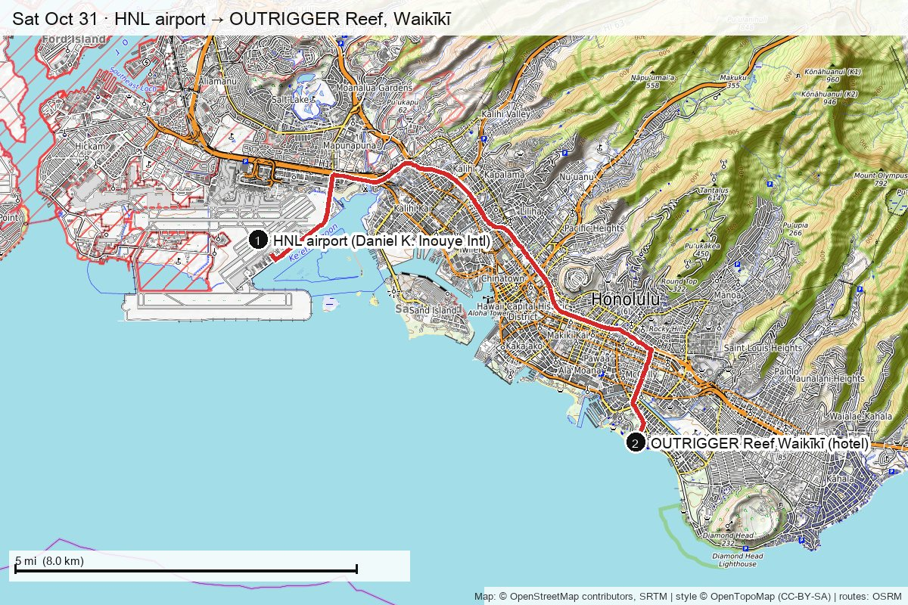

| Leg | Distance | Drive (no traffic) | Plan for |
|---|---:|---:|---|
| HNL airport (Daniel K. Inouye Intl) → OUTRIGGER Reef Waikīkī (hotel) | 9.1 mi | 20 min | 30–45 min with bags and traffic; prebook the transfer |

[▶ Open these directions in Google Maps](https://www.google.com/maps/dir/?api=1&origin=21.32114,-157.91844&destination=21.27825,-157.83279&travelmode=driving)

### Sun Nov 1: Diamond Head

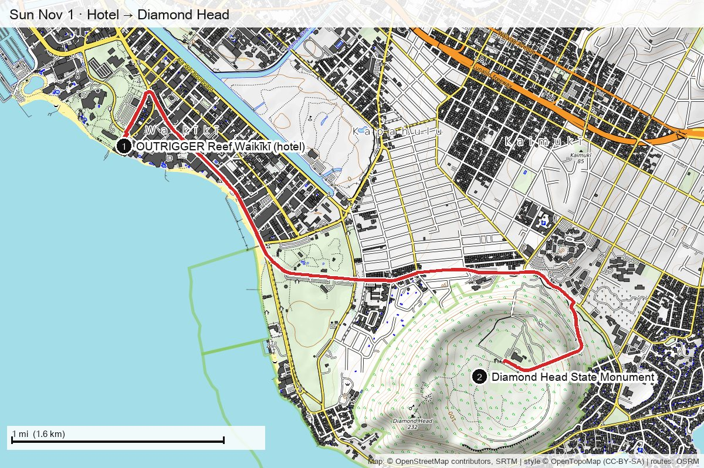

| Leg | Distance | Drive (no traffic) | Plan for |
|---|---:|---:|---|
| OUTRIGGER Reef Waikīkī (hotel) → Diamond Head State Monument | 3.4 mi | 14 min | 15–20 min by rideshare; the trail climbs ~560 ft from the crater floor to the rim |

[▶ Open these directions in Google Maps](https://www.google.com/maps/dir/?api=1&origin=21.27825,-157.83279&destination=21.26249,-157.80679&travelmode=driving)

### Mon Nov 2: Pearl Harbor (+ optional Bishop Museum)

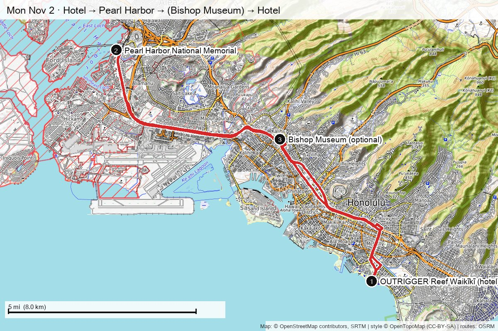

| Leg | Distance | Drive (no traffic) | Plan for |
|---|---:|---:|---|
| OUTRIGGER Reef Waikīkī (hotel) → Pearl Harbor National Memorial | 11.6 mi | 22 min | 30–40 min in morning traffic; be there an hour before the program |
| Pearl Harbor National Memorial → Bishop Museum (optional) | 6.4 mi | 12 min | 15–20 min |
| Bishop Museum (optional) → OUTRIGGER Reef Waikīkī (hotel) | 5.3 mi | 12 min | 15–25 min |
| **Total** | **23.3 mi** | **47 min** | |

[▶ Open these directions in Google Maps](https://www.google.com/maps/dir/?api=1&origin=21.27825,-157.83279&destination=21.27825,-157.83279&travelmode=driving&waypoints=21.36748%2C-157.93845%7C21.33308%2C-157.87071)

### Tue Nov 3: hotel → HNL

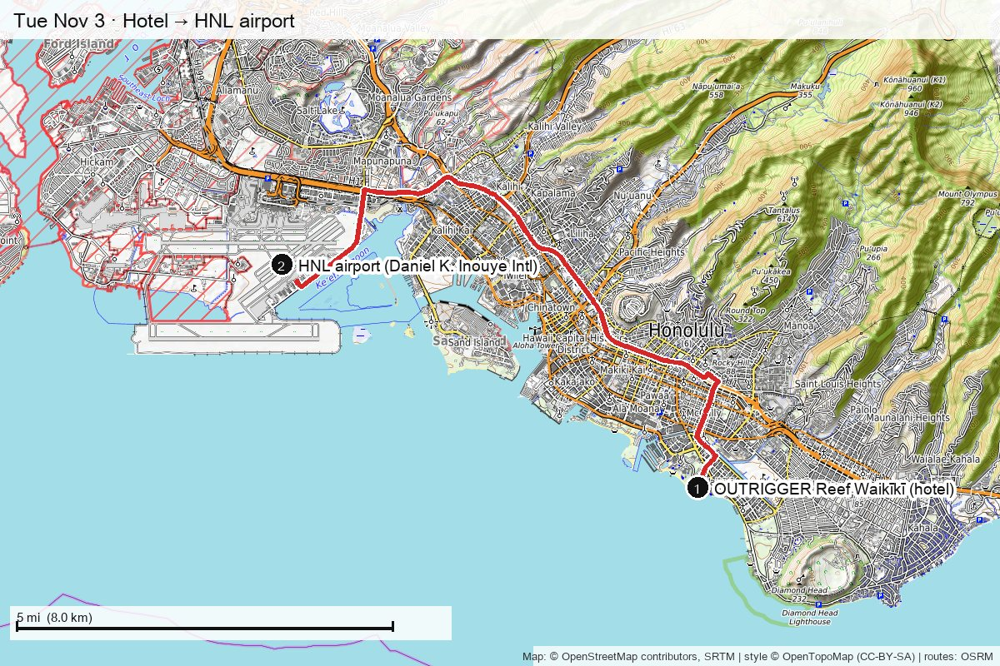

| Leg | Distance | Drive (no traffic) | Plan for |
|---|---:|---:|---|
| OUTRIGGER Reef Waikīkī (hotel) → HNL airport (Daniel K. Inouye Intl) | 9.4 mi | 20 min | Leave ~2.5 h before the island hop |

[▶ Open these directions in Google Maps](https://www.google.com/maps/dir/?api=1&origin=21.27825,-157.83279&destination=21.32114,-157.91844&travelmode=driving)

---

<a id="maui"></a>
## Maui (Nov 3 – 8)

**No car**, based in Kīhei. Hāna and Haleakalā are guided tours with hotel pickup; the airport is a prebooked shuttle; Molokini is a dawn taxi to the harbor; dinner is a rideshare. Every ride and its options: [`commute.md`](commute.md).


**Interactive map:**

```geojson
{"type":"FeatureCollection","features":[{"type":"Feature","properties":{"title":"OGG airport (Kahului)","marker-color":"#111111"},"geometry":{"type":"Point","coordinates":[-156.43405,20.8957]}},{"type":"Feature","properties":{"title":"Costco Kahului (optional groceries)","marker-color":"#111111"},"geometry":{"type":"Point","coordinates":[-156.45088,20.88719]}},{"type":"Feature","properties":{"title":"Maui Coast Hotel, K\u012bhei (hotel)","marker-color":"#d62828"},"geometry":{"type":"Point","coordinates":[-156.44605,20.72386]}},{"type":"Feature","properties":{"title":"M\u0101\u02bbalaea Harbor (Molokini boat)","marker-color":"#111111"},"geometry":{"type":"Point","coordinates":[-156.51113,20.79135]}},{"type":"Feature","properties":{"title":"Molokini Crater","marker-color":"#111111"},"geometry":{"type":"Point","coordinates":[-156.49603,20.63287]}},{"type":"Feature","properties":{"title":"P\u0101\u02bbia town","marker-color":"#111111"},"geometry":{"type":"Point","coordinates":[-156.37013,20.90926]}},{"type":"Feature","properties":{"title":"Ho\u02bbokipa Lookout","marker-color":"#111111"},"geometry":{"type":"Point","coordinates":[-156.35585,20.93442]}},{"type":"Feature","properties":{"title":"Twin Falls","marker-color":"#111111"},"geometry":{"type":"Point","coordinates":[-156.2432,20.9118]}},{"type":"Feature","properties":{"title":"Ke\u02bbanae Peninsula","marker-color":"#111111"},"geometry":{"type":"Point","coordinates":[-156.1461,20.86549]}},{"type":"Feature","properties":{"title":"Wai\u02bb\u0101napanapa State Park","marker-color":"#111111"},"geometry":{"type":"Point","coordinates":[-156.00212,20.78655]}},{"type":"Feature","properties":{"title":"H\u0101na town","marker-color":"#111111"},"geometry":{"type":"Point","coordinates":[-155.99075,20.7671]}},{"type":"Feature","properties":{"title":"Hotel Wailea (birthday dinner)","marker-color":"#111111"},"geometry":{"type":"Point","coordinates":[-156.43222,20.67748]}},{"type":"Feature","properties":{"title":"Kula (Upcountry)","marker-color":"#111111"},"geometry":{"type":"Point","coordinates":[-156.32371,20.79203]}},{"type":"Feature","properties":{"title":"Haleakal\u0101 Visitor Center (summit)","marker-color":"#111111"},"geometry":{"type":"Point","coordinates":[-156.24981,20.71511]}},{"type":"Feature","properties":{"title":"OGG airport (Kahului) \u2192 Costco Kahului (optional groceries) \u2192 Maui Coast Hotel, K\u012bhei (hotel)","stroke":"#1d4ed8","stroke-width":4},"geometry":{"type":"LineString","coordinates":[[-156.43605,20.89517],[-156.43625,20.89541],[-156.43646,20.89578],[-156.43698,20.89553],[-156.43709,20.89554],[-156.43718,20.89559],[-156.43727,20.89569],[-156.43739,20.89582],[-156.43752,20.89593],[-156.43768,20.89601],[-156.43784,20.89606],[-156.43801,20.89609],[-156.43819,20.89609],[-156.43837,20.89606],[-156.43857,20.89599],[-156.43873,20.8959],[-156.43885,20.89579],[-156.439,20.89562],[-156.43975,20.89462],[-156.44003,20.8942],[-156.4404,20.89362],[-156.44096,20.89285],[-156.44142,20.89223],[-156.44201,20.89146],[-156.44284,20.89035],[-156.44294,20.8902],[-156.44299,20.89002],[-156.44301,20.88982],[-156.44297,20.88963],[-156.44288,20.88942],[-156.44272,20.88916],[-156.44262,20.8889],[-156.4426,20.88866],[-156.44266,20.88836],[-156.44273,20.88819],[-156.44286,20.88799],[-156.44907,20.88339],[-156.45169,20.8849],[-156.45261,20.88556],[-156.45266,20.88566],[-156.45268,20.88581],[-156.45257,20.88614],[-156.45246,20.88638],[-156.45224,20.88685],[-156.45208,20.88701],[-156.4515,20.88762],[-156.45136,20.88771],[-156.4509,20.88774],[-156.45015,20.88768],[-156.45009,20.88773],[-156.4494,20.88747],[-156.44915,20.88755],[-156.44916,20.88785],[-156.44999,20.8879],[-156.45094,20.88785],[-156.45154,20.88783],[-156.45179,20.88781],[-156.45197,20.88753],[-156.45209,20.88717],[-156.45215,20.88704],[-156.45235,20.88661],[-156.45253,20.88623],[-156.45266,20.88595],[-156.45282,20.88562],[-156.45294,20.88534],[-156.45312,20.88498],[-156.4533,20.88461],[-156.45348,20.88425],[-156.45373,20.88374],[-156.45382,20.88355],[-156.45394,20.88339],[-156.4544,20.88292],[-156.45459,20.8827],[-156.45547,20.88171],[-156.45602,20.88103],[-156.45632,20.88065],[-156.45683,20.88008],[-156.45713,20.87972],[-156.45753,20.87927],[-156.45762,20.87905],[-156.45767,20.87884],[-156.45761,20.87867],[-156.45762,20.87858],[-156.45768,20.8785],[-156.4582,20.87826],[-156.45889,20.87788],[-156.45951,20.87733],[-156.46028,20.87649],[-156.46041,20.87636],[-156.46044,20.87619],[-156.45996,20.87529],[-156.45935,20.8741],[-156.45901,20.8735],[-156.45856,20.8728],[-156.45816,20.87217],[-156.45791,20.87172],[-156.45759,20.87101],[-156.45745,20.87064],[-156.45726,20.87003],[-156.45719,20.86971],[-156.45707,20.86892],[-156.45703,20.86843],[-156.45705,20.86764],[-156.45718,20.86666],[-156.45723,20.86639],[-156.45739,20.86572],[-156.45759,20.86498],[-156.45792,20.86373],[-156.45823,20.86263],[-156.45912,20.85925],[-156.45959,20.85748],[-156.46008,20.85566],[-156.46122,20.85132],[-156.46193,20.84864],[-156.46474,20.83803],[-156.46544,20.83532],[-156.46579,20.83334],[-156.46743,20.81917],[-156.46804,20.8143],[-156.46833,20.81152],[-156.46819,20.80907],[-156.46689,20.80365],[-156.46476,20.79487],[-156.46385,20.79109],[-156.46327,20.78856],[-156.463,20.78751],[-156.46274,20.78692],[-156.46221,20.78607],[-156.46215,20.78576],[-156.46235,20.78552],[-156.46267,20.78536],[-156.46329,20.78522],[-156.46395,20.78509],[-156.46405,20.78494],[-156.46402,20.78449],[-156.46393,20.78395],[-156.46382,20.78343],[-156.46353,20.78288],[-156.4632,20.78229],[-156.46295,20.78184],[-156.46197,20.78035],[-156.46122,20.77926],[-156.46098,20.77875],[-156.46067,20.77785],[-156.4605,20.77647],[-156.46036,20.77526],[-156.4603,20.77503],[-156.46029,20.77488],[-156.46007,20.77361],[-156.4596,20.77197],[-156.4594,20.77123],[-156.45919,20.77046],[-156.45888,20.76921],[-156.45875,20.76865],[-156.45852,20.7672],[-156.45843,20.7662],[-156.45837,20.7655],[-156.45828,20.76433],[-156.4582,20.76342],[-156.45805,20.76224],[-156.45791,20.76147],[-156.45777,20.76082],[-156.45765,20.76014],[-156.45749,20.75934],[-156.45735,20.75854],[-156.45714,20.75738],[-156.45702,20.75684],[-156.45693,20.75637],[-156.45676,20.75549],[-156.45653,20.75455],[-156.45642,20.75381],[-156.45613,20.75157],[-156.45606,20.7512],[-156.45589,20.75063],[-156.45569,20.75009],[-156.45561,20.7498],[-156.45556,20.74966],[-156.45541,20.74915],[-156.45538,20.74894],[-156.45532,20.74864],[-156.45527,20.74836],[-156.45494,20.74666],[-156.45489,20.74641],[-156.45476,20.74572],[-156.45464,20.74488],[-156.45454,20.74391],[-156.45447,20.74299],[-156.4544,20.74225],[-156.45418,20.73996],[-156.45406,20.73871],[-156.45383,20.73769],[-156.45318,20.73509],[-156.45287,20.73413],[-156.45275,20.73375],[-156.45258,20.73307],[-156.45251,20.73284],[-156.45227,20.7322],[-156.45205,20.73158],[-156.45172,20.7308],[-156.45155,20.73031],[-156.45144,20.73005],[-156.45109,20.72944],[-156.45099,20.72931],[-156.45083,20.7291],[-156.45065,20.7289],[-156.4498,20.72816],[-156.44955,20.72793],[-156.44939,20.72779],[-156.44898,20.72736],[-156.44869,20.72696],[-156.44847,20.72657],[-156.44823,20.72602],[-156.44808,20.72544],[-156.44795,20.72483],[-156.4479,20.7246],[-156.44772,20.72379],[-156.4475,20.72384],[-156.44735,20.72387],[-156.44724,20.72387],[-156.44714,20.72385],[-156.44679,20.72377],[-156.44675,20.72376],[-156.4467,20.72377],[-156.44665,20.72378],[-156.44661,20.72381],[-156.44635,20.72402],[-156.44633,20.72403],[-156.44631,20.72404],[-156.44629,20.72404],[-156.44604,20.72403],[-156.44604,20.72403]]}},{"type":"Feature","properties":{"title":"Maui Coast Hotel, K\u012bhei (hotel) \u2192 M\u0101\u02bbalaea Harbor (Molokini boat)","stroke":"#1d4ed8","stroke-width":4},"geometry":{"type":"LineString","coordinates":[[-156.44604,20.72403],[-156.44622,20.72404],[-156.44629,20.72404],[-156.4463,20.72404],[-156.44631,20.72404],[-156.44632,20.72404],[-156.44633,20.72403],[-156.44634,20.72402],[-156.44635,20.72402],[-156.44659,20.72382],[-156.44661,20.72381],[-156.44663,20.72379],[-156.44665,20.72378],[-156.44667,20.72377],[-156.4467,20.72377],[-156.44672,20.72376],[-156.44675,20.72376],[-156.44677,20.72377],[-156.44679,20.72377],[-156.44682,20.72378],[-156.44714,20.72385],[-156.44719,20.72387],[-156.44724,20.72387],[-156.44729,20.72387],[-156.44735,20.72387],[-156.4474,20.72386],[-156.4475,20.72384],[-156.44767,20.7238],[-156.44772,20.72379],[-156.44789,20.72453],[-156.4479,20.7246],[-156.44791,20.72465],[-156.44795,20.72483],[-156.44801,20.72511],[-156.44808,20.72544],[-156.44815,20.72572],[-156.44823,20.72602],[-156.44835,20.72633],[-156.44847,20.72657],[-156.44856,20.72675],[-156.44869,20.72696],[-156.44876,20.72706],[-156.44898,20.72736],[-156.44921,20.72761],[-156.44939,20.72779],[-156.44948,20.72787],[-156.44955,20.72793],[-156.44967,20.72805],[-156.4498,20.72816],[-156.45044,20.72871],[-156.45065,20.7289],[-156.45074,20.729],[-156.45083,20.7291],[-156.45093,20.72922],[-156.45099,20.72931],[-156.45101,20.72934],[-156.45109,20.72944],[-156.45137,20.72988],[-156.45144,20.73005],[-156.45149,20.73018],[-156.45155,20.73031],[-156.45167,20.73063],[-156.45172,20.7308],[-156.45187,20.73112],[-156.45205,20.73158],[-156.45211,20.73174],[-156.45227,20.7322],[-156.45236,20.73239],[-156.45251,20.73284],[-156.45255,20.73298],[-156.45258,20.73307],[-156.45273,20.73369],[-156.45275,20.73375],[-156.45281,20.73393],[-156.45287,20.73413],[-156.45296,20.7344],[-156.45318,20.73509],[-156.45333,20.73567],[-156.45383,20.73769],[-156.45399,20.73834],[-156.45406,20.73871],[-156.45414,20.73965],[-156.45418,20.73996],[-156.45425,20.74066],[-156.4544,20.74225],[-156.45441,20.74235],[-156.45447,20.74299],[-156.45453,20.74385],[-156.45454,20.74391],[-156.4546,20.74466],[-156.45464,20.74488],[-156.45467,20.74511],[-156.45476,20.74572],[-156.45487,20.74631],[-156.45489,20.74641],[-156.45492,20.74654],[-156.45494,20.74666],[-156.45514,20.7476],[-156.45527,20.74836],[-156.45528,20.74844],[-156.45532,20.74864],[-156.45536,20.74888],[-156.45538,20.74894],[-156.4554,20.74907],[-156.45541,20.74915],[-156.45548,20.74941],[-156.45556,20.74966],[-156.4556,20.74977],[-156.45561,20.7498],[-156.45563,20.74989],[-156.45569,20.75009],[-156.45573,20.75021],[-156.45589,20.75063],[-156.45603,20.75104],[-156.45606,20.7512],[-156.45609,20.75132],[-156.45613,20.75157],[-156.45621,20.75198],[-156.45642,20.75381],[-156.45644,20.75389],[-156.45653,20.75455],[-156.45671,20.75521],[-156.45676,20.75549],[-156.4569,20.75617],[-156.45693,20.75637],[-156.45699,20.75668],[-156.45702,20.75684],[-156.45704,20.75694],[-156.45714,20.75738],[-156.45731,20.75834],[-156.45735,20.75854],[-156.45744,20.75908],[-156.45749,20.75934],[-156.45757,20.75972],[-156.45765,20.76014],[-156.45774,20.76058],[-156.45777,20.76082],[-156.45788,20.76133],[-156.45791,20.76147],[-156.45793,20.7616],[-156.45805,20.76224],[-156.4581,20.76262],[-156.4582,20.76342],[-156.45825,20.76396],[-156.45828,20.76433],[-156.4583,20.76463],[-156.45837,20.7655],[-156.45838,20.76561],[-156.45843,20.7662],[-156.45844,20.76638],[-156.45852,20.7672],[-156.45859,20.76781],[-156.45875,20.76865],[-156.45882,20.76894],[-156.45888,20.76921],[-156.45901,20.7698],[-156.45919,20.77046],[-156.45925,20.77069],[-156.4594,20.77123],[-156.45958,20.77191],[-156.4596,20.77197],[-156.45994,20.77308],[-156.46007,20.77361],[-156.46027,20.77465],[-156.46029,20.77488],[-156.4603,20.77493],[-156.4603,20.77503],[-156.46034,20.77516],[-156.46036,20.77526],[-156.46042,20.77565],[-156.4605,20.77647],[-156.46055,20.77725],[-156.46067,20.77785],[-156.46081,20.7783],[-156.46098,20.77875],[-156.46119,20.77919],[-156.46122,20.77926],[-156.46144,20.77959],[-156.46197,20.78035],[-156.46273,20.78146],[-156.46295,20.78184],[-156.46306,20.78209],[-156.4632,20.78229],[-156.46347,20.78277],[-156.46353,20.78288],[-156.46365,20.78307],[-156.46382,20.78343],[-156.46388,20.78368],[-156.46393,20.78395],[-156.46395,20.78401],[-156.46402,20.78449],[-156.46404,20.78483],[-156.46405,20.78494],[-156.46407,20.78507],[-156.46423,20.78505],[-156.46462,20.78504],[-156.46501,20.78507],[-156.4654,20.78513],[-156.46578,20.78523],[-156.46588,20.78523],[-156.46597,20.78526],[-156.46606,20.7853],[-156.46608,20.78531],[-156.46618,20.78535],[-156.46628,20.7854],[-156.46647,20.7855],[-156.46668,20.78561],[-156.46727,20.78598],[-156.46782,20.78629],[-156.46811,20.78647],[-156.46827,20.78655],[-156.46879,20.78684],[-156.46931,20.78717],[-156.46976,20.78745],[-156.47005,20.78765],[-156.47065,20.78806],[-156.47083,20.78819],[-156.47181,20.78895],[-156.47229,20.78927],[-156.47281,20.78954],[-156.47337,20.7898],[-156.47413,20.7901],[-156.47513,20.79053],[-156.47659,20.79117],[-156.47885,20.79221],[-156.47962,20.79258],[-156.4819,20.79369],[-156.48423,20.79491],[-156.48449,20.79508],[-156.4847,20.79523],[-156.48484,20.79536],[-156.48536,20.79584],[-156.48576,20.79625],[-156.48587,20.79636],[-156.48623,20.7967],[-156.48641,20.79685],[-156.48665,20.79702],[-156.48667,20.79703],[-156.48684,20.79714],[-156.48718,20.79731],[-156.48752,20.79745],[-156.48783,20.79756],[-156.49015,20.79821],[-156.49104,20.79845],[-156.49411,20.79931],[-156.49445,20.79941],[-156.49482,20.79951],[-156.49507,20.79959],[-156.49526,20.79967],[-156.49557,20.79983],[-156.49605,20.8001],[-156.49645,20.8004],[-156.49679,20.80072],[-156.49693,20.80086],[-156.49757,20.80158],[-156.49847,20.80263],[-156.50115,20.80576],[-156.5025,20.80733],[-156.50563,20.81096],[-156.50576,20.81109],[-156.5059,20.81119],[-156.50605,20.81129],[-156.50623,20.81137],[-156.50639,20.81142],[-156.50656,20.81146],[-156.50662,20.81146],[-156.50701,20.81152],[-156.50738,20.81157],[-156.50746,20.81158],[-156.50754,20.81154],[-156.50761,20.8115],[-156.50765,20.81145],[-156.50768,20.81138],[-156.50821,20.80785],[-156.50866,20.80495],[-156.50879,20.80419],[-156.50914,20.80232],[-156.50939,20.80107],[-156.50943,20.80057],[-156.50958,20.80001],[-156.50967,20.79975],[-156.50974,20.79953],[-156.50985,20.79921],[-156.50996,20.79888],[-156.51009,20.79852],[-156.51032,20.79795],[-156.51049,20.79756],[-156.51092,20.79662],[-156.51155,20.79549],[-156.51113,20.79526],[-156.51092,20.79514],[-156.51065,20.79498],[-156.51073,20.79466],[-156.5108,20.79438],[-156.51089,20.79407],[-156.51101,20.79358],[-156.51108,20.79324],[-156.51115,20.7929],[-156.51122,20.79254],[-156.51125,20.79238],[-156.51126,20.79237],[-156.51127,20.79234],[-156.51129,20.79231],[-156.51131,20.79228],[-156.51128,20.79224],[-156.51121,20.79208],[-156.51109,20.79207],[-156.51109,20.79207]]}},{"type":"Feature","properties":{"title":"Maui Coast Hotel, K\u012bhei (hotel) \u2192 P\u0101\u02bbia town \u2192 Ho\u02bbokipa Lookout \u2192 Twin Falls \u2192 Ke\u02bbanae Peninsula \u2192 Wai\u02bb\u0101napanapa State Park \u2192 H\u0101na town","stroke":"#1d4ed8","stroke-width":4},"geometry":{"type":"LineString","coordinates":[[-156.44604,20.72403],[-156.44772,20.72379],[-156.45109,20.72944],[-156.4544,20.74225],[-156.45589,20.75063],[-156.45805,20.76224],[-156.46036,20.77526],[-156.46269,20.78522],[-156.46589,20.83134],[-156.4569,20.86776],[-156.46022,20.87623],[-156.44362,20.88075],[-156.43021,20.88066],[-156.4175,20.89879],[-156.39502,20.91054],[-156.38106,20.9159],[-156.37592,20.90808],[-156.37892,20.91369],[-156.37862,20.91823],[-156.3676,20.92662],[-156.36454,20.93049],[-156.36015,20.93279],[-156.3548,20.93473],[-156.35972,20.93301],[-156.36384,20.93065],[-156.36662,20.92917],[-156.36173,20.93151],[-156.35771,20.93285],[-156.34197,20.93756],[-156.33785,20.93495],[-156.33564,20.93627],[-156.32135,20.92981],[-156.30957,20.93018],[-156.29694,20.91848],[-156.29095,20.92273],[-156.28531,20.92433],[-156.2773,20.92327],[-156.26786,20.91828],[-156.26562,20.91486],[-156.26548,20.91177],[-156.24846,20.91475],[-156.24319,20.91197],[-156.23436,20.90732],[-156.23388,20.90378],[-156.23236,20.90383],[-156.22902,20.90469],[-156.22756,20.90366],[-156.2276,20.90196],[-156.22515,20.9017],[-156.22585,20.89974],[-156.22449,20.898],[-156.22356,20.89821],[-156.22262,20.89991],[-156.2208,20.89948],[-156.21995,20.89917],[-156.2194,20.89806],[-156.21922,20.89524],[-156.21667,20.89225],[-156.21345,20.88976],[-156.21156,20.88838],[-156.21001,20.88683],[-156.20953,20.88646],[-156.20622,20.88474],[-156.20464,20.8829],[-156.20355,20.88086],[-156.20263,20.88282],[-156.20134,20.8817],[-156.20061,20.87894],[-156.19697,20.87964],[-156.19467,20.87937],[-156.19083,20.87838],[-156.18893,20.87622],[-156.18681,20.87568],[-156.18483,20.87371],[-156.1864,20.87247],[-156.18205,20.87238],[-156.17978,20.87094],[-156.17808,20.86911],[-156.17686,20.86705],[-156.17606,20.86817],[-156.1759,20.86693],[-156.17348,20.86962],[-156.16889,20.8716],[-156.16782,20.86992],[-156.16797,20.8678],[-156.16797,20.86567],[-156.16992,20.86189],[-156.16944,20.85642],[-156.16656,20.85728],[-156.16536,20.86],[-156.16373,20.86001],[-156.16247,20.86203],[-156.16125,20.86206],[-156.15889,20.86058],[-156.15855,20.85935],[-156.16051,20.85472],[-156.15251,20.85921],[-156.14921,20.85778],[-156.14776,20.85955],[-156.14689,20.864],[-156.14489,20.86377],[-156.14845,20.86003],[-156.14699,20.85636],[-156.14479,20.85725],[-156.14166,20.85065],[-156.13598,20.84802],[-156.14007,20.84103],[-156.13859,20.83277],[-156.13732,20.83338],[-156.135,20.83405],[-156.13524,20.83206],[-156.13465,20.83076],[-156.1347,20.82924],[-156.13497,20.82809],[-156.13548,20.8264],[-156.13765,20.82348],[-156.1373,20.82194],[-156.13605,20.82272],[-156.13541,20.82097],[-156.13576,20.81994],[-156.13411,20.82083],[-156.1329,20.81977],[-156.13378,20.8176],[-156.13318,20.81735],[-156.12955,20.81824],[-156.12768,20.81818],[-156.12664,20.81788],[-156.12516,20.81709],[-156.12164,20.81621],[-156.11981,20.81417],[-156.11795,20.81309],[-156.11571,20.81205],[-156.11344,20.81108],[-156.11013,20.81124],[-156.10927,20.80921],[-156.10543,20.81045],[-156.09868,20.80865],[-156.09434,20.80596],[-156.08909,20.80662],[-156.08351,20.80586],[-156.07864,20.80268],[-156.07523,20.80001],[-156.07327,20.79887],[-156.07107,20.79842],[-156.06777,20.79893],[-156.06454,20.79936],[-156.06088,20.79813],[-156.05799,20.79762],[-156.0553,20.79637],[-156.05266,20.79497],[-156.04854,20.79388],[-156.04621,20.79278],[-156.04377,20.79169],[-156.0416,20.79008],[-156.03675,20.78773],[-156.03003,20.78391],[-156.01635,20.78214],[-156.00678,20.78409],[-156.00263,20.78666],[-156.00661,20.7842],[-156.00611,20.78173],[-156.00057,20.77564],[-155.99623,20.77014],[-155.99209,20.76956],[-155.98974,20.76901]]}},{"type":"Feature","properties":{"title":"Maui Coast Hotel, K\u012bhei (hotel) \u2192 Hotel Wailea (birthday dinner)","stroke":"#1d4ed8","stroke-width":4},"geometry":{"type":"LineString","coordinates":[[-156.44604,20.72403],[-156.44622,20.72404],[-156.44629,20.72404],[-156.4463,20.72404],[-156.44631,20.72404],[-156.44632,20.72404],[-156.44633,20.72403],[-156.44634,20.72402],[-156.44635,20.72402],[-156.44659,20.72382],[-156.44661,20.72381],[-156.44663,20.72379],[-156.44665,20.72378],[-156.44667,20.72377],[-156.4467,20.72377],[-156.44672,20.72376],[-156.44675,20.72376],[-156.44677,20.72377],[-156.44679,20.72377],[-156.44682,20.72378],[-156.44714,20.72385],[-156.44719,20.72387],[-156.44724,20.72387],[-156.44729,20.72387],[-156.44735,20.72387],[-156.4474,20.72386],[-156.4475,20.72384],[-156.44767,20.7238],[-156.44772,20.72379],[-156.44741,20.72241],[-156.4474,20.72232],[-156.44729,20.72185],[-156.44726,20.72168],[-156.44721,20.72147],[-156.447,20.72048],[-156.44698,20.7204],[-156.44692,20.72011],[-156.44688,20.71993],[-156.44683,20.71965],[-156.44679,20.71946],[-156.44674,20.71922],[-156.4467,20.71903],[-156.44666,20.71886],[-156.4466,20.71857],[-156.44654,20.7183],[-156.44652,20.71823],[-156.44634,20.71743],[-156.44634,20.71739],[-156.44633,20.71734],[-156.4463,20.71727],[-156.4463,20.71724],[-156.44628,20.71712],[-156.44627,20.7171],[-156.44627,20.71708],[-156.44622,20.71683],[-156.44621,20.71676],[-156.4461,20.71622],[-156.4461,20.71618],[-156.44609,20.71613],[-156.44608,20.71611],[-156.44596,20.71562],[-156.44594,20.71555],[-156.44565,20.71416],[-156.44563,20.71407],[-156.44555,20.71372],[-156.44545,20.71324],[-156.44539,20.71298],[-156.44536,20.71281],[-156.44532,20.71264],[-156.4453,20.71255],[-156.44529,20.71248],[-156.44528,20.71244],[-156.44526,20.71238],[-156.44515,20.71168],[-156.44511,20.71155],[-156.44508,20.71145],[-156.44505,20.71138],[-156.44504,20.71134],[-156.44485,20.71035],[-156.44479,20.71001],[-156.44476,20.70975],[-156.44475,20.70959],[-156.44475,20.70916],[-156.44476,20.70892],[-156.44476,20.70877],[-156.44476,20.70871],[-156.44482,20.70803],[-156.44485,20.70749],[-156.4449,20.70665],[-156.44492,20.70632],[-156.44497,20.70542],[-156.44498,20.70534],[-156.44499,20.70497],[-156.44502,20.70459],[-156.44502,20.70454],[-156.44503,20.70424],[-156.44504,20.70406],[-156.44505,20.70386],[-156.44505,20.70375],[-156.44502,20.70337],[-156.44491,20.7028],[-156.44484,20.70256],[-156.44478,20.70237],[-156.44473,20.70221],[-156.44431,20.70077],[-156.44389,20.69926],[-156.44384,20.69902],[-156.44383,20.69894],[-156.44381,20.6988],[-156.44373,20.69866],[-156.44369,20.6986],[-156.44365,20.69855],[-156.44361,20.69851],[-156.44352,20.69843],[-156.44341,20.69834],[-156.44331,20.69829],[-156.44317,20.69823],[-156.44302,20.69816],[-156.44268,20.69805],[-156.44235,20.69793],[-156.4422,20.69786],[-156.44209,20.6978],[-156.44201,20.69775],[-156.44191,20.6977],[-156.44183,20.69762],[-156.44161,20.69735],[-156.44155,20.69728],[-156.44142,20.69718],[-156.44129,20.6971],[-156.44114,20.69703],[-156.44099,20.69697],[-156.44084,20.69693],[-156.44068,20.69691],[-156.44051,20.6969],[-156.44035,20.69691],[-156.4402,20.69694],[-156.43989,20.69699],[-156.43943,20.69709],[-156.43919,20.69713],[-156.43909,20.69715],[-156.43899,20.69717],[-156.43883,20.6972],[-156.4384,20.69729],[-156.43816,20.69735],[-156.43799,20.69737],[-156.43767,20.69738],[-156.43684,20.69737],[-156.43668,20.69735],[-156.4366,20.69733],[-156.43652,20.69731],[-156.43637,20.69726],[-156.43624,20.6972],[-156.4361,20.69712],[-156.43597,20.69706],[-156.43586,20.69695],[-156.43576,20.69683],[-156.43563,20.69662],[-156.43561,20.69658],[-156.43557,20.69652],[-156.43556,20.69651],[-156.43547,20.69641],[-156.43537,20.69632],[-156.43527,20.69624],[-156.43515,20.69616],[-156.43461,20.69583],[-156.43373,20.69537],[-156.43357,20.69532],[-156.43342,20.69528],[-156.43325,20.69526],[-156.43309,20.69525],[-156.43293,20.69527],[-156.43277,20.69531],[-156.43241,20.69539],[-156.43222,20.69544],[-156.43215,20.69544],[-156.43212,20.69543],[-156.43209,20.69541],[-156.43206,20.6954],[-156.43203,20.69538],[-156.43201,20.69536],[-156.43192,20.6953],[-156.43178,20.69475],[-156.43167,20.69433],[-156.43152,20.69381],[-156.43109,20.692],[-156.43062,20.69032],[-156.43056,20.69003],[-156.43052,20.68989],[-156.43042,20.68946],[-156.43034,20.68908],[-156.43026,20.68874],[-156.43022,20.68858],[-156.43021,20.68852],[-156.43021,20.68845],[-156.43023,20.68841],[-156.43027,20.68834],[-156.43034,20.68828],[-156.4304,20.68824],[-156.43058,20.68819],[-156.43084,20.68813],[-156.43108,20.68807],[-156.43133,20.68799],[-156.43163,20.68786],[-156.43189,20.68774],[-156.43209,20.68763],[-156.43233,20.68752],[-156.43241,20.68748],[-156.43233,20.68735],[-156.4323,20.6873],[-156.43223,20.68719],[-156.43217,20.68708],[-156.43215,20.68707],[-156.4321,20.68695],[-156.43205,20.68684],[-156.43201,20.68668],[-156.43198,20.68656],[-156.43196,20.68639],[-156.43198,20.68615],[-156.43199,20.68604],[-156.43204,20.68576],[-156.43208,20.68559],[-156.43212,20.68543],[-156.43218,20.68521],[-156.4322,20.68511],[-156.43222,20.68506],[-156.43227,20.68487],[-156.43229,20.68475],[-156.4323,20.68468],[-156.43232,20.68459],[-156.43233,20.68447],[-156.43233,20.68443],[-156.4323,20.68396],[-156.43222,20.68313],[-156.4322,20.6829],[-156.43219,20.68257],[-156.4322,20.68224],[-156.43225,20.68176],[-156.43231,20.68106],[-156.43234,20.68083],[-156.43236,20.68075],[-156.43238,20.68067],[-156.4324,20.68059],[-156.43244,20.68052],[-156.43249,20.68044],[-156.43254,20.68038],[-156.4327,20.68021],[-156.43278,20.68009],[-156.4328,20.68005],[-156.43285,20.67996],[-156.43289,20.67984],[-156.43292,20.6797],[-156.43292,20.67966],[-156.43293,20.67955],[-156.43295,20.67942],[-156.43298,20.67933],[-156.43311,20.67904],[-156.43306,20.67903],[-156.43249,20.67892],[-156.43237,20.67889],[-156.43225,20.67885],[-156.43204,20.67873],[-156.43191,20.67865],[-156.43185,20.67862],[-156.4318,20.67859],[-156.43174,20.67863],[-156.43166,20.67865],[-156.43159,20.67864],[-156.4315,20.67861],[-156.43142,20.67854],[-156.43135,20.67846],[-156.43134,20.67839],[-156.43133,20.67832],[-156.43135,20.67803],[-156.43135,20.6779],[-156.43135,20.67782],[-156.43138,20.67772],[-156.43146,20.67756],[-156.4315,20.67758],[-156.43154,20.67757],[-156.43157,20.67756],[-156.4316,20.67753],[-156.43161,20.6775],[-156.43161,20.67746],[-156.43159,20.67742],[-156.43158,20.67741],[-156.43161,20.67737],[-156.43163,20.67732],[-156.43166,20.67728],[-156.43166,20.67728]]}},{"type":"Feature","properties":{"title":"Maui Coast Hotel, K\u012bhei (hotel) \u2192 Kula (Upcountry) \u2192 Haleakal\u0101 Visitor Center (summit)","stroke":"#1d4ed8","stroke-width":4},"geometry":{"type":"LineString","coordinates":[[-156.44604,20.72403],[-156.44667,20.72377],[-156.4475,20.72384],[-156.44856,20.72675],[-156.45083,20.7291],[-156.45211,20.73174],[-156.45383,20.73769],[-156.45467,20.74511],[-156.45541,20.74915],[-156.45621,20.75198],[-156.45735,20.75854],[-156.45825,20.76396],[-156.45919,20.77046],[-156.46042,20.77565],[-156.4632,20.78229],[-156.46291,20.78516],[-156.46297,20.78807],[-156.46807,20.81317],[-156.46104,20.85154],[-156.45739,20.86524],[-156.45708,20.86989],[-156.45886,20.87356],[-156.45837,20.87794],[-156.44834,20.88279],[-156.44104,20.87996],[-156.43324,20.87901],[-156.42971,20.8813],[-156.41597,20.8825],[-156.40836,20.88093],[-156.40225,20.87731],[-156.38048,20.86712],[-156.37163,20.86268],[-156.35646,20.85218],[-156.34721,20.84861],[-156.33626,20.84264],[-156.32981,20.83721],[-156.32985,20.83209],[-156.3302,20.82798],[-156.32905,20.82222],[-156.3257,20.81304],[-156.32756,20.80602],[-156.32503,20.79559],[-156.32487,20.7914],[-156.32272,20.79138],[-156.32406,20.79104],[-156.32485,20.78728],[-156.32208,20.78638],[-156.32219,20.78562],[-156.32002,20.78494],[-156.31843,20.78415],[-156.31647,20.78362],[-156.31463,20.78367],[-156.3126,20.78211],[-156.31128,20.78161],[-156.31096,20.77983],[-156.30992,20.78123],[-156.3092,20.77976],[-156.30836,20.7798],[-156.30739,20.77537],[-156.30749,20.77177],[-156.30638,20.77023],[-156.30542,20.7691],[-156.30351,20.77099],[-156.30354,20.7675],[-156.30187,20.76881],[-156.30195,20.76676],[-156.30201,20.766],[-156.30026,20.76711],[-156.29825,20.76854],[-156.29716,20.77114],[-156.29571,20.77144],[-156.29629,20.76844],[-156.29536,20.76618],[-156.29262,20.76912],[-156.29277,20.76595],[-156.29272,20.76315],[-156.28902,20.76635],[-156.29023,20.7646],[-156.29055,20.76231],[-156.28774,20.76427],[-156.28664,20.76352],[-156.28846,20.76114],[-156.28784,20.75883],[-156.28687,20.76074],[-156.28429,20.76096],[-156.28419,20.7604],[-156.28496,20.75841],[-156.2841,20.75725],[-156.28253,20.7592],[-156.27955,20.76014],[-156.28047,20.75856],[-156.28086,20.75589],[-156.28016,20.75669],[-156.27929,20.75664],[-156.27901,20.75505],[-156.27777,20.75603],[-156.2773,20.75343],[-156.27688,20.75408],[-156.27477,20.75518],[-156.27526,20.75131],[-156.27475,20.75099],[-156.27189,20.75288],[-156.2711,20.75388],[-156.26932,20.75544],[-156.26596,20.75758],[-156.26452,20.75924],[-156.26307,20.76004],[-156.26256,20.76094],[-156.2588,20.76436],[-156.25715,20.76612],[-156.25515,20.76787],[-156.2536,20.7694],[-156.24987,20.77064],[-156.24735,20.77206],[-156.24534,20.77495],[-156.24312,20.77351],[-156.24194,20.77263],[-156.24368,20.76797],[-156.24356,20.76488],[-156.24197,20.76406],[-156.24519,20.76195],[-156.2468,20.75903],[-156.24637,20.75867],[-156.24371,20.76],[-156.24077,20.75922],[-156.23828,20.75956],[-156.23554,20.75979],[-156.23237,20.75939],[-156.23116,20.75972],[-156.23351,20.75848],[-156.23681,20.75702],[-156.23925,20.75489],[-156.24249,20.75243],[-156.24436,20.75021],[-156.24179,20.75153],[-156.2391,20.75157],[-156.23511,20.75217],[-156.23356,20.75243],[-156.23029,20.75295],[-156.22906,20.75308],[-156.23314,20.75023],[-156.2345,20.74939],[-156.23668,20.74757],[-156.23934,20.7467],[-156.24098,20.74445],[-156.2421,20.74179],[-156.24542,20.73926],[-156.24368,20.73972],[-156.24125,20.74019],[-156.2399,20.74123],[-156.23776,20.74372],[-156.23464,20.74268],[-156.23165,20.74321],[-156.22964,20.74425],[-156.23126,20.74252],[-156.23329,20.7414],[-156.23707,20.7386],[-156.23952,20.73592],[-156.24117,20.7338],[-156.23745,20.7353],[-156.23847,20.73408],[-156.24135,20.72915],[-156.2446,20.72609],[-156.2477,20.72254],[-156.24939,20.71937],[-156.25103,20.71629],[-156.2515,20.71472],[-156.25092,20.71466],[-156.25022,20.71468],[-156.25022,20.7148]]}},{"type":"Feature","properties":{"title":"Boat to Molokini","stroke":"#0369a1"},"geometry":{"type":"LineString","coordinates":[[-156.5111307,20.7913486],[-156.4960277,20.6328714]]}}]}
```

### From the hotel to everything on Maui

| Place | Drive from Maui Coast Hotel, Kīhei (hotel) | Time (no traffic) | Live maps |
|---|---:|---:|---|
| [OGG airport (Kahului)](#ogg) | 13.2 mi | 28 min | [terrain](https://www.google.com/maps/@?api=1&map_action=map&center=20.89570,-156.43405&zoom=15&basemap=terrain) · [satellite](https://www.google.com/maps/@?api=1&map_action=map&center=20.89570,-156.43405&zoom=16&basemap=satellite) · [3D](https://earth.google.com/web/@20.89570,-156.43405,300a,2500d,35y,0h,60t,0r) |
| [Costco Kahului (optional groceries)](#costco) | 12.2 mi | 27 min | [terrain](https://www.google.com/maps/@?api=1&map_action=map&center=20.88719,-156.45088&zoom=15&basemap=terrain) · [satellite](https://www.google.com/maps/@?api=1&map_action=map&center=20.88719,-156.45088&zoom=16&basemap=satellite) · [3D](https://earth.google.com/web/@20.88719,-156.45088,300a,2500d,35y,0h,60t,0r) |
| [Māʻalaea Harbor (Molokini boat)](#maalaea) | 9.4 mi | 22 min | [terrain](https://www.google.com/maps/@?api=1&map_action=map&center=20.79135,-156.51113&zoom=15&basemap=terrain) · [satellite](https://www.google.com/maps/@?api=1&map_action=map&center=20.79135,-156.51113&zoom=16&basemap=satellite) · [3D](https://earth.google.com/web/@20.79135,-156.51113,300a,2500d,35y,0h,60t,0r) |
| [Molokini Crater](#molokini) | by boat from Māʻalaea | ~1 h by boat | [terrain](https://www.google.com/maps/@?api=1&map_action=map&center=20.63287,-156.49603&zoom=15&basemap=terrain) · [satellite](https://www.google.com/maps/@?api=1&map_action=map&center=20.63287,-156.49603&zoom=16&basemap=satellite) · [3D](https://earth.google.com/web/@20.63287,-156.49603,300a,2500d,35y,0h,60t,0r) |
| [Hotel Wailea (birthday dinner)](#wailea) | 4.2 mi | 13 min | [terrain](https://www.google.com/maps/@?api=1&map_action=map&center=20.67748,-156.43222&zoom=15&basemap=terrain) · [satellite](https://www.google.com/maps/@?api=1&map_action=map&center=20.67748,-156.43222&zoom=16&basemap=satellite) · [3D](https://earth.google.com/web/@20.67748,-156.43222,300a,2500d,35y,0h,60t,0r) |
| [Kula (Upcountry)](#kula) | 24.3 mi | 47 min | [terrain](https://www.google.com/maps/@?api=1&map_action=map&center=20.79203,-156.32371&zoom=15&basemap=terrain) · [satellite](https://www.google.com/maps/@?api=1&map_action=map&center=20.79203,-156.32371&zoom=16&basemap=satellite) · [3D](https://earth.google.com/web/@20.79203,-156.32371,300a,2500d,35y,0h,60t,0r) |
| [Haleakalā Visitor Center (summit)](#hale) | 48.1 mi | 1 h 46 min | [terrain](https://www.google.com/maps/@?api=1&map_action=map&center=20.71511,-156.24981&zoom=15&basemap=terrain) · [satellite](https://www.google.com/maps/@?api=1&map_action=map&center=20.71511,-156.24981&zoom=16&basemap=satellite) · [3D](https://earth.google.com/web/@20.71511,-156.24981,300a,2500d,35y,0h,60t,0r) |
| [Pāʻia town](#paia) | 18.3 mi | 37 min | [terrain](https://www.google.com/maps/@?api=1&map_action=map&center=20.90926,-156.37013&zoom=15&basemap=terrain) · [satellite](https://www.google.com/maps/@?api=1&map_action=map&center=20.90926,-156.37013&zoom=16&basemap=satellite) · [3D](https://earth.google.com/web/@20.90926,-156.37013,300a,2500d,35y,0h,60t,0r) |
| [Hoʻokipa Lookout](#hookipa) | 19.8 mi | 41 min | [terrain](https://www.google.com/maps/@?api=1&map_action=map&center=20.93442,-156.35585&zoom=15&basemap=terrain) · [satellite](https://www.google.com/maps/@?api=1&map_action=map&center=20.93442,-156.35585&zoom=16&basemap=satellite) · [3D](https://earth.google.com/web/@20.93442,-156.35585,300a,2500d,35y,0h,60t,0r) |
| [Twin Falls](#twin) | 29.2 mi | 56 min | [terrain](https://www.google.com/maps/@?api=1&map_action=map&center=20.91180,-156.24320&zoom=15&basemap=terrain) · [satellite](https://www.google.com/maps/@?api=1&map_action=map&center=20.91180,-156.24320&zoom=16&basemap=satellite) · [3D](https://earth.google.com/web/@20.91180,-156.24320,300a,2500d,35y,0h,60t,0r) |
| [Keʻanae Peninsula](#keanae) | 44.2 mi | 1 h 32 min | [terrain](https://www.google.com/maps/@?api=1&map_action=map&center=20.86549,-156.14610&zoom=15&basemap=terrain) · [satellite](https://www.google.com/maps/@?api=1&map_action=map&center=20.86549,-156.14610&zoom=16&basemap=satellite) · [3D](https://earth.google.com/web/@20.86549,-156.14610,300a,2500d,35y,0h,60t,0r) |
| [Waiʻānapanapa State Park](#wai) | 59.5 mi | 2 h 11 min | [terrain](https://www.google.com/maps/@?api=1&map_action=map&center=20.78655,-156.00212&zoom=15&basemap=terrain) · [satellite](https://www.google.com/maps/@?api=1&map_action=map&center=20.78655,-156.00212&zoom=16&basemap=satellite) · [3D](https://earth.google.com/web/@20.78655,-156.00212,300a,2500d,35y,0h,60t,0r) |
| [Hāna town](#hana) | 60.8 mi | 2 h 12 min | [terrain](https://www.google.com/maps/@?api=1&map_action=map&center=20.76710,-155.99075&zoom=15&basemap=terrain) · [satellite](https://www.google.com/maps/@?api=1&map_action=map&center=20.76710,-155.99075&zoom=16&basemap=satellite) · [3D](https://earth.google.com/web/@20.76710,-155.99075,300a,2500d,35y,0h,60t,0r) |

### Tue Nov 3: OGG → hotel (shuttle)

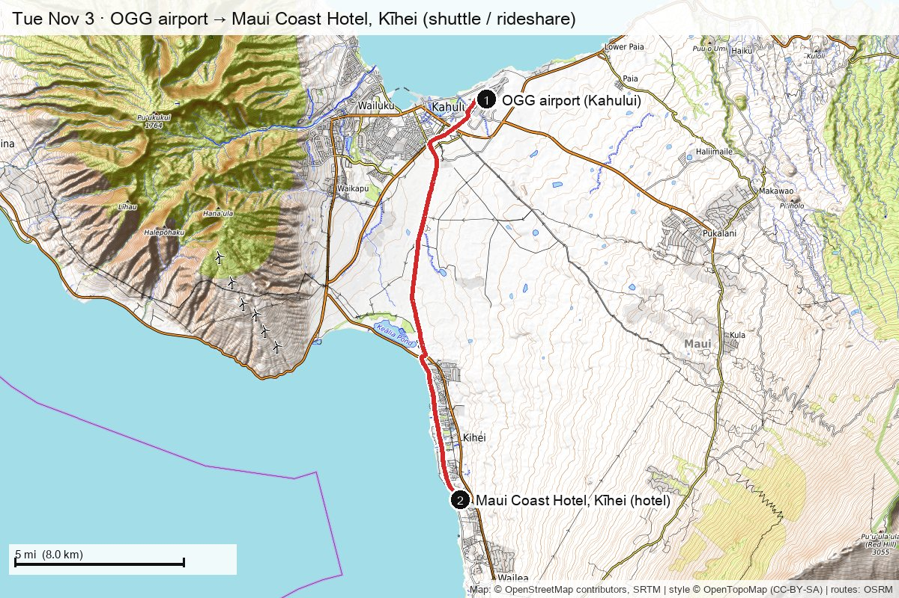

| Leg | Distance | Drive (no traffic) | Plan for |
|---|---:|---:|---|
| OGG airport (Kahului) → Maui Coast Hotel, Kīhei (hotel) | 13.3 mi | 29 min | 🚐 Prebooked shared shuttle (a few hotel stops) or rideshare; groceries in Kīhei after check-in |

[▶ Open these directions in Google Maps](https://www.google.com/maps/dir/?api=1&origin=20.89570,-156.43405&destination=20.72386,-156.44605&travelmode=driving)

### Wed Nov 4: Molokini snorkel

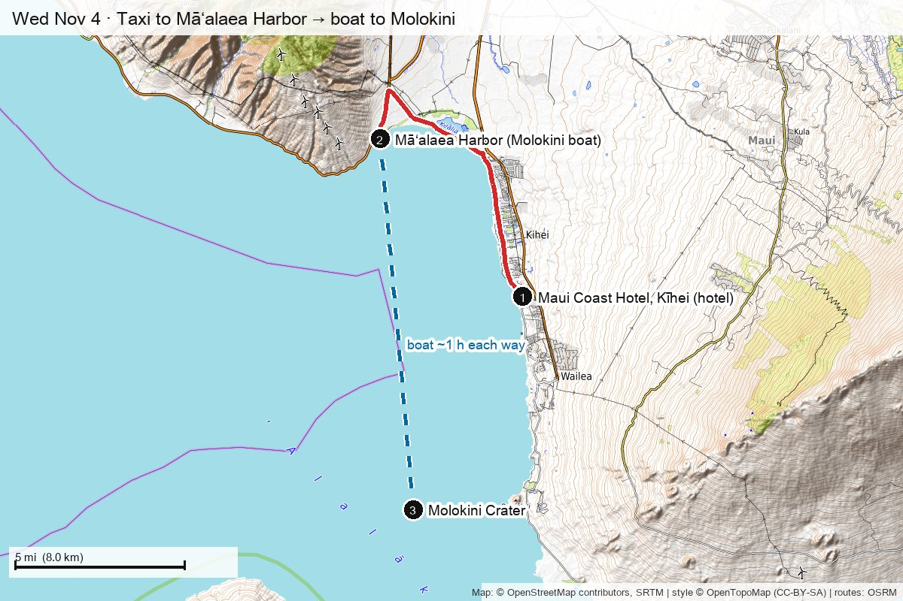

| Leg | Distance | Drive (no traffic) | Plan for |
|---|---:|---:|---|
| Maui Coast Hotel, Kīhei (hotel) → Māʻalaea Harbor (Molokini boat) | 9.4 mi | 22 min | 🚖 Prebooked taxi at dawn (no hotel pickup; rideshare thin before 7 AM); check in 45 min before departure |

[▶ Open these directions in Google Maps](https://www.google.com/maps/dir/?api=1&origin=20.72386,-156.44605&destination=20.79135,-156.51113&travelmode=driving)

Then about 11 miles by boat to Molokini, a sunken crater rim in the ʻAlalākeiki Channel. Around 5 hours in total, with Turtle Arches on the way back.

### Thu Nov 5: Road to Hāna (guided tour)


| Leg | Distance | Drive (no traffic) | Plan for |
|---|---:|---:|---|
| Maui Coast Hotel, Kīhei (hotel) → Pāʻia town | 18.3 mi | 37 min | ~40 min |
| Pāʻia town → Hoʻokipa Lookout | 3.1 mi | 7 min | 5–10 min |
| Hoʻokipa Lookout → Twin Falls | 11.2 mi | 21 min | 20–30 min: the winding section starts around here |
| Twin Falls → Keʻanae Peninsula | 15.2 mi | 38 min | 45–60 min |
| Keʻanae Peninsula → Waiʻānapanapa State Park | 17.2 mi | 48 min | 60–75 min |
| Waiʻānapanapa State Park → Hāna town | 2.3 mi | 10 min | 10 min |
| **Total** | **67.4 mi** | **2 h 41 min** | |

[▶ Open these directions in Google Maps](https://www.google.com/maps/dir/?api=1&origin=20.72386,-156.44605&destination=20.76710,-155.99075&travelmode=driving&waypoints=20.90926%2C-156.37013%7C20.93442%2C-156.35585%7C20.91180%2C-156.24320%7C20.86549%2C-156.14610%7C20.78655%2C-156.00212)

The road has 59 bridges (many single-lane) and 600+ curves; the routing engine's no-traffic time badly understates it. With stops it's a **10–12 hour round trip**, which is why it's a guided tour. The tour route may differ from the one shown.

### Fri Nov 6 🎂: birthday dinner

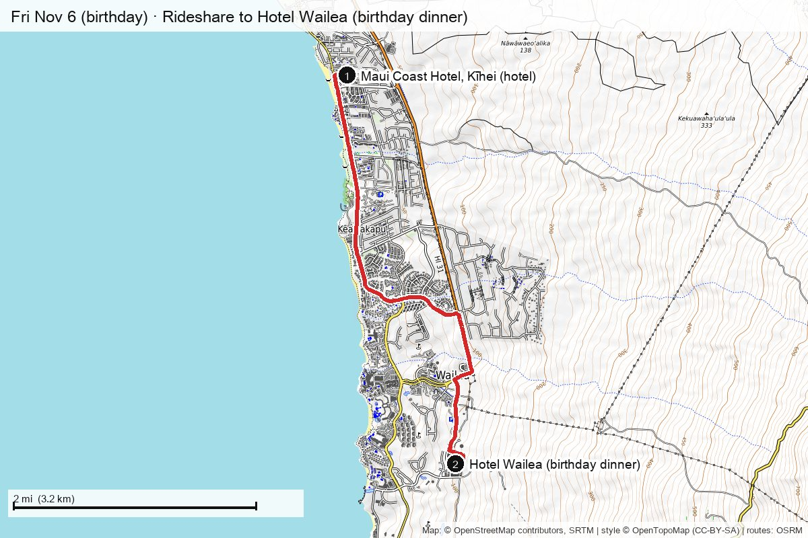

| Leg | Distance | Drive (no traffic) | Plan for |
|---|---:|---:|---|
| Maui Coast Hotel, Kīhei (hotel) → Hotel Wailea (birthday dinner) | 4.2 mi | 13 min | 🚕 15 min by rideshare; prebook a taxi for the ride back after dinner |

[▶ Open these directions in Google Maps](https://www.google.com/maps/dir/?api=1&origin=20.72386,-156.44605&destination=20.67748,-156.43222&travelmode=driving)

### Sat Nov 7: Haleakalā sunset

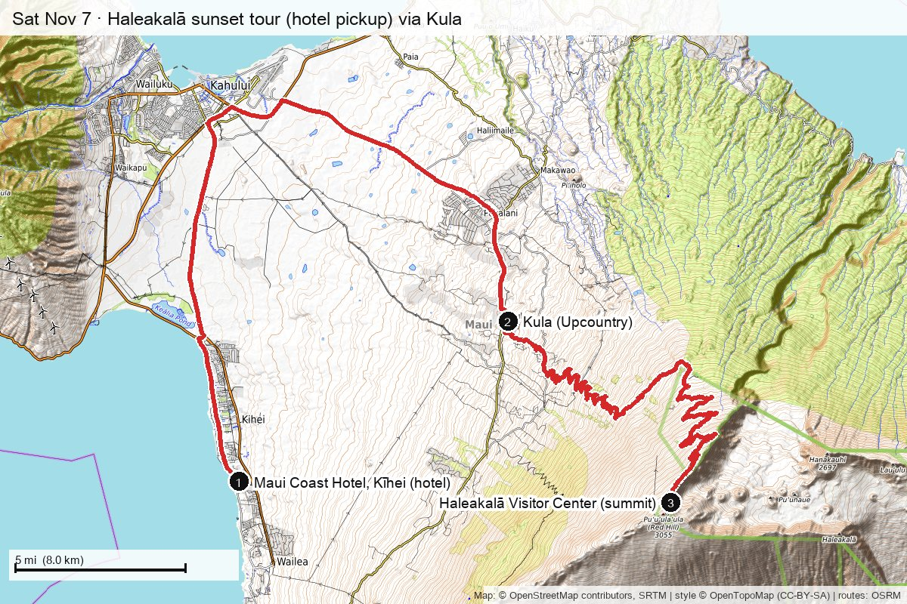

| Leg | Distance | Drive (no traffic) | Plan for |
|---|---:|---:|---|
| Maui Coast Hotel, Kīhei (hotel) → Kula (Upcountry) | 24.4 mi | 49 min | 🚐 On the tour: ~50 min to Upcountry |
| Kula (Upcountry) → Haleakalā Visitor Center (summit) | 23.5 mi | 62 min | 60–75 min of switchbacks, sea level → 9,740 ft |
| **Total** | **47.9 mi** | **1 h 51 min** | |

[▶ Open these directions in Google Maps](https://www.google.com/maps/dir/?api=1&origin=20.72386,-156.44605&destination=20.71511,-156.24981&travelmode=driving&waypoints=20.79203%2C-156.32371)

🚐 **Guided sunset tour with hotel pickup** (~1:30 PM, back ~8 PM; park entry and a to-go dinner included). The van climbs from sea level to **~10,000 ft** in about 50 miles: dozens of switchbacks above Kula, ~35–45 °F with wind at sunset, then the guide drives down in the dark. The route shown is the usual one; the tour's may differ.

### Sun Nov 8: hotel → OGG

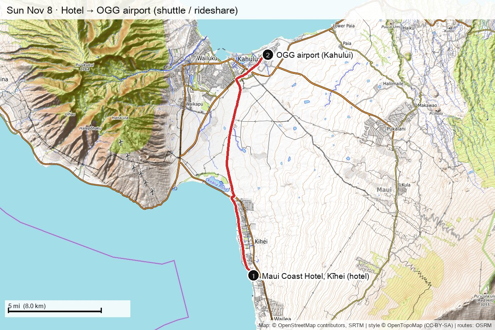

| Leg | Distance | Drive (no traffic) | Plan for |
|---|---:|---:|---|
| Maui Coast Hotel, Kīhei (hotel) → OGG airport (Kahului) | 13.2 mi | 28 min | 🚐 30–45 min by prebooked shuttle or rideshare; leave the hotel ~11:30 AM |

[▶ Open these directions in Google Maps](https://www.google.com/maps/dir/?api=1&origin=20.72386,-156.44605&destination=20.89570,-156.43405&travelmode=driving)

---

<a id="every"></a>
## Every location, close up

Terrain close-ups of each place, in trip order. Click through for live maps.

#### Oʻahu
<a id="hnl"></a>
### HNL airport (Daniel K. Inouye Intl)

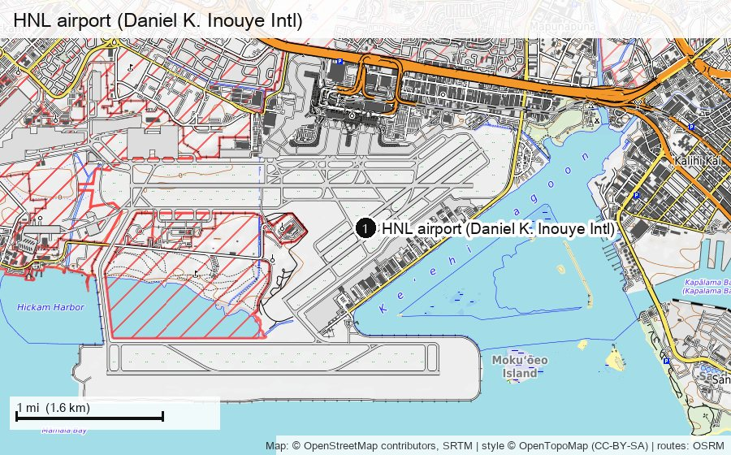

Oʻahu · `21.32114,-157.91844` · [Google terrain](https://www.google.com/maps/@?api=1&map_action=map&center=21.32114,-157.91844&zoom=15&basemap=terrain) · [satellite](https://www.google.com/maps/@?api=1&map_action=map&center=21.32114,-157.91844&zoom=16&basemap=satellite) · [Google Earth 3D](https://earth.google.com/web/@21.32114,-157.91844,300a,2500d,35y,0h,60t,0r)

<a id="reef"></a>
### OUTRIGGER Reef Waikīkī (hotel)

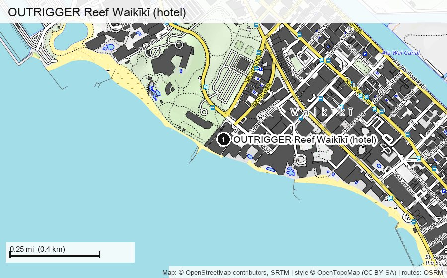

Oʻahu · `21.27825,-157.83279` · [Google terrain](https://www.google.com/maps/@?api=1&map_action=map&center=21.27825,-157.83279&zoom=15&basemap=terrain) · [satellite](https://www.google.com/maps/@?api=1&map_action=map&center=21.27825,-157.83279&zoom=16&basemap=satellite) · [Google Earth 3D](https://earth.google.com/web/@21.27825,-157.83279,300a,2500d,35y,0h,60t,0r)

<a id="dh"></a>
### Diamond Head State Monument

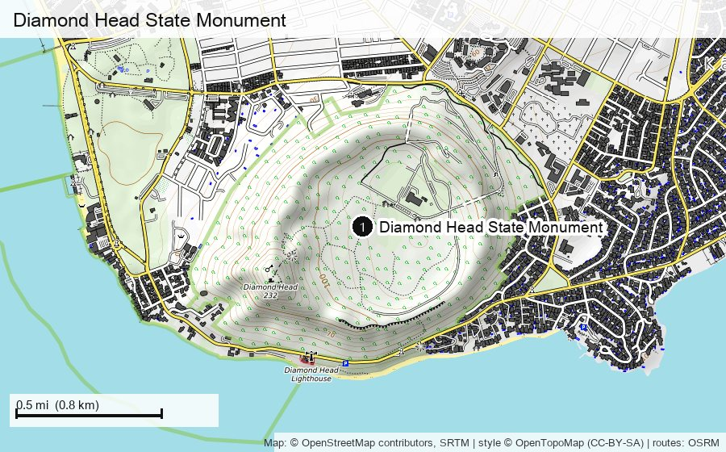

Oʻahu · `21.26249,-157.80679` · [Google terrain](https://www.google.com/maps/@?api=1&map_action=map&center=21.26249,-157.80679&zoom=15&basemap=terrain) · [satellite](https://www.google.com/maps/@?api=1&map_action=map&center=21.26249,-157.80679&zoom=16&basemap=satellite) · [Google Earth 3D](https://earth.google.com/web/@21.26249,-157.80679,300a,2500d,35y,0h,60t,0r)

<a id="ph"></a>
### Pearl Harbor National Memorial

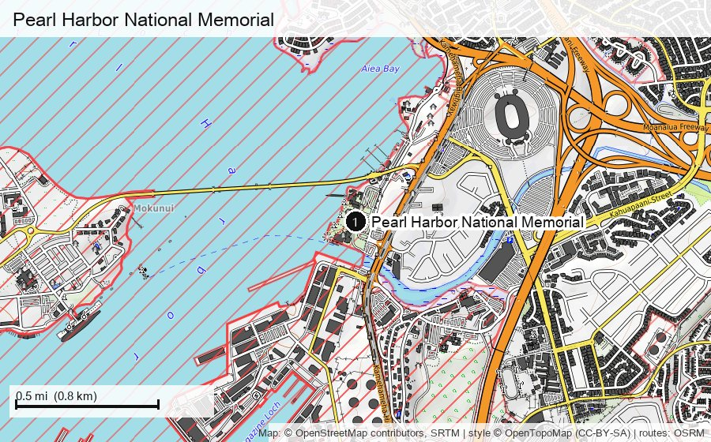

Oʻahu · `21.36748,-157.93845` · [Google terrain](https://www.google.com/maps/@?api=1&map_action=map&center=21.36748,-157.93845&zoom=15&basemap=terrain) · [satellite](https://www.google.com/maps/@?api=1&map_action=map&center=21.36748,-157.93845&zoom=16&basemap=satellite) · [Google Earth 3D](https://earth.google.com/web/@21.36748,-157.93845,300a,2500d,35y,0h,60t,0r)

<a id="bishop"></a>
### Bishop Museum (optional)

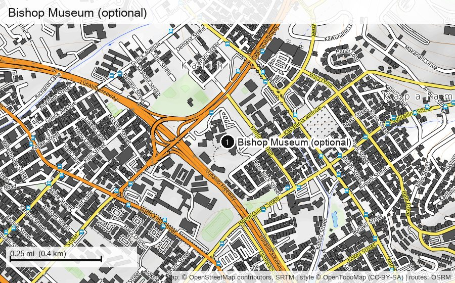

Oʻahu · `21.33308,-157.87071` · [Google terrain](https://www.google.com/maps/@?api=1&map_action=map&center=21.33308,-157.87071&zoom=15&basemap=terrain) · [satellite](https://www.google.com/maps/@?api=1&map_action=map&center=21.33308,-157.87071&zoom=16&basemap=satellite) · [Google Earth 3D](https://earth.google.com/web/@21.33308,-157.87071,300a,2500d,35y,0h,60t,0r)

#### Maui
<a id="ogg"></a>
### OGG airport (Kahului)

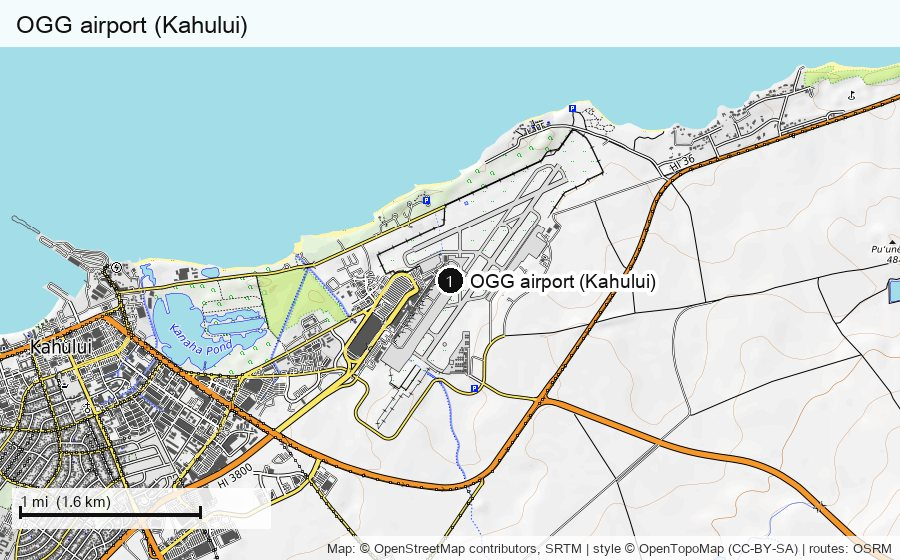

Maui · `20.89570,-156.43405` · [Google terrain](https://www.google.com/maps/@?api=1&map_action=map&center=20.89570,-156.43405&zoom=15&basemap=terrain) · [satellite](https://www.google.com/maps/@?api=1&map_action=map&center=20.89570,-156.43405&zoom=16&basemap=satellite) · [Google Earth 3D](https://earth.google.com/web/@20.89570,-156.43405,300a,2500d,35y,0h,60t,0r)

<a id="costco"></a>
### Costco Kahului (optional groceries)

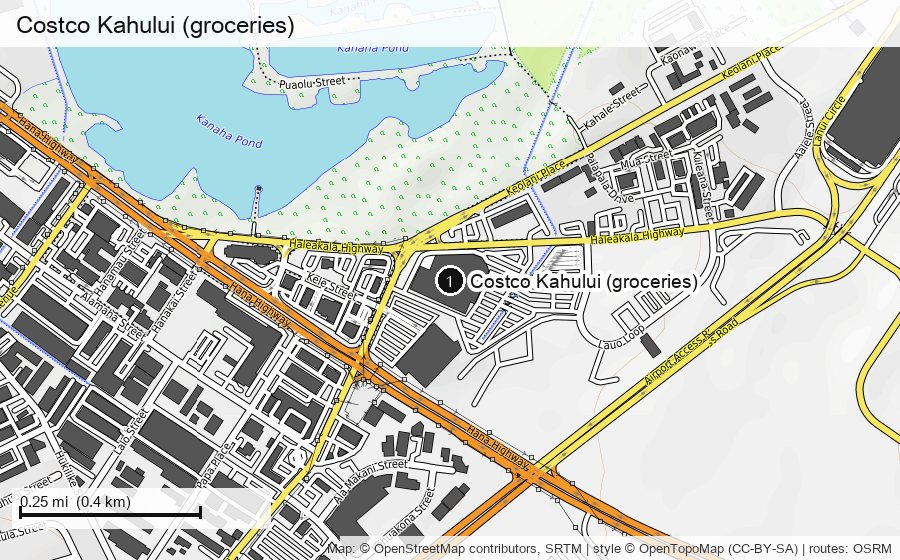

Maui · `20.88719,-156.45088` · [Google terrain](https://www.google.com/maps/@?api=1&map_action=map&center=20.88719,-156.45088&zoom=15&basemap=terrain) · [satellite](https://www.google.com/maps/@?api=1&map_action=map&center=20.88719,-156.45088&zoom=16&basemap=satellite) · [Google Earth 3D](https://earth.google.com/web/@20.88719,-156.45088,300a,2500d,35y,0h,60t,0r)

<a id="mch"></a>
### Maui Coast Hotel, Kīhei (hotel)

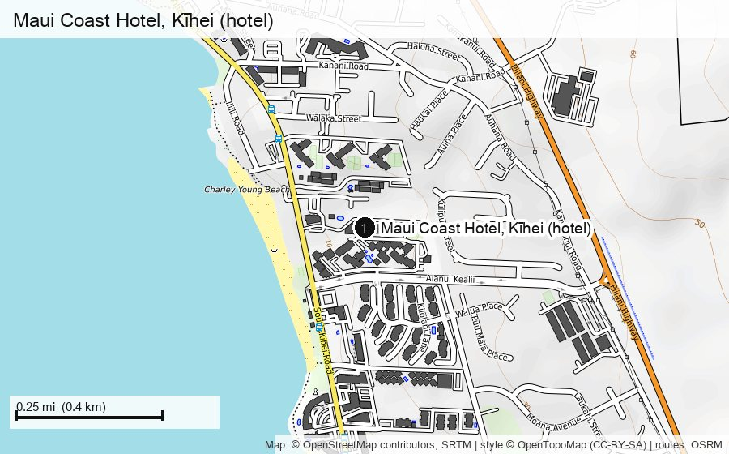

Maui · `20.72386,-156.44605` · [Google terrain](https://www.google.com/maps/@?api=1&map_action=map&center=20.72386,-156.44605&zoom=15&basemap=terrain) · [satellite](https://www.google.com/maps/@?api=1&map_action=map&center=20.72386,-156.44605&zoom=16&basemap=satellite) · [Google Earth 3D](https://earth.google.com/web/@20.72386,-156.44605,300a,2500d,35y,0h,60t,0r)

<a id="maalaea"></a>
### Māʻalaea Harbor (Molokini boat)

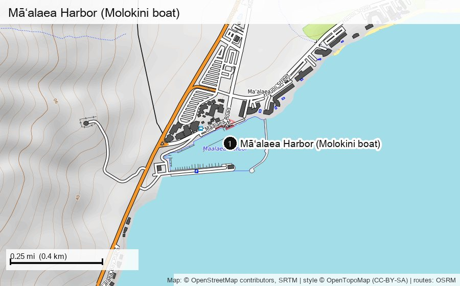

Maui · `20.79135,-156.51113` · [Google terrain](https://www.google.com/maps/@?api=1&map_action=map&center=20.79135,-156.51113&zoom=15&basemap=terrain) · [satellite](https://www.google.com/maps/@?api=1&map_action=map&center=20.79135,-156.51113&zoom=16&basemap=satellite) · [Google Earth 3D](https://earth.google.com/web/@20.79135,-156.51113,300a,2500d,35y,0h,60t,0r)

<a id="molokini"></a>
### Molokini Crater

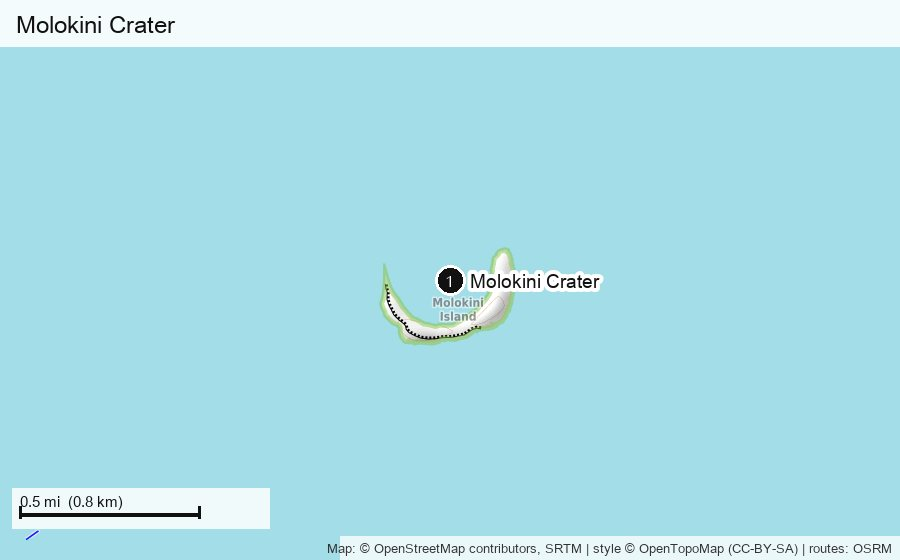

Maui · `20.63287,-156.49603` · [Google terrain](https://www.google.com/maps/@?api=1&map_action=map&center=20.63287,-156.49603&zoom=15&basemap=terrain) · [satellite](https://www.google.com/maps/@?api=1&map_action=map&center=20.63287,-156.49603&zoom=16&basemap=satellite) · [Google Earth 3D](https://earth.google.com/web/@20.63287,-156.49603,300a,2500d,35y,0h,60t,0r)

<a id="paia"></a>
### Pāʻia town

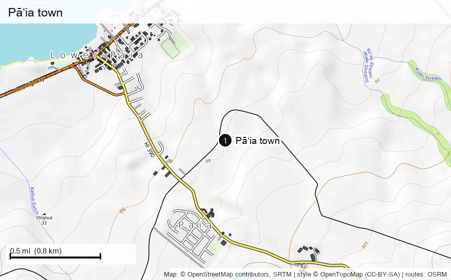

Maui · `20.90926,-156.37013` · [Google terrain](https://www.google.com/maps/@?api=1&map_action=map&center=20.90926,-156.37013&zoom=15&basemap=terrain) · [satellite](https://www.google.com/maps/@?api=1&map_action=map&center=20.90926,-156.37013&zoom=16&basemap=satellite) · [Google Earth 3D](https://earth.google.com/web/@20.90926,-156.37013,300a,2500d,35y,0h,60t,0r)

<a id="hookipa"></a>
### Hoʻokipa Lookout

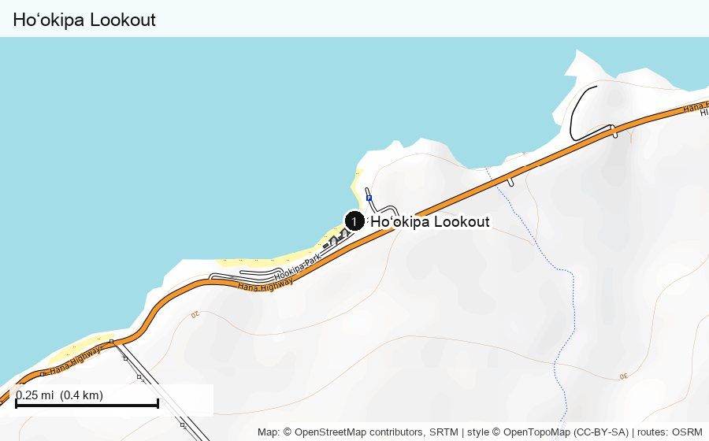

Maui · `20.93442,-156.35585` · [Google terrain](https://www.google.com/maps/@?api=1&map_action=map&center=20.93442,-156.35585&zoom=15&basemap=terrain) · [satellite](https://www.google.com/maps/@?api=1&map_action=map&center=20.93442,-156.35585&zoom=16&basemap=satellite) · [Google Earth 3D](https://earth.google.com/web/@20.93442,-156.35585,300a,2500d,35y,0h,60t,0r)

<a id="twin"></a>
### Twin Falls

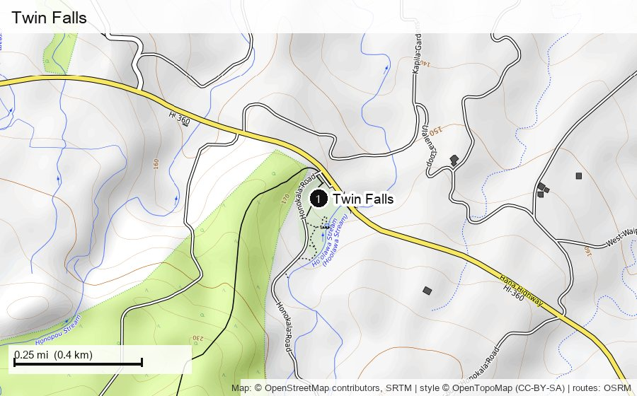

Maui · `20.91180,-156.24320` · [Google terrain](https://www.google.com/maps/@?api=1&map_action=map&center=20.91180,-156.24320&zoom=15&basemap=terrain) · [satellite](https://www.google.com/maps/@?api=1&map_action=map&center=20.91180,-156.24320&zoom=16&basemap=satellite) · [Google Earth 3D](https://earth.google.com/web/@20.91180,-156.24320,300a,2500d,35y,0h,60t,0r)

<a id="keanae"></a>
### Keʻanae Peninsula

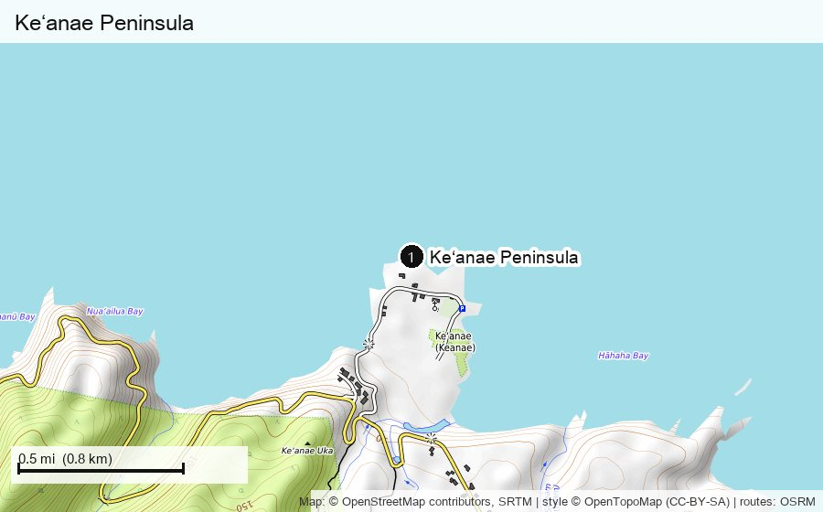

Maui · `20.86549,-156.14610` · [Google terrain](https://www.google.com/maps/@?api=1&map_action=map&center=20.86549,-156.14610&zoom=15&basemap=terrain) · [satellite](https://www.google.com/maps/@?api=1&map_action=map&center=20.86549,-156.14610&zoom=16&basemap=satellite) · [Google Earth 3D](https://earth.google.com/web/@20.86549,-156.14610,300a,2500d,35y,0h,60t,0r)

<a id="wai"></a>
### Waiʻānapanapa State Park

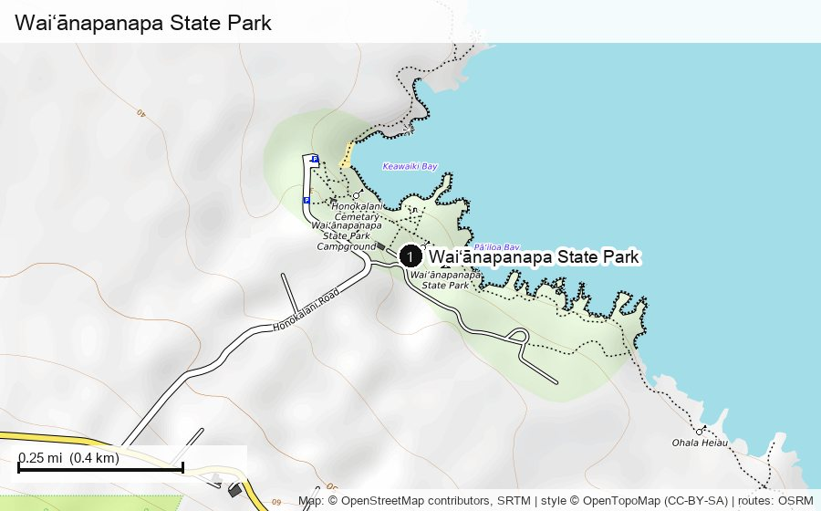

Maui · `20.78655,-156.00212` · [Google terrain](https://www.google.com/maps/@?api=1&map_action=map&center=20.78655,-156.00212&zoom=15&basemap=terrain) · [satellite](https://www.google.com/maps/@?api=1&map_action=map&center=20.78655,-156.00212&zoom=16&basemap=satellite) · [Google Earth 3D](https://earth.google.com/web/@20.78655,-156.00212,300a,2500d,35y,0h,60t,0r)

<a id="hana"></a>
### Hāna town

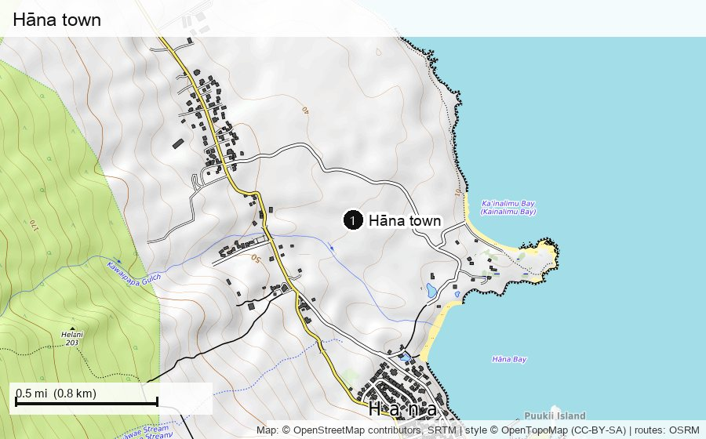

Maui · `20.76710,-155.99075` · [Google terrain](https://www.google.com/maps/@?api=1&map_action=map&center=20.76710,-155.99075&zoom=15&basemap=terrain) · [satellite](https://www.google.com/maps/@?api=1&map_action=map&center=20.76710,-155.99075&zoom=16&basemap=satellite) · [Google Earth 3D](https://earth.google.com/web/@20.76710,-155.99075,300a,2500d,35y,0h,60t,0r)

<a id="wailea"></a>
### Hotel Wailea (birthday dinner)

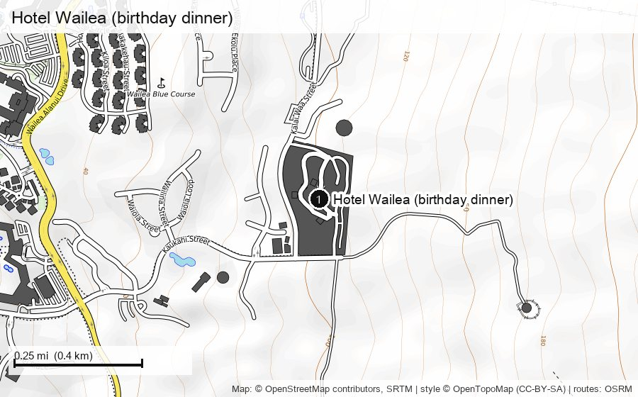

Maui · `20.67748,-156.43222` · [Google terrain](https://www.google.com/maps/@?api=1&map_action=map&center=20.67748,-156.43222&zoom=15&basemap=terrain) · [satellite](https://www.google.com/maps/@?api=1&map_action=map&center=20.67748,-156.43222&zoom=16&basemap=satellite) · [Google Earth 3D](https://earth.google.com/web/@20.67748,-156.43222,300a,2500d,35y,0h,60t,0r)

<a id="kula"></a>
### Kula (Upcountry)

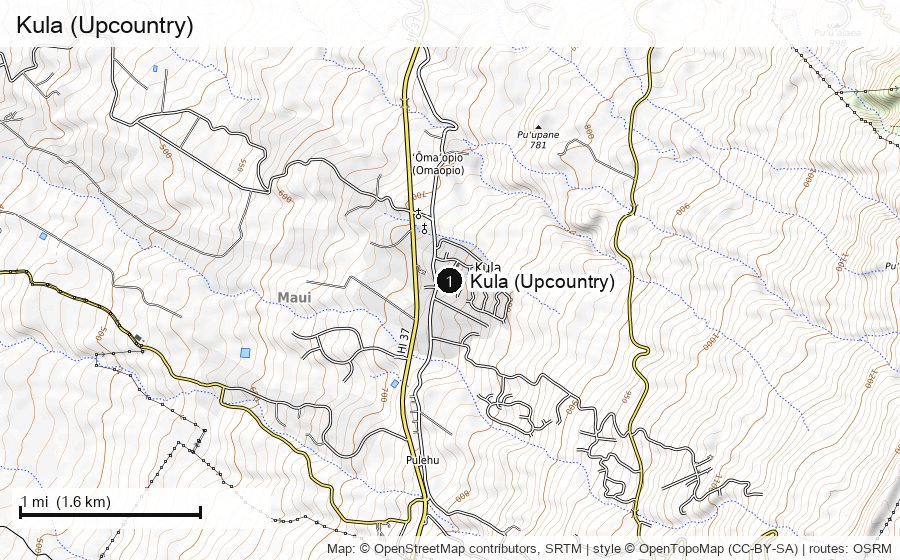

Maui · `20.79203,-156.32371` · [Google terrain](https://www.google.com/maps/@?api=1&map_action=map&center=20.79203,-156.32371&zoom=15&basemap=terrain) · [satellite](https://www.google.com/maps/@?api=1&map_action=map&center=20.79203,-156.32371&zoom=16&basemap=satellite) · [Google Earth 3D](https://earth.google.com/web/@20.79203,-156.32371,300a,2500d,35y,0h,60t,0r)

<a id="hale"></a>
### Haleakalā Visitor Center (summit)

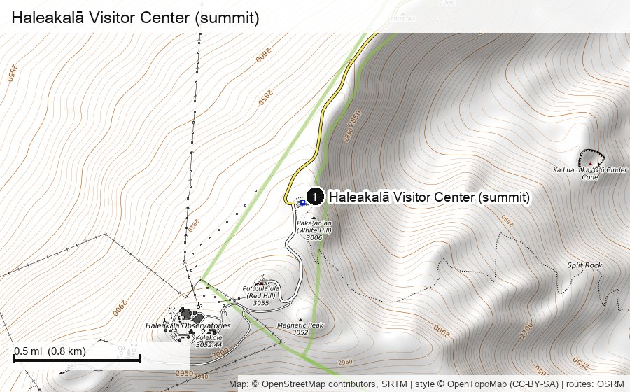

Maui · `20.71511,-156.24981` · [Google terrain](https://www.google.com/maps/@?api=1&map_action=map&center=20.71511,-156.24981&zoom=15&basemap=terrain) · [satellite](https://www.google.com/maps/@?api=1&map_action=map&center=20.71511,-156.24981&zoom=16&basemap=satellite) · [Google Earth 3D](https://earth.google.com/web/@20.71511,-156.24981,300a,2500d,35y,0h,60t,0r)

---

<a id="update"></a>
## How to update the maps

The map images and this file are generated by `maps/tools/`:

```bash
cd maps/tools
python3 render.py ..          # re-renders every image in maps/ (needs Pillow; tiles are cached in tiles/, not committed)
python3 gen_md.py ../..       # rewrites map.md
```

Add a place in `places.py` (+ its coordinates in `coords.json`), then add it to the lists in `render.py` / `gen_md.py`.

**Credits:** map tiles © [OpenStreetMap](https://www.openstreetmap.org/copyright) contributors, SRTM | map style © [OpenTopoMap](https://opentopomap.org) (CC-BY-SA). Routing by [OSRM](https://project-osrm.org). Coordinates from OSM Nominatim. Twin Falls is placed approximately.
