# 🗺️ Trip map: everything from the hotel

> Each island is laid out around **our hotel (the red H)**: one map with every place we go, then one section per trip out of the hotel, in day order.
> Every view comes as a **normal map** (left) and a **satellite view** (right). Pins are numbered to match the tables; click any map to enlarge it.
> Distances and no-traffic drive times: OSRM (OpenStreetMap routing). **"Plan for"** is the realistic time. **No car**: how we get there is in each table; details in [`commute.md`](commute.md).
> Generated 2026-10-18.

## 📑 Contents

- [✈️ Big picture](#big)
- [🌺 Oʻahu · Oct 31 – Nov 3](#oahu)
  - [🏨 The hotel (Oʻahu)](#oahu-hotel)
  - [🗺️ Everything from the hotel (Oʻahu)](#oahu-hub)
  - [✈️ Hotel ↔ HNL airport](#o-airport)
  - [🥾 Hotel → Diamond Head](#o-dh)
  - [⚓ Hotel → Pearl Harbor → Bishop Museum → Hotel](#o-ph)
- [🌋 Maui · Nov 3 – Nov 8](#maui)
  - [🏨 The hotel (Maui)](#maui-hotel)
  - [🗺️ Everything from the hotel (Maui)](#maui-hub)
  - [✈️ Hotel ↔ OGG airport](#m-airport)
  - [🤿 Hotel → Māʻalaea Harbor → boat to Molokini](#m-molokini)
  - [🌿 Hotel → Road to Hāna](#m-hana)
  - [🎂 Hotel → Hotel Wailea (birthday dinner)](#m-wailea)
  - [🌋 Hotel → Haleakalā summit (sunset)](#m-haleakala)
- [How to update the maps](#update)

<a id="big"></a>
## ✈️ Big picture

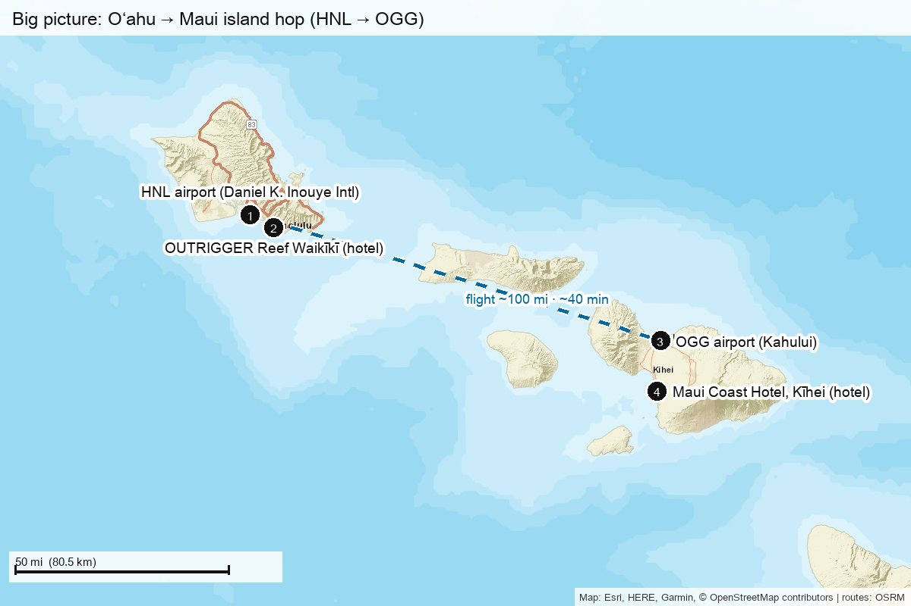 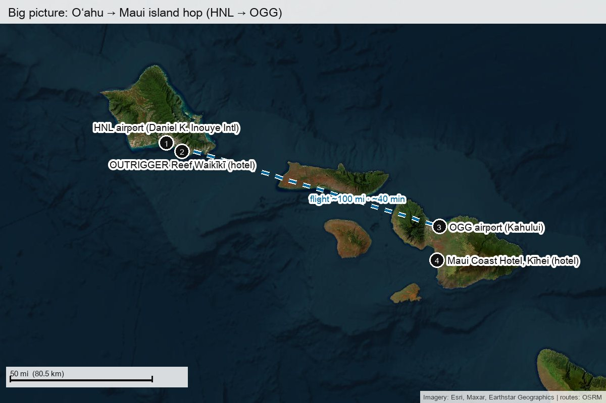

| Hop | Distance | Time |
|---|---:|---:|
| ✈️ JFK → HNL (Oct 31) | ~4,980 mi | ~11 h nonstop |
| ✈️ HNL → OGG (Nov 3) | ~100 mi | ~40 min in the air; **4–6 h hotel to hotel** |
| ✈️ OGG → JFK (Nov 8 → 9) | ~4,950 mi | ~11–16 h with one stop |

---

<a id="oahu"></a>
## 🌺 Oʻahu · Oct 31 – Nov 3

> **Home base: OUTRIGGER Reef Waikīkī.** No car: rideshare, taxi, transfers. Everything is within ~12 miles. Every ride in detail: [`commute.md`](commute.md).

<a id="oahu-hotel"></a>
### 🏨 The hotel (Oʻahu)

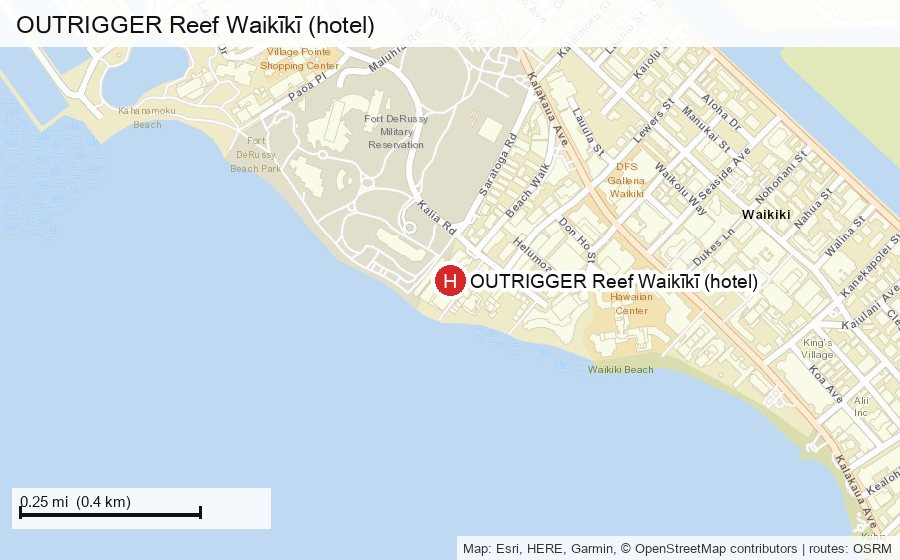 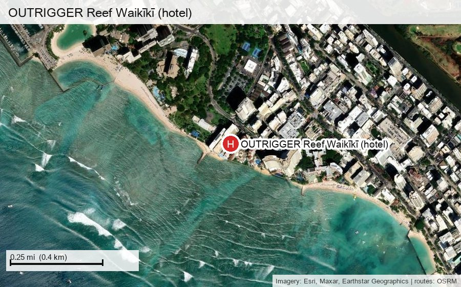

<sub>`21.27825,-157.83279` · open in Google: [map](https://www.google.com/maps/@?api=1&map_action=map&center=21.27825,-157.83279&zoom=15&basemap=roadmap) · [terrain](https://www.google.com/maps/@?api=1&map_action=map&center=21.27825,-157.83279&zoom=15&basemap=terrain) · [satellite](https://www.google.com/maps/@?api=1&map_action=map&center=21.27825,-157.83279&zoom=16&basemap=satellite) · [3D](https://earth.google.com/web/@21.27825,-157.83279,300a,2500d,35y,0h,60t,0r)</sub>

<a id="oahu-hub"></a>
### 🗺️ Everything from the hotel (Oʻahu)

<a href="maps/oahu_hub_street.jpg"></a> <a href="maps/oahu_hub_sat.jpg"></a>

| Pin | Where | Day | From the hotel | Drive (no traffic) | Plan for | How | Section |
|:-:|---|---|---:|---:|---|---|---|
| 1 | **HNL airport (Daniel K. Inouye Intl)** | Sat Oct 31 (arrive) · Tue Nov 3 (leave) | 9.4 mi | 20 min | 30–45 min with bags; leave ~2.5 h before the Nov 3 flight | 🚕 Rideshare or flat-rate taxi (~$30–50 each way); shuttle optional | [✈️ go](#o-airport) |
| 2 | **Diamond Head State Monument** | Sun Nov 1 | 3.4 mi | 14 min | 15–20 min; hike 1.5–2 h (~560 ft climb) | 🚕 Rideshare both ways (~$25–40 total) | [🥾 go](#o-dh) |
| 3 | **Pearl Harbor National Memorial** | Mon Nov 2 | 11.6 mi | 22 min | 30–40 min out in H-1 traffic; 3–4 h at Pearl Harbor | 🚕 Rideshare each leg (~$60–100 total); no bags allowed at Pearl Harbor | [⚓ go](#o-ph) |
| 4 | **Bishop Museum (optional)** | Mon Nov 2 | 5.7 mi | 13 min | 15–20 min from Pearl Harbor; 2–3 h visit | 🚕 Rideshare (~$15–25) | [⚓ go](#o-ph) |

<a id="o-airport"></a>
### ✈️ Hotel ↔ HNL airport

**Sat Oct 31 (arrive) · Tue Nov 3 (leave)**

<a href="maps/oahu_airport_street.jpg"></a> <a href="maps/oahu_airport_sat.jpg"></a>

| Distance | Drive time (no traffic) | Plan for | How we get there |
|---:|---:|---|---|
| **9.4 mi** | 20 min | 30–45 min with bags; leave ~2.5 h before the Nov 3 flight | 🚕 Rideshare or flat-rate taxi (~$30–50 each way); shuttle optional |

[▶ Directions from the hotel in Google Maps](https://www.google.com/maps/dir/?api=1&origin=21.27825,-157.83279&destination=21.32114,-157.91844&travelmode=driving)

**📍 HNL airport (Daniel K. Inouye Intl)**

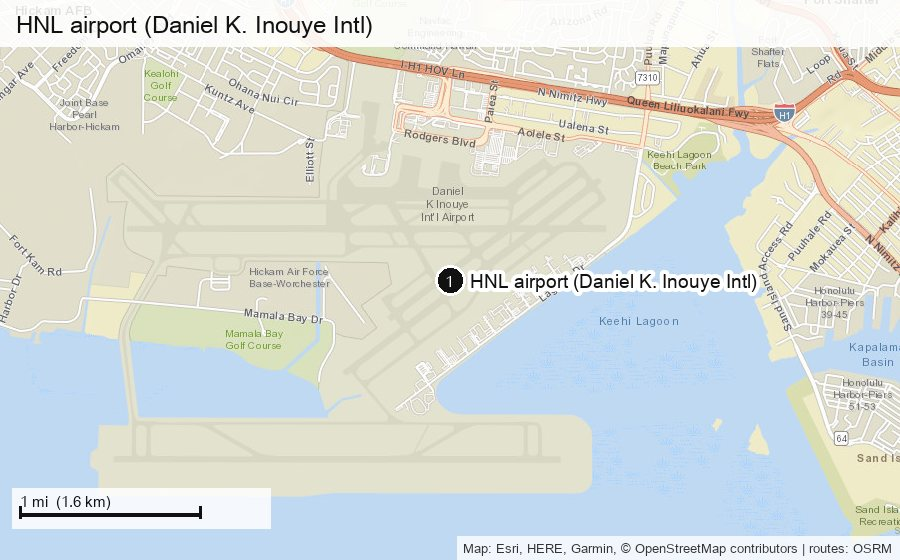 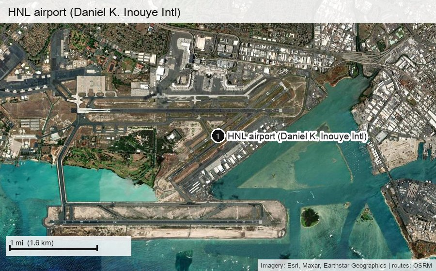

<sub>`21.32114,-157.91844` · open in Google: [map](https://www.google.com/maps/@?api=1&map_action=map&center=21.32114,-157.91844&zoom=15&basemap=roadmap) · [terrain](https://www.google.com/maps/@?api=1&map_action=map&center=21.32114,-157.91844&zoom=15&basemap=terrain) · [satellite](https://www.google.com/maps/@?api=1&map_action=map&center=21.32114,-157.91844&zoom=16&basemap=satellite) · [3D](https://earth.google.com/web/@21.32114,-157.91844,300a,2500d,35y,0h,60t,0r)</sub>

<a id="o-dh"></a>
### 🥾 Hotel → Diamond Head

**Sun Nov 1**

<a href="maps/oahu_dh_street.jpg"></a> <a href="maps/oahu_dh_sat.jpg"></a>

| Distance | Drive time (no traffic) | Plan for | How we get there |
|---:|---:|---|---|
| **3.4 mi** | 14 min | 15–20 min; hike 1.5–2 h (~560 ft climb) | 🚕 Rideshare both ways (~$25–40 total) |

[▶ Directions from the hotel in Google Maps](https://www.google.com/maps/dir/?api=1&origin=21.27825,-157.83279&destination=21.26249,-157.80679&travelmode=driving)

**📍 Diamond Head State Monument**

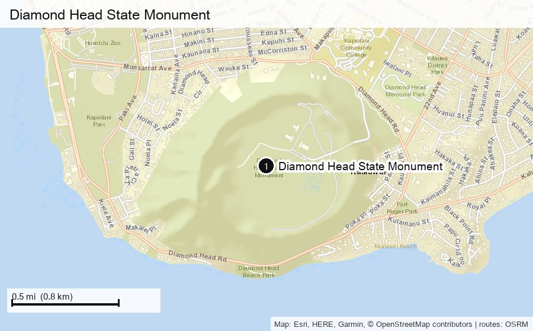 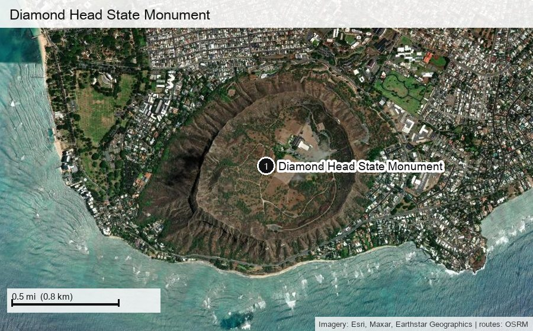

<sub>`21.26249,-157.80679` · open in Google: [map](https://www.google.com/maps/@?api=1&map_action=map&center=21.26249,-157.80679&zoom=15&basemap=roadmap) · [terrain](https://www.google.com/maps/@?api=1&map_action=map&center=21.26249,-157.80679&zoom=15&basemap=terrain) · [satellite](https://www.google.com/maps/@?api=1&map_action=map&center=21.26249,-157.80679&zoom=16&basemap=satellite) · [3D](https://earth.google.com/web/@21.26249,-157.80679,300a,2500d,35y,0h,60t,0r)</sub>

<a id="o-ph"></a>
### ⚓ Hotel → Pearl Harbor → Bishop Museum → Hotel

**Mon Nov 2**

<a href="maps/oahu_ph_street.jpg"></a> <a href="maps/oahu_ph_sat.jpg"></a>

| Distance | Drive time (no traffic) | Plan for | How we get there |
|---:|---:|---|---|
| **23.3 mi** | 47 min | 30–40 min out in H-1 traffic; 3–4 h at Pearl Harbor | 🚕 Rideshare each leg (~$60–100 total); no bags allowed at Pearl Harbor |

[▶ Directions from the hotel in Google Maps](https://www.google.com/maps/dir/?api=1&origin=21.27825,-157.83279&destination=21.27825,-157.83279&travelmode=driving&waypoints=21.36748%2C-157.93845%7C21.33308%2C-157.87071)

**📍 Pearl Harbor National Memorial**

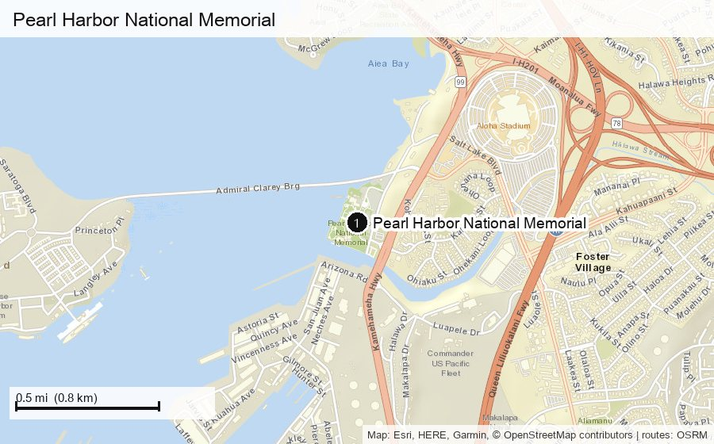 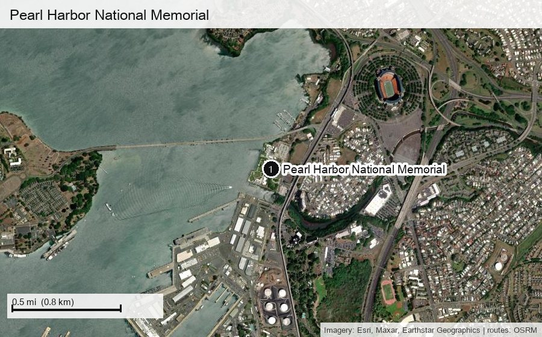

<sub>`21.36748,-157.93845` · open in Google: [map](https://www.google.com/maps/@?api=1&map_action=map&center=21.36748,-157.93845&zoom=15&basemap=roadmap) · [terrain](https://www.google.com/maps/@?api=1&map_action=map&center=21.36748,-157.93845&zoom=15&basemap=terrain) · [satellite](https://www.google.com/maps/@?api=1&map_action=map&center=21.36748,-157.93845&zoom=16&basemap=satellite) · [3D](https://earth.google.com/web/@21.36748,-157.93845,300a,2500d,35y,0h,60t,0r)</sub>

**📍 Bishop Museum (optional)**

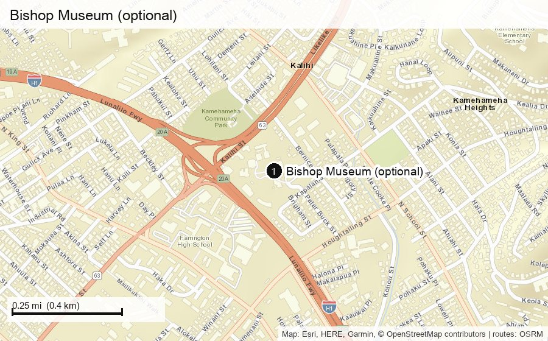 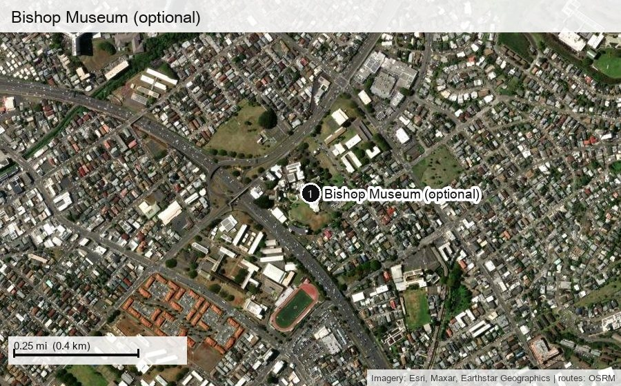

<sub>`21.33308,-157.87071` · open in Google: [map](https://www.google.com/maps/@?api=1&map_action=map&center=21.33308,-157.87071&zoom=15&basemap=roadmap) · [terrain](https://www.google.com/maps/@?api=1&map_action=map&center=21.33308,-157.87071&zoom=15&basemap=terrain) · [satellite](https://www.google.com/maps/@?api=1&map_action=map&center=21.33308,-157.87071&zoom=16&basemap=satellite) · [3D](https://earth.google.com/web/@21.33308,-157.87071,300a,2500d,35y,0h,60t,0r)</sub>


---

<a id="maui"></a>
## 🌋 Maui · Nov 3 – Nov 8

> **Home base: Maui Coast Hotel, Kīhei.** No car: rideshare to and from the airport, tours with hotel pickup (Haleakalā), an early taxi to the Molokini boat, rideshare to dinner. Every ride in detail: [`commute.md`](commute.md).

<a id="maui-hotel"></a>
### 🏨 The hotel (Maui)

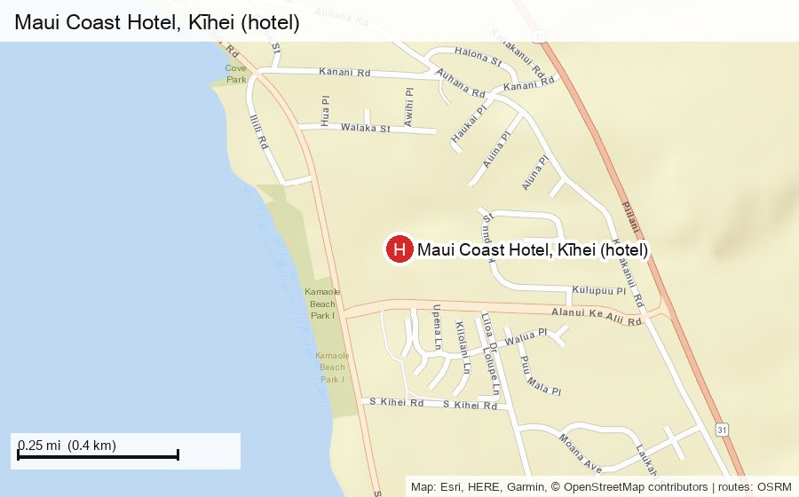 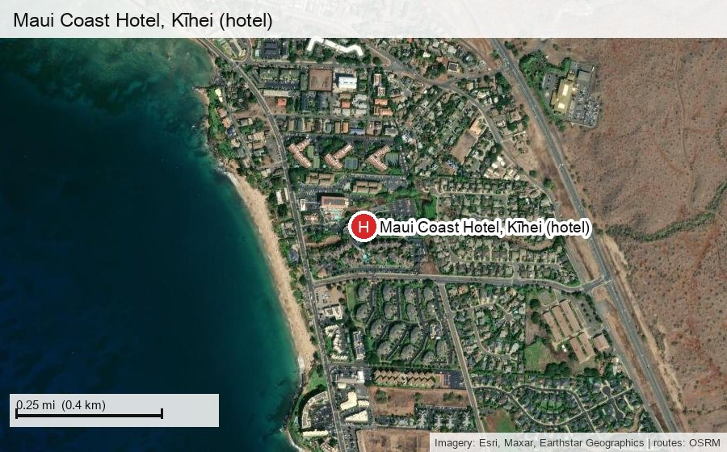

<sub>`20.72386,-156.44605` · open in Google: [map](https://www.google.com/maps/@?api=1&map_action=map&center=20.72386,-156.44605&zoom=15&basemap=roadmap) · [terrain](https://www.google.com/maps/@?api=1&map_action=map&center=20.72386,-156.44605&zoom=15&basemap=terrain) · [satellite](https://www.google.com/maps/@?api=1&map_action=map&center=20.72386,-156.44605&zoom=16&basemap=satellite) · [3D](https://earth.google.com/web/@20.72386,-156.44605,300a,2500d,35y,0h,60t,0r)</sub>

<a id="maui-hub"></a>
### 🗺️ Everything from the hotel (Maui)

<a href="maps/maui_hub_street.jpg">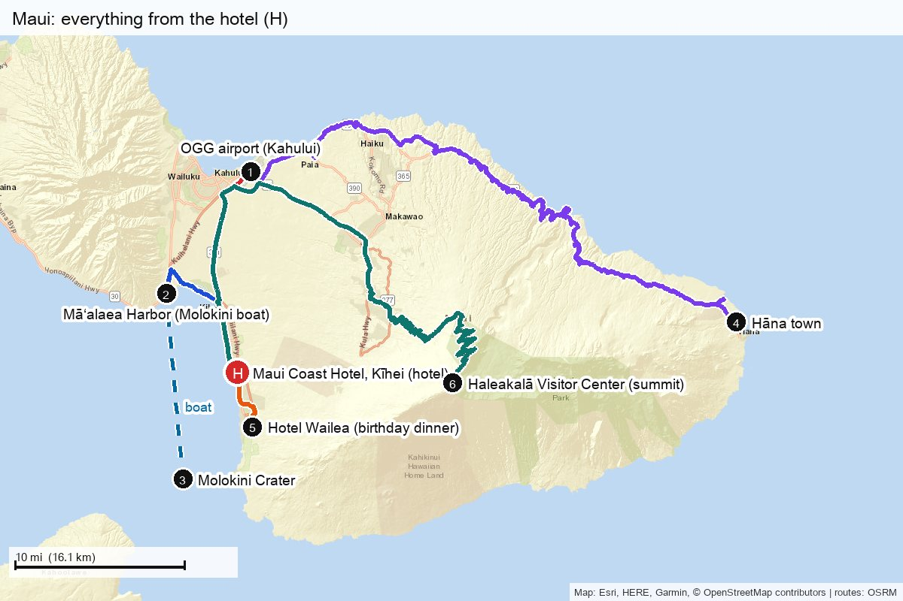</a> <a href="maps/maui_hub_sat.jpg">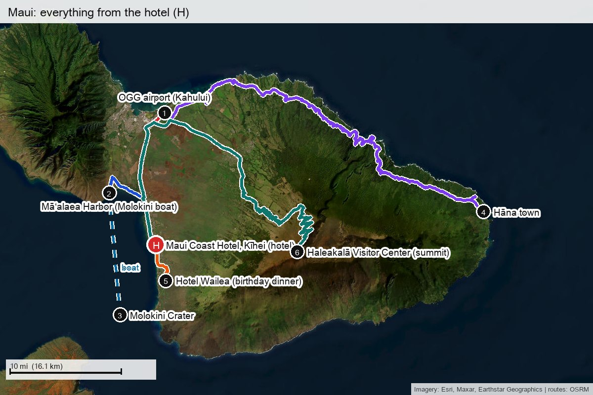</a>

| Pin | Where | Day | From the hotel | Drive (no traffic) | Plan for | How | Section |
|:-:|---|---|---:|---:|---|---|---|
| 1 | **OGG airport (Kahului)** | Tue Nov 3 (arrive) · Sun Nov 8 (leave ~11:30 AM) | 13.2 mi | 28 min | 30–45 min | 🚕 Uber / Lyft (~$45–65 each way) | [✈️ go](#m-airport) |
| 2 | **Māʻalaea Harbor (Molokini boat)** | Wed Nov 4 | 9.4 mi | 22 min | 25–40 min; check in 45 min early | 🚖 Prebooked dawn taxi there, rideshare back (~$55–80) | [🤿 go](#m-molokini) |
| 3 | **Molokini Crater** | Wed Nov 4 | by boat from Māʻalaea | ~1 h by boat | ~1 h by boat each way; ~5 h trip | 🚤 PacWhale boat from Māʻalaea (pin 2) | [🤿 go](#m-molokini) |
| 4 | **Hāna town** | Sat Nov 7 (optional) | 67.4 mi | 2 h 41 min | **10–12 h round-trip day** with stops | 🚐 Guided tour, hotel pickup ~6:30–7:00 AM | [🌿 go](#m-hana) |
| 5 | **Hotel Wailea (birthday dinner)** | Fri Nov 6 | 4.2 mi | 13 min | ~15 min; then Tikehau (Wailea Village) and dancing in Kīhei | 🚕 Rideshare there; prebooked taxi Wailea Village → Tiki Lounge ~9 PM, walk back (~$30–60) | [🎂 go](#m-wailea) |
| 6 | **Haleakalā Visitor Center (summit)** | Thu Nov 5 ✅ | 47.9 mi | 1 h 51 min | 2.5–3 h up, sea level → ~10,000 ft; back ~8 PM | 🚐 Guided sunset tour, hotel pickup 1:40 PM, street-side sign (entry + dinner included) | [🌋 go](#m-haleakala) |

<a id="m-airport"></a>
### ✈️ Hotel ↔ OGG airport

**Tue Nov 3 (arrive) · Sun Nov 8 (leave ~11:30 AM)**

<a href="maps/maui_airport_street.jpg">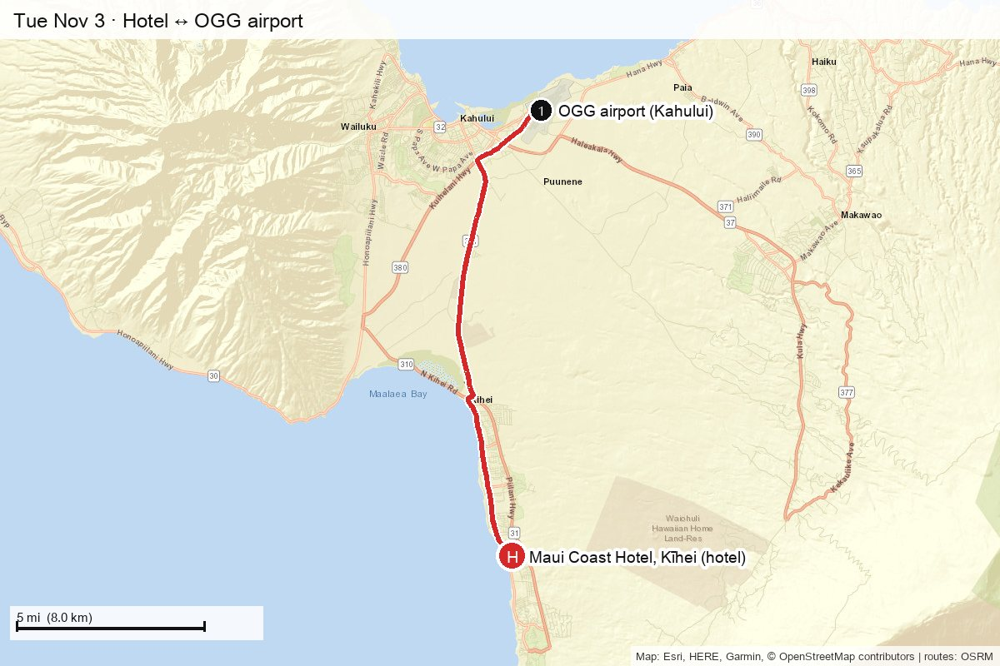</a> <a href="maps/maui_airport_sat.jpg">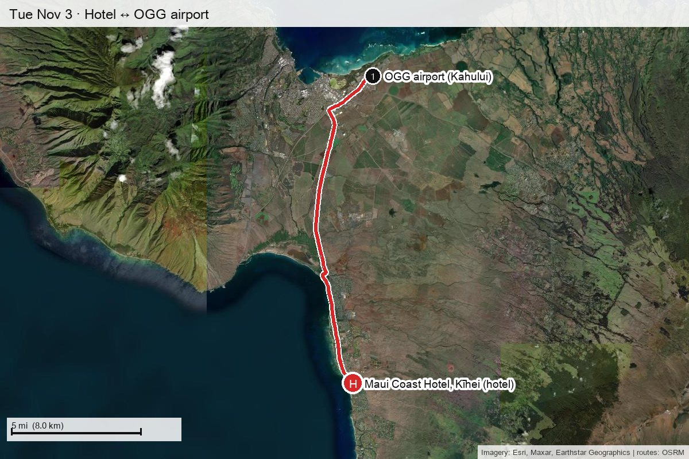</a>

| Distance | Drive time (no traffic) | Plan for | How we get there |
|---:|---:|---|---|
| **13.2 mi** | 28 min | 30–45 min | 🚕 Uber / Lyft (~$45–65 each way) |

[▶ Directions from the hotel in Google Maps](https://www.google.com/maps/dir/?api=1&origin=20.72386,-156.44605&destination=20.89570,-156.43405&travelmode=driving)

**📍 OGG airport (Kahului)**

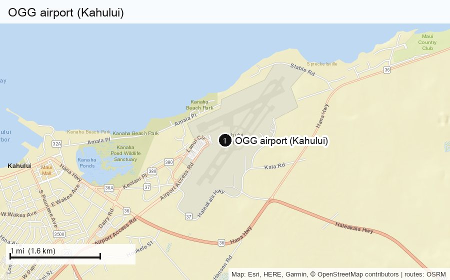 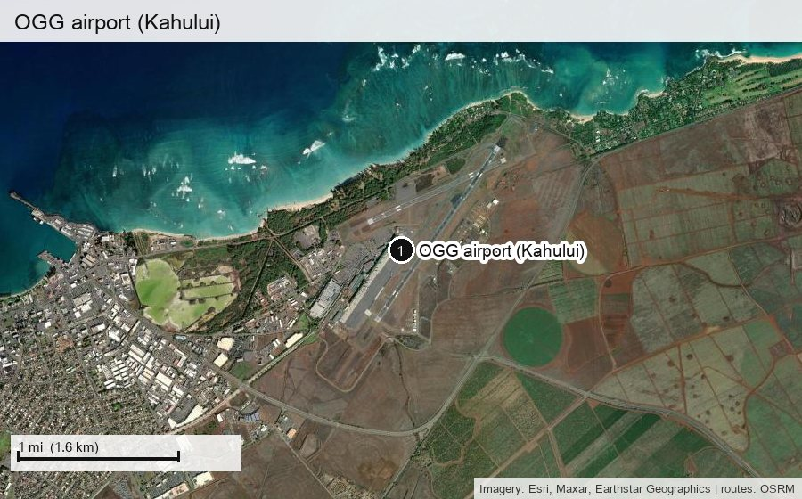

<sub>`20.89570,-156.43405` · open in Google: [map](https://www.google.com/maps/@?api=1&map_action=map&center=20.89570,-156.43405&zoom=15&basemap=roadmap) · [terrain](https://www.google.com/maps/@?api=1&map_action=map&center=20.89570,-156.43405&zoom=15&basemap=terrain) · [satellite](https://www.google.com/maps/@?api=1&map_action=map&center=20.89570,-156.43405&zoom=16&basemap=satellite) · [3D](https://earth.google.com/web/@20.89570,-156.43405,300a,2500d,35y,0h,60t,0r)</sub>

<a id="m-molokini"></a>
### 🤿 Hotel → Māʻalaea Harbor → boat to Molokini

**Wed Nov 4**

<a href="maps/maui_molokini_street.jpg">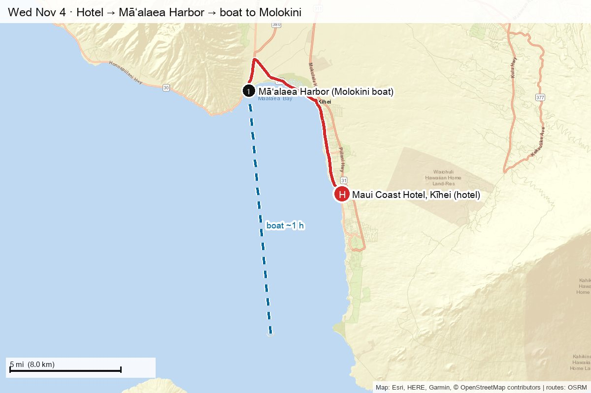</a> <a href="maps/maui_molokini_sat.jpg">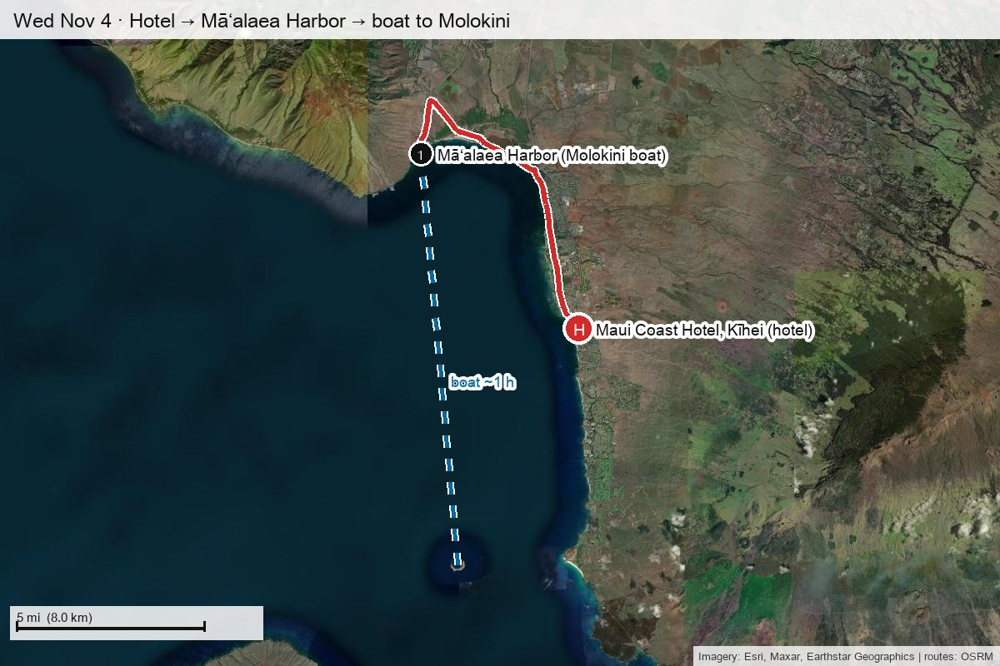</a>

| Distance | Drive time (no traffic) | Plan for | How we get there |
|---:|---:|---|---|
| **9.4 mi** | 22 min | 25–40 min; check in 45 min early · then ~11 mi by boat (~5 h trip) | 🚖 Prebooked dawn taxi there, rideshare back (~$55–80) |

[▶ Directions from the hotel in Google Maps](https://www.google.com/maps/dir/?api=1&origin=20.72386,-156.44605&destination=20.79135,-156.51113&travelmode=driving)

**📍 Māʻalaea Harbor (Molokini boat)**

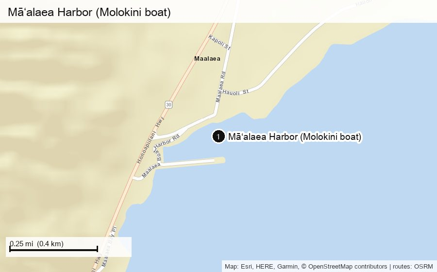 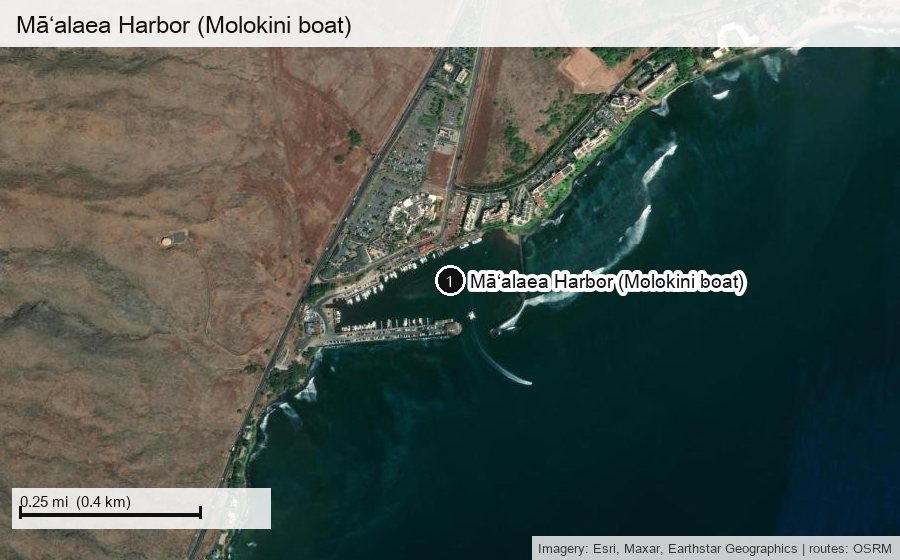

<sub>`20.79135,-156.51113` · open in Google: [map](https://www.google.com/maps/@?api=1&map_action=map&center=20.79135,-156.51113&zoom=15&basemap=roadmap) · [terrain](https://www.google.com/maps/@?api=1&map_action=map&center=20.79135,-156.51113&zoom=15&basemap=terrain) · [satellite](https://www.google.com/maps/@?api=1&map_action=map&center=20.79135,-156.51113&zoom=16&basemap=satellite) · [3D](https://earth.google.com/web/@20.79135,-156.51113,300a,2500d,35y,0h,60t,0r)</sub>

**📍 Molokini Crater**

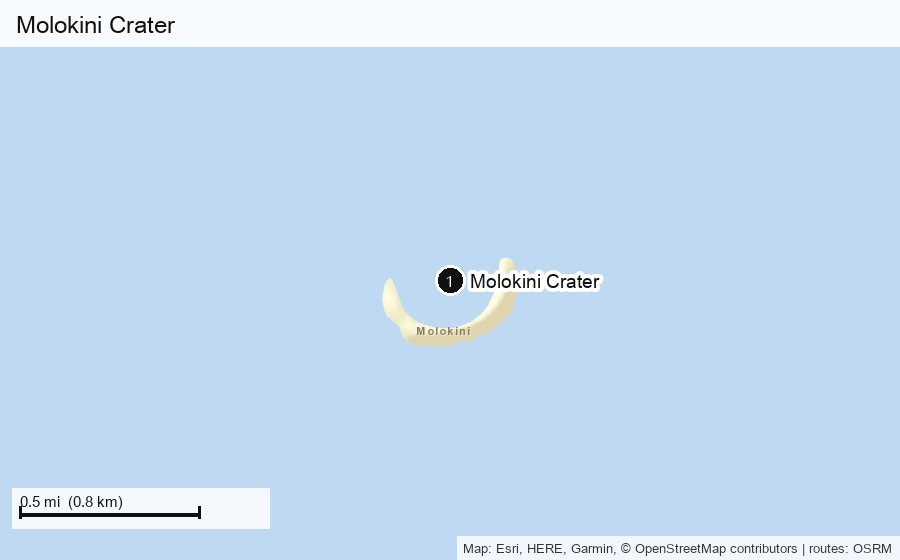 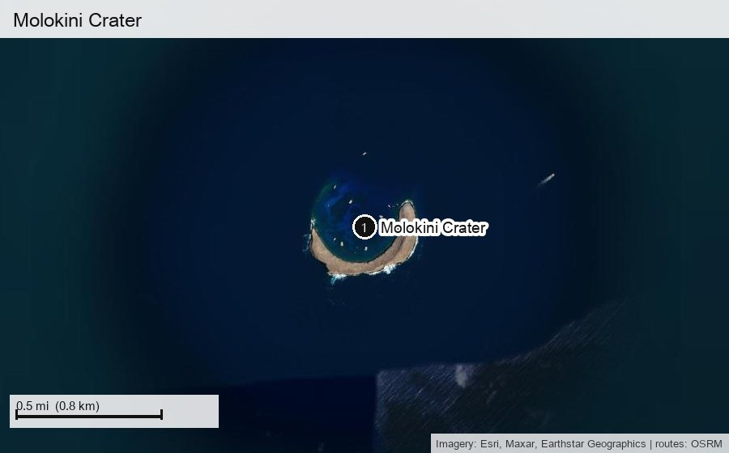

<sub>`20.63287,-156.49603` · open in Google: [map](https://www.google.com/maps/@?api=1&map_action=map&center=20.63287,-156.49603&zoom=15&basemap=roadmap) · [terrain](https://www.google.com/maps/@?api=1&map_action=map&center=20.63287,-156.49603&zoom=15&basemap=terrain) · [satellite](https://www.google.com/maps/@?api=1&map_action=map&center=20.63287,-156.49603&zoom=16&basemap=satellite) · [3D](https://earth.google.com/web/@20.63287,-156.49603,300a,2500d,35y,0h,60t,0r)</sub>

<a id="m-hana"></a>
### 🌿 Hotel → Road to Hāna

**Sat Nov 7**

<a href="maps/maui_hana_street.jpg">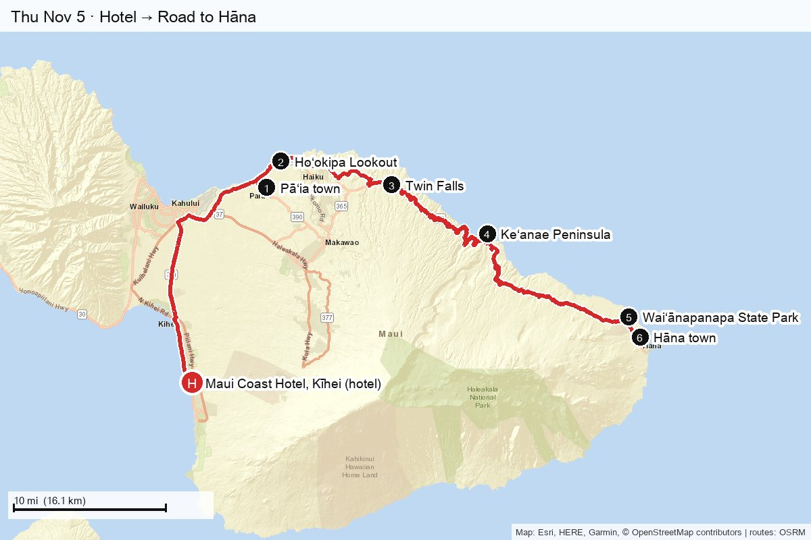</a> <a href="maps/maui_hana_sat.jpg">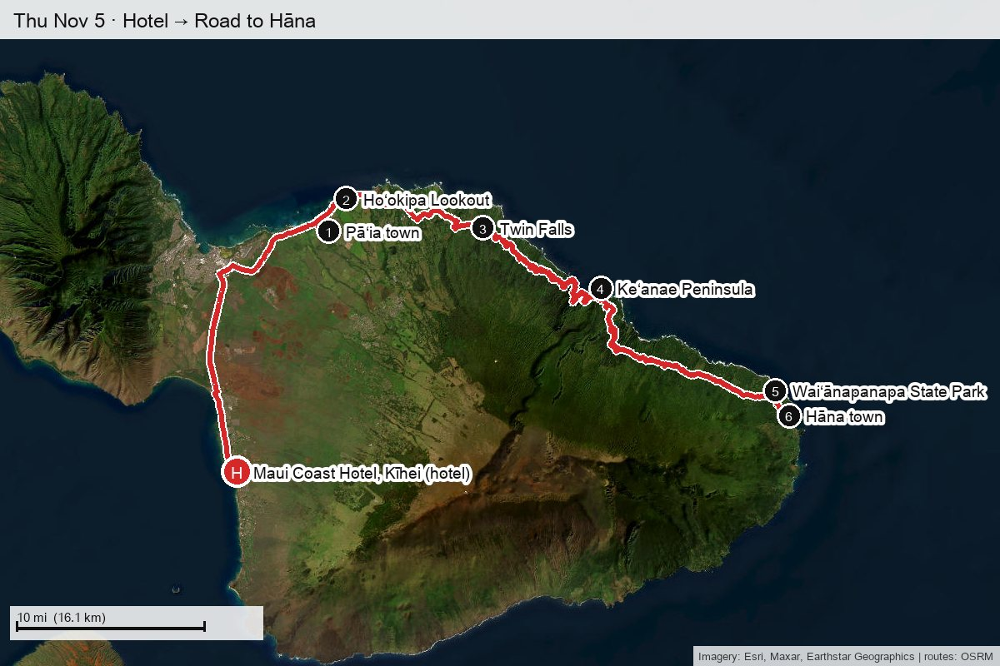</a>

| Distance | Drive time (no traffic) | Plan for | How we get there |
|---:|---:|---|---|
| **67.4 mi** | 2 h 41 min | **10–12 h round-trip day** with stops | 🚐 Guided tour, hotel pickup ~6:30–7:00 AM |

[▶ Directions from the hotel in Google Maps](https://www.google.com/maps/dir/?api=1&origin=20.72386,-156.44605&destination=20.76710,-155.99075&travelmode=driving&waypoints=20.90926%2C-156.37013%7C20.93442%2C-156.35585%7C20.91180%2C-156.24320%7C20.86549%2C-156.14610%7C20.78655%2C-156.00212)

**The stops, in order from the hotel** (the tour's exact stops may differ):

| Stop | From the hotel | Leg |
|---|---:|---:|
| 1. **Pāʻia town** | 18.3 mi | +18.3 mi · 37 min |
| 2. **Hoʻokipa Lookout** | 21.4 mi | +3.1 mi · 7 min |
| 3. **Twin Falls** | 32.6 mi | +11.2 mi · 21 min |
| 4. **Keʻanae Peninsula** | 47.8 mi | +15.2 mi · 38 min |
| 5. **Waiʻānapanapa State Park** | 65.1 mi | +17.2 mi · 48 min |
| 6. **Hāna town** | 67.4 mi | +2.3 mi · 10 min |

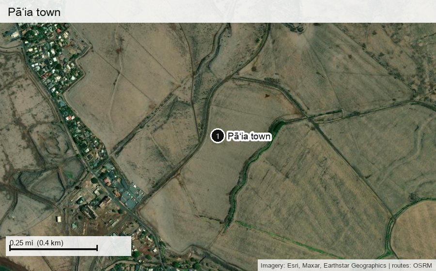 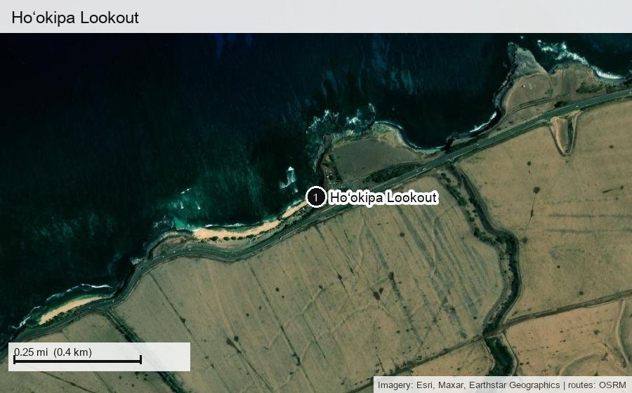 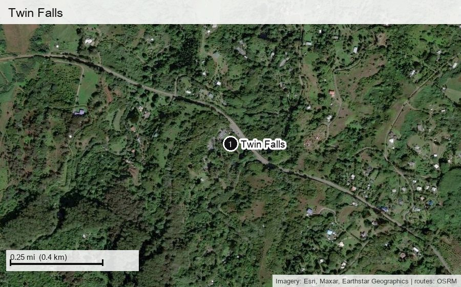 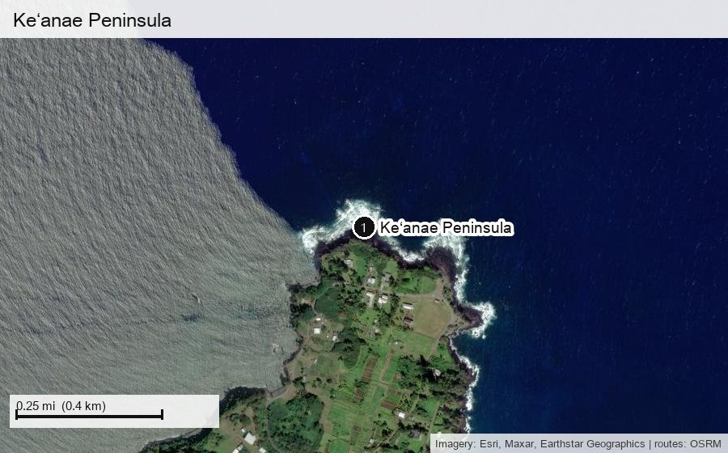 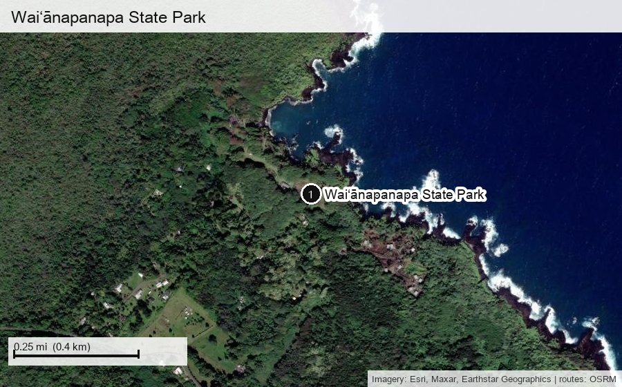 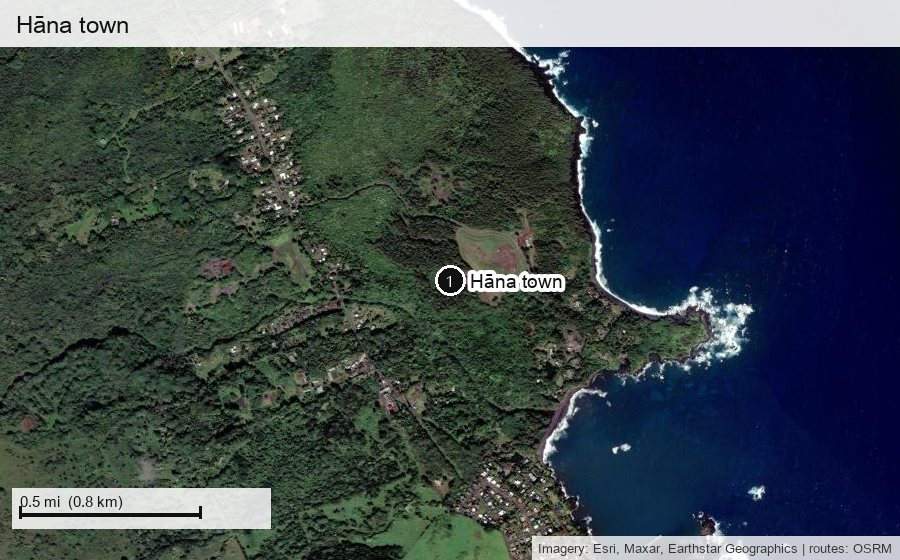

<sub>1. Pāʻia town · 2. Hoʻokipa Lookout · 3. Twin Falls · 4. Keʻanae Peninsula · 5. Waiʻānapanapa State Park · 6. Hāna town (satellite, left to right)</sub>

**📍 Hāna town**

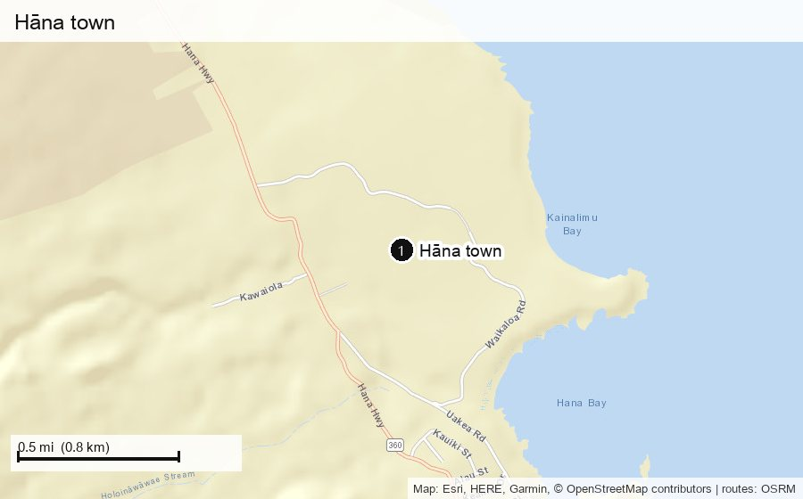 

<sub>`20.76710,-155.99075` · open in Google: [map](https://www.google.com/maps/@?api=1&map_action=map&center=20.76710,-155.99075&zoom=15&basemap=roadmap) · [terrain](https://www.google.com/maps/@?api=1&map_action=map&center=20.76710,-155.99075&zoom=15&basemap=terrain) · [satellite](https://www.google.com/maps/@?api=1&map_action=map&center=20.76710,-155.99075&zoom=16&basemap=satellite) · [3D](https://earth.google.com/web/@20.76710,-155.99075,300a,2500d,35y,0h,60t,0r)</sub>

<a id="m-wailea"></a>
### 🎂 Hotel → Hotel Wailea (birthday dinner)

**Fri Nov 6**

<a href="maps/maui_wailea_street.jpg">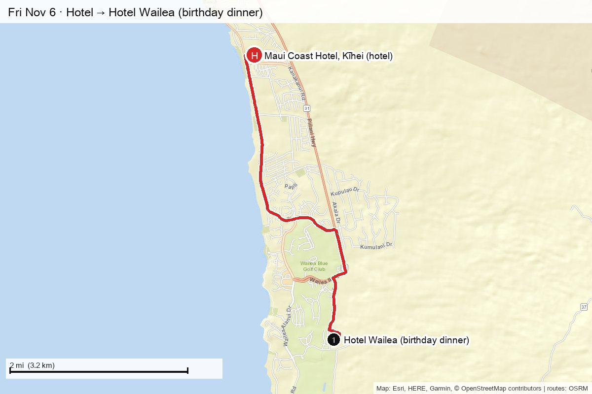</a> <a href="maps/maui_wailea_sat.jpg">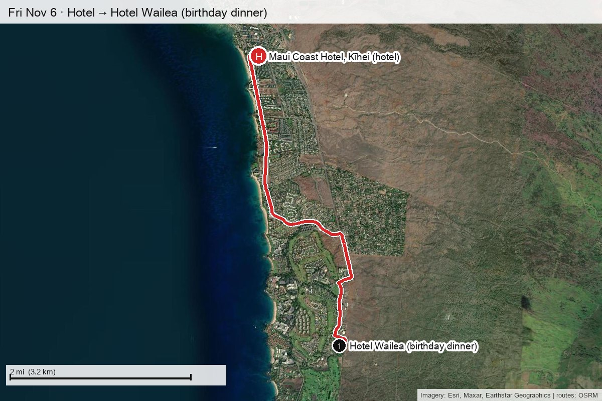</a>

| Distance | Drive time (no traffic) | Plan for | How we get there |
|---:|---:|---|---|
| **4.2 mi** | 13 min | ~15 min; then Tikehau (Wailea Village) and dancing in Kīhei | 🚕 Rideshare there; prebooked taxi Wailea Village → Tiki Lounge ~9 PM, walk back (~$30–60) |

[▶ Directions from the hotel in Google Maps](https://www.google.com/maps/dir/?api=1&origin=20.72386,-156.44605&destination=20.67748,-156.43222&travelmode=driving)

**📍 Hotel Wailea (birthday dinner)**

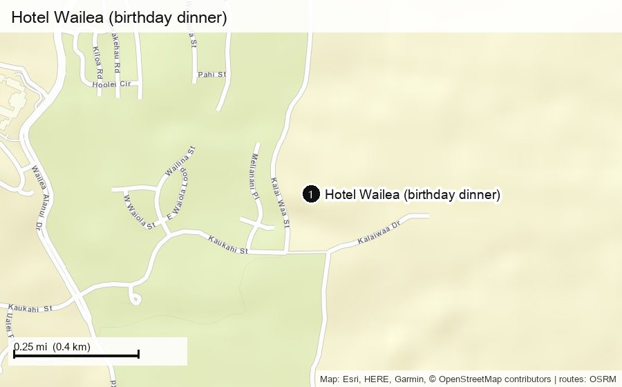 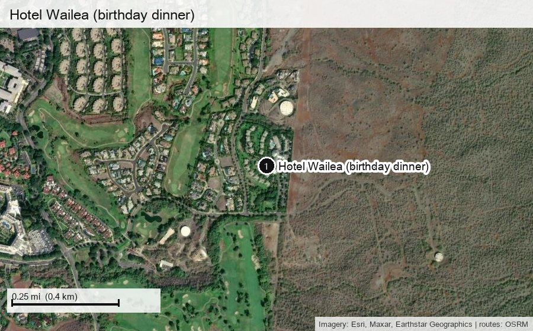

<sub>`20.67748,-156.43222` · open in Google: [map](https://www.google.com/maps/@?api=1&map_action=map&center=20.67748,-156.43222&zoom=15&basemap=roadmap) · [terrain](https://www.google.com/maps/@?api=1&map_action=map&center=20.67748,-156.43222&zoom=15&basemap=terrain) · [satellite](https://www.google.com/maps/@?api=1&map_action=map&center=20.67748,-156.43222&zoom=16&basemap=satellite) · [3D](https://earth.google.com/web/@20.67748,-156.43222,300a,2500d,35y,0h,60t,0r)</sub>

<a id="m-haleakala"></a>
### 🌋 Hotel → Haleakalā summit (sunset)

**Thu Nov 5**

<a href="maps/maui_haleakala_street.jpg">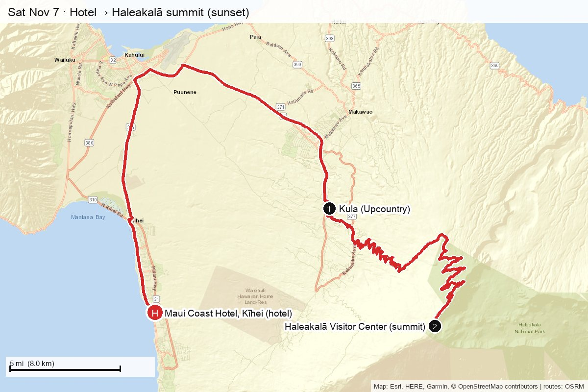</a> <a href="maps/maui_haleakala_sat.jpg">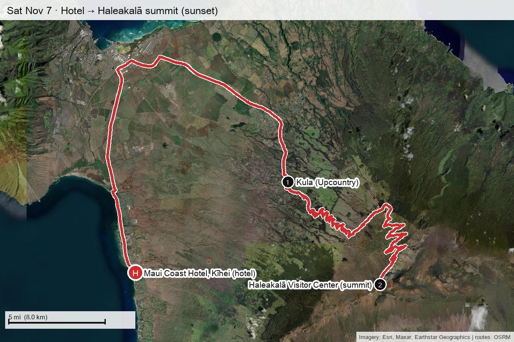</a>

| Distance | Drive time (no traffic) | Plan for | How we get there |
|---:|---:|---|---|
| **47.9 mi** | 1 h 51 min | 2.5–3 h up, sea level → ~10,000 ft; back ~8 PM | 🚐 Guided sunset tour, hotel pickup 1:40 PM, street-side sign (entry + dinner included) |

[▶ Directions from the hotel in Google Maps](https://www.google.com/maps/dir/?api=1&origin=20.72386,-156.44605&destination=20.71511,-156.24981&travelmode=driving&waypoints=20.79203%2C-156.32371)

**📍 Haleakalā Visitor Center (summit)**

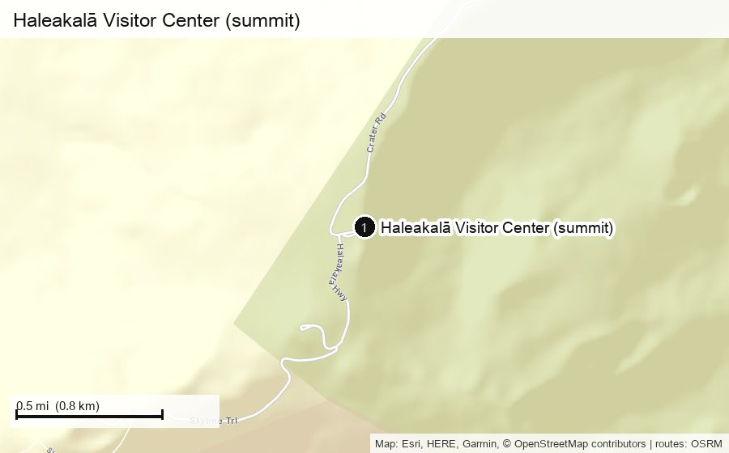 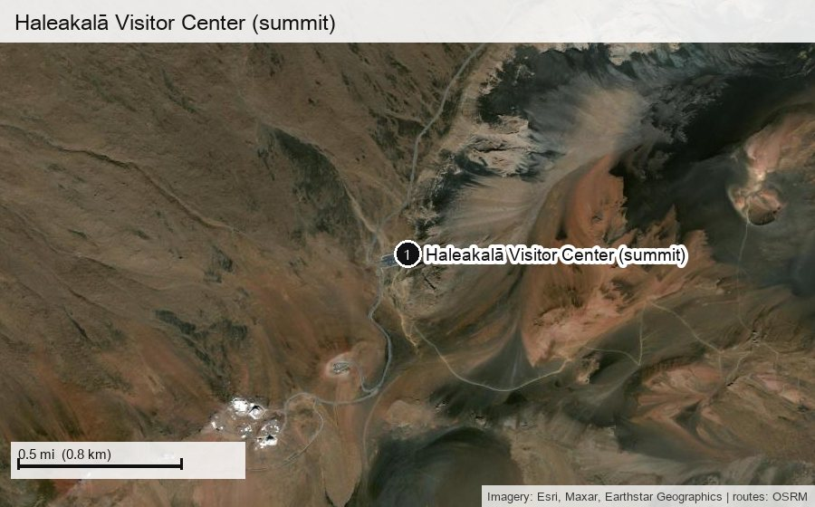

<sub>`20.71511,-156.24981` · open in Google: [map](https://www.google.com/maps/@?api=1&map_action=map&center=20.71511,-156.24981&zoom=15&basemap=roadmap) · [terrain](https://www.google.com/maps/@?api=1&map_action=map&center=20.71511,-156.24981&zoom=15&basemap=terrain) · [satellite](https://www.google.com/maps/@?api=1&map_action=map&center=20.71511,-156.24981&zoom=16&basemap=satellite) · [3D](https://earth.google.com/web/@20.71511,-156.24981,300a,2500d,35y,0h,60t,0r)</sub>


---

<a id="update"></a>
## 🔧 How to update the maps

```bash
cd maps/tools
python3 gen_md.py ../..   # re-renders the hotel-centred maps and rewrites map.md (needs Pillow; tiles cache in tiles/)
```

Places live in `places.py` + `coords.json`; trips are the `OAHU` / `MAUI` lists in `gen_md.py`.

**Credits:** normal maps: Esri World Street Map (Esri, HERE, Garmin, © [OpenStreetMap](https://www.openstreetmap.org/copyright) contributors); satellite imagery © Esri, Maxar, Earthstar Geographics. Routing: [OSRM](https://project-osrm.org). Twin Falls is placed approximately.
