# Oʻahu: Oct 31 – Nov 3

> Island guide for the first leg. **The final plan is at the top**; everything else on the island (options, details, photos, bookings, backups) is below it.
> Created 2026-10-18. Nothing is booked yet: see [`bookings.md`](bookings.md). Overall trip: [`tentative_plan.md`](tentative_plan.md).
> Base: **Waikīkī, no car** (transfers + rideshare). Then → [`maui.md`](maui.md) on Nov 3.

## 📑 Contents

- [✅ The final plan](#-the-final-plan)
  - [Sat Oct 31: arrive](#sat-oct-31-arrive)
  - [Sun Nov 1: Diamond Head + Waikīkī](#sun-nov-1-diamond-head--waikīkī)
  - [Mon Nov 2: Pearl Harbor](#mon-nov-2-pearl-harbor)
  - [Tue Nov 3: → Maui](#tue-nov-3--maui)
- [🎟️ Bookings for Oʻahu (do these now)](#bookings-for-oʻahu-do-these-now)
- [🌺 Everything else to do on Oʻahu](#-everything-else-to-do-on-oʻahu)
  - [Waikīkī and Honolulu (all easy without a car)](#waikīkī-and-honolulu-all-easy-without-a-car)
  - [East Oʻahu (half day; car, tour or rideshare)](#east-oʻahu-half-day-car-tour-or-rideshare)
  - [Windward side (full day; tour or car)](#windward-side-full-day-tour-or-car)
  - [North Shore (full day; tour or car) · ❌ not in the plan](#north-shore-full-day-tour-or-car---not-in-the-plan)
  - [Evenings](#evenings)
- [🍽️ Food ideas (no reservations needed unless noted)](#food-ideas-no-reservations-needed-unless-noted)
- [🌧️ Rain and backup swaps](#rain-and-backup-swaps)
- [💵 Oʻahu costs (two people)](#-oʻahu-costs-two-people)
- [🧭 Practical notes](#-practical-notes)
- [Sources](#sources)

Waikīkī · [Photo: Andrew Shoemaker](https://www.andrewshoemaker.com/photo/waikiki-blue-beach-abstract-panorama/)

---

## ✅ The final plan

| Date | Day | Morning | Afternoon | Evening |
|---|---|---|---|---|
| **Oct 31** | Sat | ✈️ JFK → HNL nonstop (lands ~2–3 PM) | Transfer to Waikīkī, check in | Beach walk, early dinner, early night |
| **Nov 1** | Sun | 🌋 **Diamond Head** at opening | Brunch, Waikīkī beach time | Sunset on the beach, dinner |
| **Nov 2** | Mon | ⚓ **Pearl Harbor / USS Arizona** | Free: pool, nap, shopping, optional Bishop Museum | Pack, last Waikīkī dinner |
| **Nov 3** | Tue | Breakfast, check out, ride to HNL | ✈️ Midday HNL → OGG ([`maui.md`](maui.md)) | |

**Hotel:** OUTRIGGER Reef Waikīkī Beach Resort (price it first). Fallbacks: Prince Waikīkī, OUTRIGGER Waikīkī Beach Resort. Rule: **under $500/night including taxes + resort fees**.

<!-- map:oahu_hub -->
**🗺️ Everything from the hotel (H)** · numbered pins and distances in [map.md](map.md#oahu-hub)

<a href="maps/oahu_hub_street.jpg">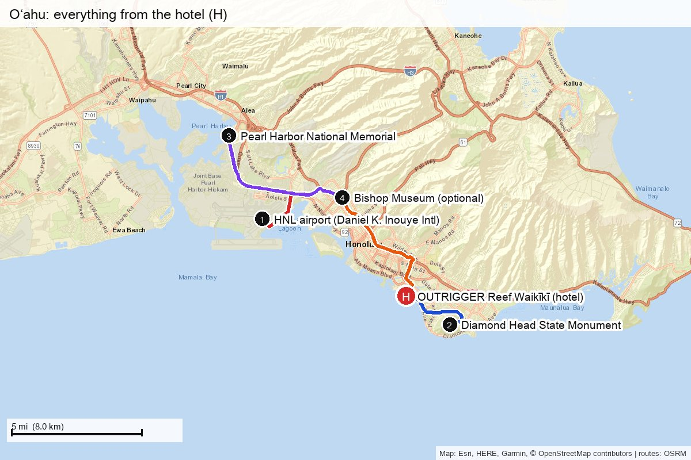</a> <a href="maps/oahu_hub_sat.jpg">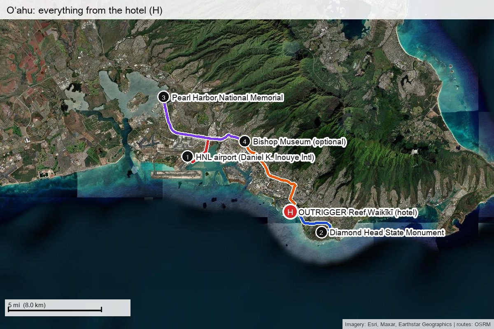</a>

### Sat Oct 31: arrive
- ✈️ Morning nonstop from JFK. Options seen this week: **Delta JFK 10:00 AM → HNL 2:58 PM**, **Alaska JFK 8:55 AM → HNL 2:10 PM**. ~11 hours in the air; Hawaiʻi is **6 hours behind NYC** today.
- 🚐 HNL → Waikīkī: prebooked shared or private transfer, or rideshare from the marked pickup area (~25–40 min depending on traffic).
- 🏨 Check in, shower, change.
- 🌅 Sunset is around 6 PM. Walk Kalākaua Ave and the beach path, then an easy dinner near the hotel.
- 🎃 It's **Halloween**: Waikīkī and Kalākaua Ave get busy and costumed. Fun to watch for an hour; skip it if you're tired.
- Carry-on: swimsuits, meds, a change of clothes, chargers (in case bags are late).
- ⛔ Nothing time-sensitive today.

<!-- map:oahu_airport -->
**🗺️ Route from the hotel:** 9.4 mi · 30–45 min with bags; leave ~2.5 h before the Nov 3 flight · 🚕 Rideshare or flat-rate taxi (~$30–50 each way); shuttle optional · [▶ directions](https://www.google.com/maps/dir/?api=1&origin=21.27825,-157.83279&destination=21.32114,-157.91844&travelmode=driving) · [more in map.md](map.md#o-airport)

<a href="maps/oahu_airport_street.jpg">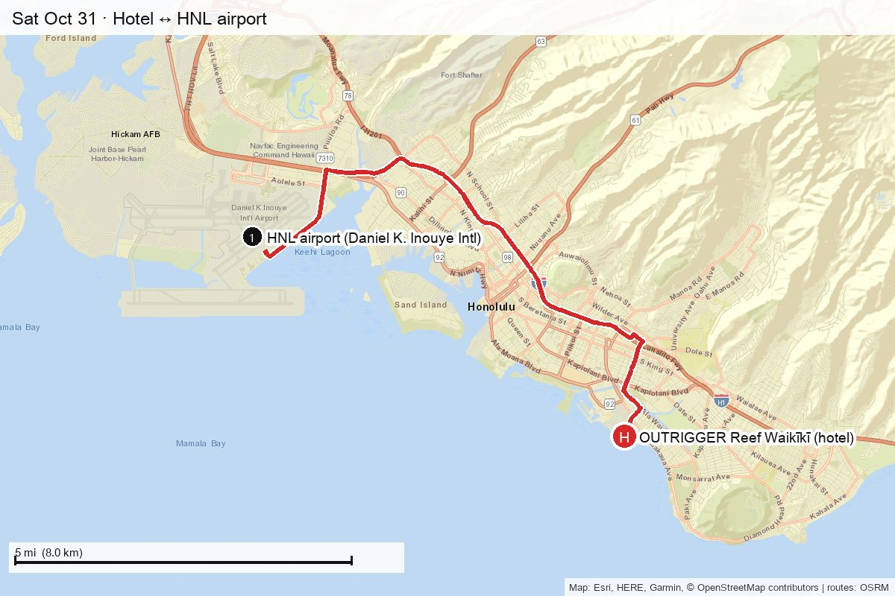</a> <a href="maps/oahu_airport_sat.jpg">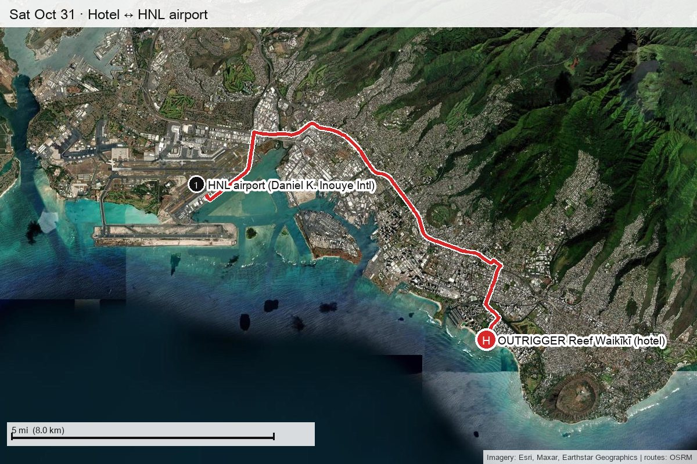</a>

<b>Photos</b>

**📸 Daniel K. Inouye Intl Airport (HNL)**

 

Photos: [Famartin](https://commons.wikimedia.org/wiki/File:2021-10-05_21_52_10_Gates_and_seats_within_Daniel_K._Inouye_International_Airport_in_Honolulu,_Oahu,_Hawaii.jpg), CC BY-SA 4.0 · [Steven Pavlov](https://commons.wikimedia.org/wiki/File:2023-04-24,_Daniel_K._Inouye_International_Airport,_Honolulu,_Hawaii,_001.jpg), CC BY-SA 4.0 (Wikimedia Commons)

**📸 OUTRIGGER Reef Waikīkī**

 

Photos: [Fuzheado](https://commons.wikimedia.org/wiki/File:Outrigger_Reef_Waikiki_Beach_Resort.jpg), CC BY-SA 3.0 · [hh oldman](https://commons.wikimedia.org/wiki/File:Waik%C4%ABk%C4%AB,_Honolulu,_HI_96815,_USA_-_panoramio_(58).jpg), CC BY 3.0 (Wikimedia Commons)

**📸 Waikīkī Beach**

   

Photos: [Highsmith, Carol M., 1946-](https://commons.wikimedia.org/wiki/File:Aerial_view_of_Waikiki_Beach_and_Honolulu,_Hawaii,_Highsmith.jpg), Public domain · [Pickle the cool](https://commons.wikimedia.org/wiki/File:City_of_Waikiki_view.jpg), CC BY-SA 4.0 · [Edmund Garman from Salem, Oregon, USA](https://commons.wikimedia.org/wiki/File:Rainbow_Tower_Waikiki_(16178632002).jpg), CC BY 2.0 · [Cristo Vlahos](https://commons.wikimedia.org/wiki/File:Surfboards_in_Waikiki.JPG), CC BY-SA 3.0 (Wikimedia Commons)

**📸 Kalākaua Avenue**

 

Photos: [Prayitno / Thank you for (12 millions +) view from Los Angel](https://commons.wikimedia.org/wiki/File:Kalakaua_Avenue_(15625051226).jpg), CC BY 2.0 · [verygreen](https://commons.wikimedia.org/wiki/File:Kalakaua_avenue_in_the_evening_-_panoramio.jpg), CC BY-SA 3.0 (Wikimedia Commons)

**📸 Duke Kahanamoku statue**

 

Photos: [DestinationFearFan](https://commons.wikimedia.org/wiki/File:Duke_Paoa_Kahanamoku_Statue.jpg), CC BY-SA 4.0 · [Fjmustak](https://commons.wikimedia.org/wiki/File:Duke_Kahanamoku_statue.jpg), CC BY-SA 4.0 (Wikimedia Commons)

### Sun Nov 1: Diamond Head + Waikīkī
- 🕕 ~6:00–6:30 AM: rideshare to **Diamond Head** (Lēʻahi), ~10–15 min from Waikīkī. Your body clock still thinks it's mid-morning, so an early start is easy.
- 🥾 Hike: ~1.6 miles round trip, ~560 ft climb, steep switchbacks, stairs and a tunnel; allow **1.5–2 hours**. Little shade: water, hat, sunscreen.
- 🥞 Brunch on the way back (Kapahulu Ave / Monsarrat Ave cafés are right below the crater).
- 🏖️ Afternoon: beach + pool. Optional: beginner surf or paddleboard lesson at Waikīkī (~$200–300 for two).
- 🌅 Sunset from the beach or the Duke Kahanamoku statue area; dinner.
- 🕐 NYC falls back today, so Hawaiʻi is now **5 hours behind NYC**.

<!-- map:oahu_dh -->
**🗺️ Route from the hotel:** 3.4 mi · 15–20 min; hike 1.5–2 h (~560 ft climb) · 🚕 Rideshare both ways (~$25–40 total) · [▶ directions](https://www.google.com/maps/dir/?api=1&origin=21.27825,-157.83279&destination=21.26249,-157.80679&travelmode=driving) · [more in map.md](map.md#o-dh)

<a href="maps/oahu_dh_street.jpg">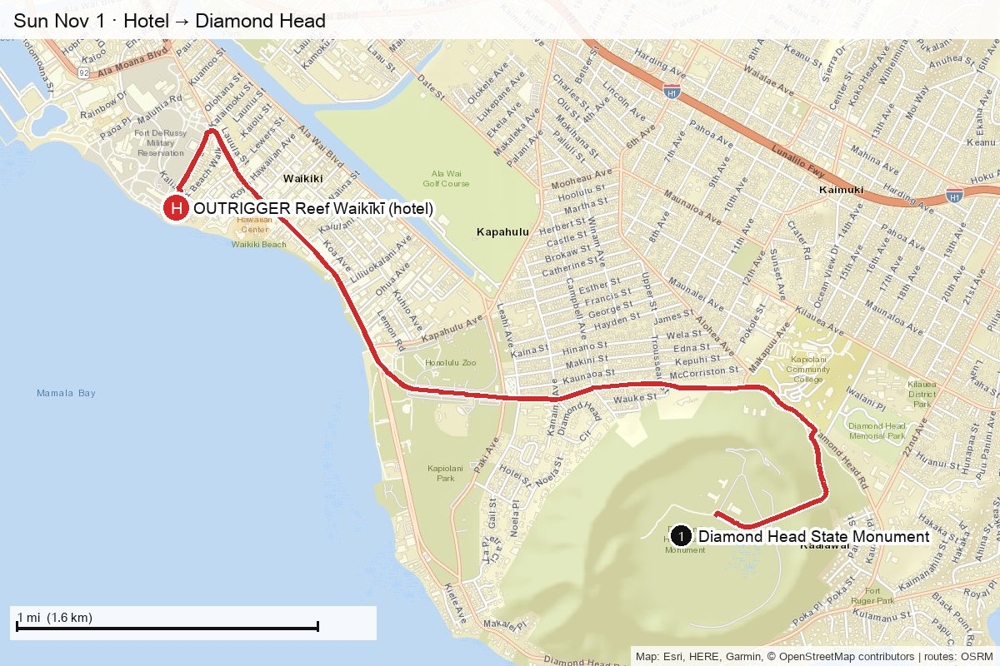</a> <a href="maps/oahu_dh_sat.jpg">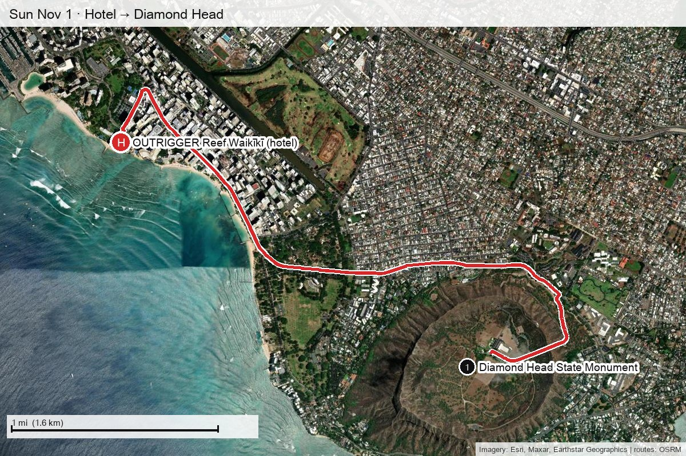</a>

<b>Photos</b>

**📸 Diamond Head (Lēʻahi)**

   

Photos: [Steven Pavlov](https://commons.wikimedia.org/wiki/File:2023-04-18,_Diamond_Head_Summit_Trail,_114530.jpg), CC BY-SA 4.0 · [VideoFrog](https://commons.wikimedia.org/wiki/File:Diamond_Head.jpg), CC BY 2.0 · [Eric Tessmer](https://commons.wikimedia.org/wiki/File:Diamond_Head_East_View_%5E_Eric_Tessmer_Hawaii_-_panoramio.jpg), CC BY 3.0 · [Eric Tessmer](https://commons.wikimedia.org/wiki/File:Diamond_Head_Hawaii_-_panoramio.jpg), CC BY 3.0 (Wikimedia Commons)

**📸 Surfing at Waikīkī**

  

Photos: [D. Howard Hitchcock](https://commons.wikimedia.org/wiki/File:%27Canoe_Surfing,_Waikiki%27_by_D._Howard_Hitchcock.JPG), Public domain · [Prayitno / Thank you for (12 millions +) view from Los Angel](https://commons.wikimedia.org/wiki/File:Surfing_@_Waikiki_Beach_(15068357533).jpg), CC BY 2.0 · [Prayitno / Thank you for (12 millions +) view from Los Angel](https://commons.wikimedia.org/wiki/File:Surfing_@_Waikiki_Beach_(15501979860).jpg), CC BY 2.0 (Wikimedia Commons)

### Mon Nov 2: Pearl Harbor
- 🕖 Leave ~1 hour before your **USS Arizona** program time (rideshare ~25–40 min).
- ⚓ The Arizona program is ~45 min (film + boat to the memorial). Add the free museums at the visitor center; allow **3–4 hours** total, more with the Battleship Missouri.
- 🎒 **No bags allowed** (wallets, phones, cameras, clear water bottles only). Leave bags at the hotel, or pay for the storage by the entrance.
- 👕 Respectful clothing; it's a war grave.
- Afternoon free: pool and nap, Ala Moana shopping, or **Bishop Museum** (~2–3 h, ~$30/adult).
- Pack for tomorrow's island hop.

<!-- map:oahu_ph -->
**🗺️ Route from the hotel:** 23.3 mi · 30–40 min out in H-1 traffic; 3–4 h at Pearl Harbor · 🚕 Rideshare each leg (~$60–100 total); no bags allowed at Pearl Harbor · [▶ directions](https://www.google.com/maps/dir/?api=1&origin=21.27825,-157.83279&destination=21.27825,-157.83279&travelmode=driving&waypoints=21.36748%2C-157.93845%7C21.33308%2C-157.87071) · [more in map.md](map.md#o-ph)

<a href="maps/oahu_ph_street.jpg">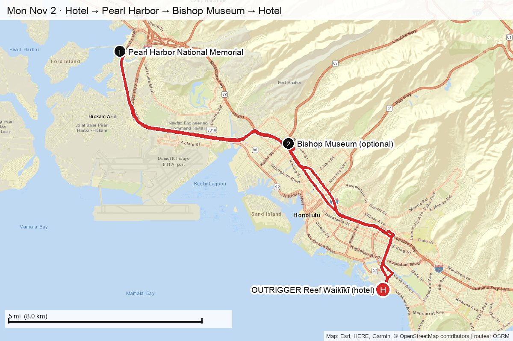</a> <a href="maps/oahu_ph_sat.jpg">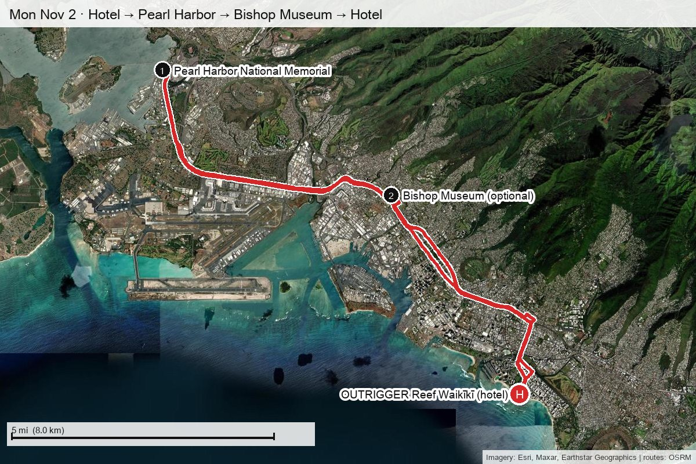</a>

<b>Photos</b>

**📸 USS Arizona Memorial**

  

Photos: [SCFoxJD](https://commons.wikimedia.org/wiki/File:Aboard_the_Memorial_-_Arizona_survivors,_cremated_and_urns_added.jpg), CC BY-SA 4.0 · [SCFoxJD](https://commons.wikimedia.org/wiki/File:Aboard_the_U.S.S._Arizona_Memorial_-_looking_into_the_back.jpg), CC BY-SA 4.0 · [Cristo Vlahos](https://commons.wikimedia.org/wiki/File:Arizona_Memorial_at_Pearl_Harbor,_Hawaii.JPG), CC BY-SA 3.0 (Wikimedia Commons)

**📸 Pearl Harbor National Memorial**

 

Photos: [Victor-ny](https://commons.wikimedia.org/wiki/File:USS_Arizona_Memorial.JPG), CC BY-SA 3.0 · [DavidaJohanson](https://commons.wikimedia.org/wiki/File:Pearl_Harbor_Visitor_Center_is_the_entry_point_of_the_Pearl_Harbor_National_Memorial.jpg), CC BY-SA 4.0 (Wikimedia Commons)

**📸 Bishop Museum**

  

Photos: [Bishop Museum](https://commons.wikimedia.org/wiki/File:Amy_B._H._Greenwell_Ethnobotanical_Garden,_Captain_Cook,_Hawai%E2%80%98i_Island.jpg), CC BY-SA 3.0 · [Joel Bradshaw](https://commons.wikimedia.org/wiki/File:BPBishopMuseum-Bishophall-far.JPG), Public domain · [Joel Bradshaw](https://commons.wikimedia.org/wiki/File:BPBishopMuseum-Hawaiianhall-frontend.JPG), Public domain (Wikimedia Commons)

### Tue Nov 3: → Maui
- Breakfast, check out, rideshare to HNL (~25–40 min).
- ✈️ Midday interisland flight to OGG (~40 min in the air, ~$138 for two). A separate ticket isn't protected if the mainland flight is late, but you're already on Oʻahu by then, so leave normal airport buffer.
- Continue in [`maui.md`](maui.md).

---

## 🎟️ Bookings for Oʻahu (do these now)

| What | When to book | Cost (two) | Where | Status |
|---|---|---:|---|---|
| ✈️ JFK → HNL Oct 31 | **By Oct 19** | part of ~$1,981–2,168 total airfare | Airline site (Delta / Alaska) | ⬜ |
| 🏨 OUTRIGGER Reef Oct 31 → Nov 3 | **By Oct 19** | ~$1,050–1,500 | Hotel site or Booking.com | ⬜ |
| 🚕 HNL → Waikīkī | No booking (rideshare or flat-rate taxi); shuttle optional | ~$30–50 | Uber / Lyft / taxi rank (see [`commute.md`](commute.md)) | — |
| 🌋 Diamond Head timed entry, Nov 1 | **Now** (opens 30 days ahead, sells out) | $10 + fees | [gostateparks.hawaii.gov/diamondhead](https://gostateparks.hawaii.gov/diamondhead/about) | ⬜ |
| ⚓ USS Arizona program, Nov 2 | **Now** if any left; otherwise the **next-day release Nov 1, 3 PM HST** | $2 | [recreation.gov](https://www.recreation.gov/ticket/facility/233338) | ⬜ |
| ✈️ HNL → OGG Nov 3 | **By Oct 19** | ~$138 | Southwest / Hawaiian | ⬜ |

**About the Arizona tickets:** most tickets release **56 days ahead at 3 PM HST**, so the main batch for Nov 2 already went out in September. A second batch releases **the day before at 3 PM HST** (9 PM NYC on Nov 1 is 3 PM in Hawaiʻi; you'll be on the island). Same-day walk-up tickets are no longer offered. Backup: a Pearl Harbor tour package that includes the Arizona program.

**Diamond Head rules:** arrive within the first 30 minutes of your slot or you can be turned away; refunds only up to 3 days before; changes allowed until midnight the day before. Entry is $5/person for nonresidents (parking extra, not needed by rideshare). Open ~6 AM–6 PM.

---

## 🌺 Everything else to do on Oʻahu

Pick from these if you have energy, if the weather changes, or to swap days. Rough time needed and whether it works **without a car** are noted. Prices marked ~ for lessons, canoe rides, sails, transfers and Kualoa are typical ranges, not quotes; check before booking.

### Waikīkī and Honolulu (all easy without a car)

| Thing | Why | Time | Cost | Notes |
|---|---|---|---|---|
| **Waikīkī Beach** | The classic: calm water inside the reef, Diamond Head view | Any | Free | Kūhiō Beach area has the calmest swimming |
| **Beginner surf / paddleboard lesson** | Waikīkī's gentle waves are where surfing was popularised | 2 h | ~$200–300 for two | Book a morning group or private lesson |
| **Outrigger canoe ride** | Catch waves in a traditional canoe, very easy | 30–45 min | ~$50/pp | Beach stands along Waikīkī |
| **Sunset sail / catamaran** | Diamond Head + skyline from the water | 1.5 h | ~$60–150/pp | Leaves from Waikīkī beach; good for Oct 31 or Nov 2 evening |
| **Kapiʻolani Park + Queen's Surf** | Banyan trees, quieter beach | 1 h | Free | Walk from the hotel |
| **ʻIolani Palace** | The only royal palace in the US | 1.5–2 h | from ~$34/pp | Guided tours; weekday mornings |
| **Bishop Museum** | Best museum of Hawaiian and Pacific culture | 2–3 h | ~$30/pp | Optional for the Nov 2 afternoon |
| **Chinatown + Downtown** | Lei shops, bakeries, bars, street art | 1–2 h | Free | Daytime, or First Friday evening |
| **Punchbowl (National Memorial Cemetery)** | Crater cemetery with a view over Honolulu | 30–45 min | Free | Pairs with Pearl Harbor |
| **Foster Botanical Garden** | Giant old trees in the city | 1–1.5 h | ~$5/pp | Quiet morning option |
| **Ala Moana Center + Beach Park** | Big open-air mall, calm lagoon beach | 2 h | Free | Good rainy-afternoon fallback |
| **Puʻu ʻUalakaʻa lookout (Tantalus)** | Sunset over the whole city | 30 min | $7 parking | Needs a car or rideshare both ways |

<!-- map:area_oahu_honolulu -->
**🗺️ Waikīkī + Honolulu: where these are from the hotel (H).** Getting there without a car: Walk (Waikīkī), or a short rideshare.

<a href="maps/area_oahu_honolulu_street.jpg">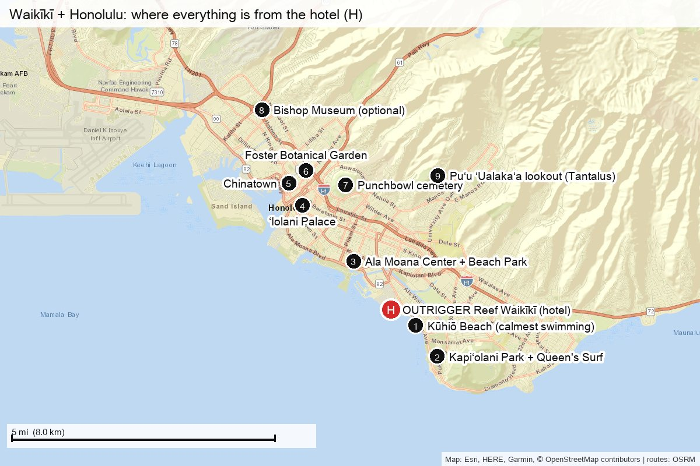</a> <a href="maps/area_oahu_honolulu_sat.jpg">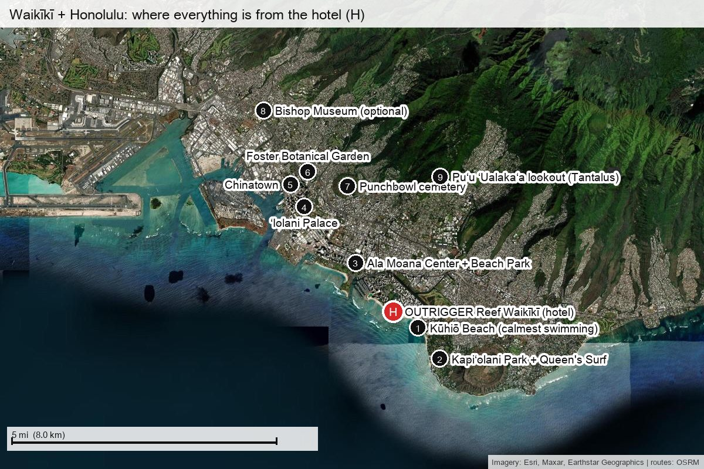</a>

| Pin | Place | From the hotel | Drive (no traffic) | Map |
|:-:|---|---:|---:|---|
| 1 | Kūhiō Beach (calmest swimming) | 0.9 mi | 3 min | [▶ directions](https://www.google.com/maps/dir/?api=1&origin=21.27825,-157.83279&destination=21.27380,-157.82550&travelmode=driving) · [pin](https://www.google.com/maps/@?api=1&map_action=map&center=21.27380,-157.82550&zoom=15&basemap=roadmap) |
| 2 | Kapiʻolani Park + Queen's Surf | 2.1 mi | 7 min | [▶ directions](https://www.google.com/maps/dir/?api=1&origin=21.27825,-157.83279&destination=21.26535,-157.81916&travelmode=driving) · [pin](https://www.google.com/maps/@?api=1&map_action=map&center=21.26535,-157.81916&zoom=15&basemap=roadmap) |
| 3 | Ala Moana Center + Beach Park | 1.5 mi | 6 min | [▶ directions](https://www.google.com/maps/dir/?api=1&origin=21.27825,-157.83279&destination=21.29147,-157.84378&travelmode=driving) · [pin](https://www.google.com/maps/@?api=1&map_action=map&center=21.29147,-157.84378&zoom=15&basemap=roadmap) |
| 4 | ʻIolani Palace | 3.2 mi | 10 min | [▶ directions](https://www.google.com/maps/dir/?api=1&origin=21.27825,-157.83279&destination=21.30681,-157.85877&travelmode=driving) · [pin](https://www.google.com/maps/@?api=1&map_action=map&center=21.30681,-157.85877&zoom=15&basemap=roadmap) |
| 5 | Chinatown | 3.9 mi | 11 min | [▶ directions](https://www.google.com/maps/dir/?api=1&origin=21.27825,-157.83279&destination=21.31290,-157.86280&travelmode=driving) · [pin](https://www.google.com/maps/@?api=1&map_action=map&center=21.31290,-157.86280&zoom=15&basemap=roadmap) |
| 6 | Foster Botanical Garden | 4.1 mi | 10 min | [▶ directions](https://www.google.com/maps/dir/?api=1&origin=21.27825,-157.83279&destination=21.31635,-157.85779&travelmode=driving) · [pin](https://www.google.com/maps/@?api=1&map_action=map&center=21.31635,-157.85779&zoom=15&basemap=roadmap) |
| 7 | Punchbowl cemetery | 3.4 mi | 9 min | [▶ directions](https://www.google.com/maps/dir/?api=1&origin=21.27825,-157.83279&destination=21.31247,-157.84610&travelmode=driving) · [pin](https://www.google.com/maps/@?api=1&map_action=map&center=21.31247,-157.84610&zoom=15&basemap=roadmap) |
| 8 | Bishop Museum (optional) | 5.7 mi | 13 min | [▶ directions](https://www.google.com/maps/dir/?api=1&origin=21.27825,-157.83279&destination=21.33308,-157.87071&travelmode=driving) · [pin](https://www.google.com/maps/@?api=1&map_action=map&center=21.33308,-157.87071&zoom=15&basemap=roadmap) |
| 9 | Puʻu ʻUalakaʻa lookout (Tantalus) | 5.0 mi | 13 min | [▶ directions](https://www.google.com/maps/dir/?api=1&origin=21.27825,-157.83279&destination=21.31500,-157.81900&travelmode=driving) · [pin](https://www.google.com/maps/@?api=1&map_action=map&center=21.31500,-157.81900&zoom=15&basemap=roadmap) |

<b>Photos</b>

Waikīkī Beach, surf lessons and Bishop Museum are pictured in the day plan above.

**📸 Sunset sail off Waikīkī**

 

Photos: [Ossewa](https://commons.wikimedia.org/wiki/File:Catamarans,_Waikiki.jpg), CC BY-SA 4.0 · [Phil Whitehouse from London, United Kingdom](https://commons.wikimedia.org/wiki/File:Waikiki_Beach_(6480776787).jpg), CC BY 2.0 (Wikimedia Commons)

**📸 Kapiʻolani Park + Queen's Surf**

  

Photos: [kajikawa](https://commons.wikimedia.org/wiki/File:Kapiolani_Park_-_panoramio.jpg), CC BY 3.0 · [Janine from Mililani, Hawaii, United States](https://commons.wikimedia.org/wiki/File:Under_the_banyan_tree.jpg), CC BY 2.0 · [Diego Delso](https://commons.wikimedia.org/wiki/File:Banyan_tree,_Waikiki_Beach,_Oahu,_Hawaii,_USA4.jpg), CC BY-SA 3.0 (Wikimedia Commons)

**📸 ʻIolani Palace**

  

Photos: [Cliff from Arlington, Virginia, USA](https://commons.wikimedia.org/wiki/File:Coat_of_Arms_(2856237729).jpg), CC BY 2.0 · [Daniel Ramirez from Honolulu, USA](https://commons.wikimedia.org/wiki/File:Grand_Staircase_-_Iolani_Palce_(9487418505).jpg), CC BY 2.0 · [Gage Skidmore from Surprise, AZ, United States of America](https://commons.wikimedia.org/wiki/File:Iolani_Palace_(51872681413).jpg), CC BY-SA 2.0 (Wikimedia Commons)

**📸 Chinatown, Honolulu**

Photos: [Joel Bradshaw](https://commons.wikimedia.org/wiki/File:Honolulu-Chinatown-WoFat-building.JPG), Public domain (Wikimedia Commons)

**📸 Punchbowl (National Memorial Cemetery)**

 

Photos: [Cleared as filed at English Wikipedia](https://commons.wikimedia.org/wiki/File:National_Memorial_Cemetery_of_the_Pacific_2005.jpg), CC BY-SA 3.0 · [Gage Skidmore from Surprise, AZ, United States of America](https://commons.wikimedia.org/wiki/File:National_Memorial_Cemetery_of_the_Pacific_(51871630202).jpg), CC BY-SA 2.0 (Wikimedia Commons)

**📸 Foster Botanical Garden**

  

Photos: [SCFoxJD](https://commons.wikimedia.org/wiki/File:%27Ohai-ali%27i_plant_in_bloom.jpg), CC BY-SA 4.0 · [Elizabeth Main](https://commons.wikimedia.org/wiki/File:Banyan_tree_Foster_Botanical_Gardens.jpg), CC BY-SA 4.0 · [SCFoxJD](https://commons.wikimedia.org/wiki/File:Butterfly_Garden_-_plants_attract_butterflies.jpg), CC BY-SA 4.0 (Wikimedia Commons)

**📸 Ala Moana Center + Beach Park**

Photos: [TastyPoutine](https://commons.wikimedia.org/wiki/File:Nieman_Marcus_Ala_Moana.jpg), CC BY-SA 3.0 (Wikimedia Commons)

**📸 Puʻu ʻUalakaʻa lookout (Tantalus)**

 

Photos: [The Eloquent Peasant](https://commons.wikimedia.org/wiki/File:Round_Top_Drive_with_view_of_UH_Manoa,_Diamond_Head_and_the_city_of_Honolulu.jpg), CC BY-SA 4.0 · [Steven Pavlov](https://commons.wikimedia.org/wiki/File:2023-04-22,_Pu%CA%BBu_%CA%BBUalaka%CA%BBa_State_Wayside,_Honolulu,_Hawaii,_022.jpg), CC BY-SA 4.0 (Wikimedia Commons)

### East Oʻahu (half day; car, tour or rideshare)

Sandy Beach, East Oʻahu · [Photo: Andrew Shoemaker](https://www.andrewshoemaker.com/photo/a-place-in-the-sun-sandy-beach-oahu-hawaii/)

| Thing | Why | Time | Cost | Notes |
|---|---|---|---|---|
| **Hanauma Bay** | Oʻahu's best easy snorkeling, a reef inside a volcanic crater | Half day | $25/pp + $3 parking (cash) | **Closed Mon + Tue.** Nov 1 (Sun) works, Nov 2 (Mon) doesn't. Reservations open **2 days ahead at 7 AM HST** (Oct 30 for Nov 1). Entry 6:45 AM–1:30 PM; mandatory video. [Official page](https://www.honolulu.gov/dpr/hanauma-bay-nature-preserve/) |
| **Hālona Blowhole + Cove** | Coastal lookout, blowhole spout | 15–20 min | Free | Stay behind the rail |
| **Makapuʻu Lighthouse Trail** | Paved ~2 mi round trip, huge coastal views, whales sometimes in winter | 1.5 h | Free | No shade; go early |
| **Sandy Beach** | Beautiful but dangerous shorebreak | Look only | Free | Don't swim here |
| **Lanikai + Kailua** | Postcard beaches, Mokulua islets, Kailua town cafés | Half day | Free | Lanikai has no parking; go by tour/rideshare. Lanikai Pillbox hike for the view (~1 h) |

<!-- map:area_oahu_east -->
**🗺️ East Oʻahu: where these are from the hotel (H).** Getting there without a car: Rideshare or a tour; the coast road loops round to Kailua.

<a href="maps/area_oahu_east_street.jpg">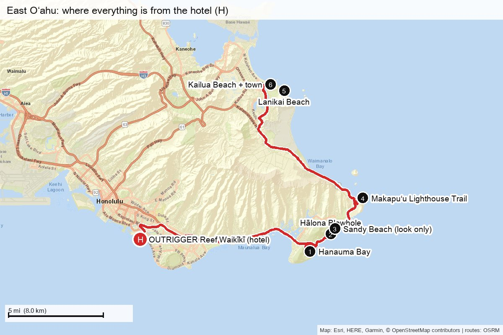</a> <a href="maps/area_oahu_east_sat.jpg">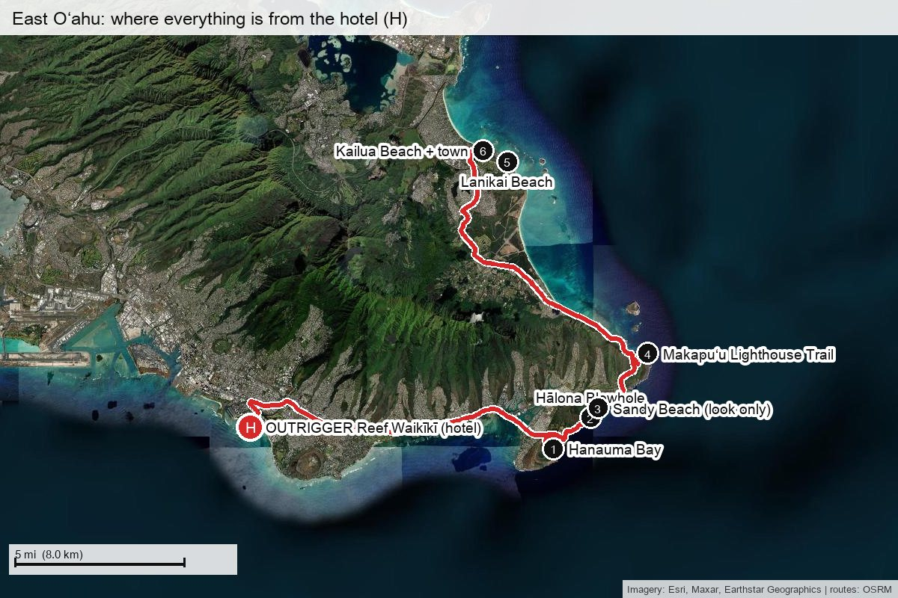</a>

| Pin | Place | From the hotel | Drive (no traffic) | Map |
|:-:|---|---:|---:|---|
| 1 | Hanauma Bay | 11.0 mi | 26 min | [▶ directions](https://www.google.com/maps/dir/?api=1&origin=21.27825,-157.83279&destination=21.26900,-157.69380&travelmode=driving) · [pin](https://www.google.com/maps/@?api=1&map_action=map&center=21.26900,-157.69380&zoom=15&basemap=roadmap) |
| 2 | Hālona Blowhole | 12.0 mi | 27 min | [▶ directions](https://www.google.com/maps/dir/?api=1&origin=21.27825,-157.83279&destination=21.28229,-157.67676&travelmode=driving) · [pin](https://www.google.com/maps/@?api=1&map_action=map&center=21.28229,-157.67676&zoom=15&basemap=roadmap) |
| 3 | Sandy Beach (look only) | 12.4 mi | 27 min | [▶ directions](https://www.google.com/maps/dir/?api=1&origin=21.27825,-157.83279&destination=21.28640,-157.67337&travelmode=driving) · [pin](https://www.google.com/maps/@?api=1&map_action=map&center=21.28640,-157.67337&zoom=15&basemap=roadmap) |
| 4 | Makapuʻu Lighthouse Trail | 14.5 mi | 31 min | [▶ directions](https://www.google.com/maps/dir/?api=1&origin=21.27825,-157.83279&destination=21.30970,-157.65050&travelmode=driving) · [pin](https://www.google.com/maps/@?api=1&map_action=map&center=21.30970,-157.65050&zoom=15&basemap=roadmap) |
| 5 | Lanikai Beach | 16.9 mi | 37 min | [▶ directions](https://www.google.com/maps/dir/?api=1&origin=21.27825,-157.83279&destination=21.39173,-157.71481&travelmode=driving) · [pin](https://www.google.com/maps/@?api=1&map_action=map&center=21.39173,-157.71481&zoom=15&basemap=roadmap) |
| 6 | Kailua Beach + town | 15.8 mi | 33 min | [▶ directions](https://www.google.com/maps/dir/?api=1&origin=21.27825,-157.83279&destination=21.39659,-157.72592&travelmode=driving) · [pin](https://www.google.com/maps/@?api=1&map_action=map&center=21.39659,-157.72592&zoom=15&basemap=roadmap) |

<b>Photos</b>

**📸 Hanauma Bay**

  

Photos: [ErgoSum88](https://commons.wikimedia.org/wiki/File:Hanauma_Bay.JPG), Public domain · [Cristo Vlahos](https://commons.wikimedia.org/wiki/File:Hanauma_Bay_Beach_Detail.JPG), CC BY-SA 3.0 · [Don Ramey Logan](https://commons.wikimedia.org/wiki/File:Hanauma_Bay_Oahu_Hawaii_Photo_Don_Ramey_Logan.jpg), CC BY-SA 3.0 (Wikimedia Commons)

**📸 Hālona Blowhole + Cove**

 

Photos: [FeldBum](https://commons.wikimedia.org/wiki/File:Cockroach_Cove,_AKA_H%C4%81lona_Cove_03.jpg), CC BY-SA 4.0 · [This file was created by Thomas Tunsch. It is not in the pub](https://commons.wikimedia.org/wiki/File:Halona_Blowhole_a0002860.jpg), CC BY-SA 4.0 (Wikimedia Commons)

**📸 Makapuʻu Lighthouse Trail**

  

Photos: [Kaleismith](https://commons.wikimedia.org/wiki/File:Makapu%27u_Lighthouse_from_hiking_trail.JPG), CC BY-SA 3.0 · [Zhong54](https://commons.wikimedia.org/wiki/File:Makapu%CA%BBu_Lighthouse.jpg), CC BY-SA 3.0 · [Kaleismith](https://commons.wikimedia.org/wiki/File:Makapu%27u_Lighthouse_from_hiking_trail_2.JPG), CC BY-SA 3.0 (Wikimedia Commons)

**📸 Sandy Beach**

 

Photos: [Jeremy from Sydney, Australia](https://commons.wikimedia.org/wiki/File:Sandy_Beach,_Oahu_(15307974116).jpg), CC BY 2.0 · [Robert Linsdell from St. Andrews, Canada](https://commons.wikimedia.org/wiki/File:Sandy_Beach_Park,_Kalanianaole_Hwy,_Honolulu_(503323)_(17852385636).jpg), CC BY 2.0 (Wikimedia Commons)

**📸 Lanikai + Kailua**

   

Photos: [Cristo Vlahos](https://commons.wikimedia.org/wiki/File:Canoes_in_Mokulua.jpg), CC BY-SA 3.0 · [Cristo Vlahos](https://commons.wikimedia.org/wiki/File:Mokulua_Islands,_Oahu_Hawaii.JPG), CC BY-SA 3.0 · [Cristo Vlahos](https://commons.wikimedia.org/wiki/File:Lanikai_Beach,_Hawaii.JPG), CC BY-SA 3.0 · [Hakilon](https://commons.wikimedia.org/wiki/File:Lanikai_Strand_auf_Oahu.jpg), CC BY 3.0 (Wikimedia Commons)

**📸 Lanikai Pillbox hike**

 

Photos: [Raita Futo from Tokyo, Japan](https://commons.wikimedia.org/wiki/File:Lanikai_Pillbox_trail_(53313260179).jpg), CC BY 2.0 · [Raita Futo from Tokyo, Japan](https://commons.wikimedia.org/wiki/File:Lanikai_Pillbox_trail_(53312899101).jpg), CC BY 2.0 (Wikimedia Commons)

Lanikai Beach · [Photo: Andrew Shoemaker](https://www.andrewshoemaker.com/photo/blue-hawaii-lanikai-beach-oahu/)

### Windward side (full day; tour or car)

| Thing | Why | Time | Cost | Notes |
|---|---|---|---|---|
| **Nuʻuanu Pali Lookout** | Cliffs and windward view, very windy | 20–30 min | $7 parking | Clear days only |
| **Kualoa Ranch** | Jurassic Park/Jurassic World valley; UTV, horseback, movie-site tours | Half day | ~$60–200/pp | Only by ranch tour; book mornings |
| **Mokoliʻi (Chinaman's Hat)** | Iconic islet off Kualoa Regional Park | 30 min | Free | Photo stop |
| **Byōdō-In Temple (Valley of the Temples)** | Replica of a Japanese temple under the Koʻolau cliffs | 1 h | Small fee | Morning |
| **Hoʻomaluhia Botanical Garden** | Mountain-wall garden with a lake | 1–2 h | Free | Morning for still water |

<!-- map:area_oahu_windward -->
**🗺️ Windward side: where these are from the hotel (H).** Getting there without a car: Tour, or rideshare out (rides back are harder to find).

<a href="maps/area_oahu_windward_street.jpg">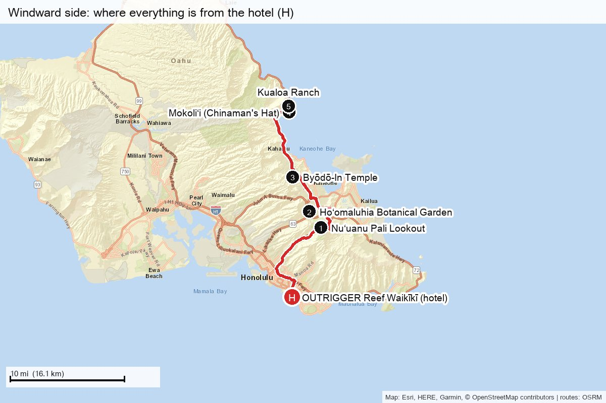</a> <a href="maps/area_oahu_windward_sat.jpg">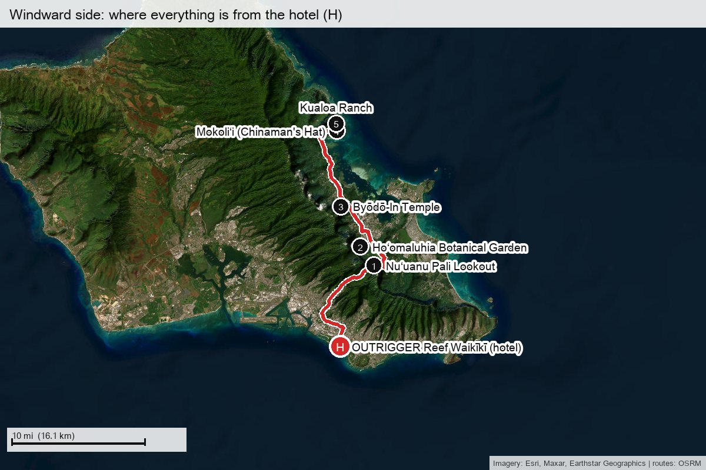</a>

| Pin | Place | From the hotel | Drive (no traffic) | Map |
|:-:|---|---:|---:|---|
| 1 | Nuʻuanu Pali Lookout | 13.2 mi | 26 min | [▶ directions](https://www.google.com/maps/dir/?api=1&origin=21.27825,-157.83279&destination=21.36670,-157.79330&travelmode=driving) · [pin](https://www.google.com/maps/@?api=1&map_action=map&center=21.36670,-157.79330&zoom=15&basemap=roadmap) |
| 2 | Hoʻomaluhia Botanical Garden | 14.6 mi | 33 min | [▶ directions](https://www.google.com/maps/dir/?api=1&origin=21.27825,-157.83279&destination=21.38700,-157.80900&travelmode=driving) · [pin](https://www.google.com/maps/@?api=1&map_action=map&center=21.38700,-157.80900&zoom=15&basemap=roadmap) |
| 3 | Byōdō-In Temple | 16.2 mi | 35 min | [▶ directions](https://www.google.com/maps/dir/?api=1&origin=21.27825,-157.83279&destination=21.43088,-157.83183&travelmode=driving) · [pin](https://www.google.com/maps/@?api=1&map_action=map&center=21.43088,-157.83183&zoom=15&basemap=roadmap) |
| 4 | Mokoliʻi (Chinaman's Hat) | 22.8 mi | 49 min | [▶ directions](https://www.google.com/maps/dir/?api=1&origin=21.27825,-157.83279&destination=21.51297,-157.83675&travelmode=driving) · [pin](https://www.google.com/maps/@?api=1&map_action=map&center=21.51297,-157.83675&zoom=15&basemap=roadmap) |
| 5 | Kualoa Ranch | 22.9 mi | 49 min | [▶ directions](https://www.google.com/maps/dir/?api=1&origin=21.27825,-157.83279&destination=21.52083,-157.83726&travelmode=driving) · [pin](https://www.google.com/maps/@?api=1&map_action=map&center=21.52083,-157.83726&zoom=15&basemap=roadmap) |

<b>Photos</b>

**📸 Nuʻuanu Pali Lookout**

  

Photos: [Lukas from Tokyo, Japan](https://commons.wikimedia.org/wiki/File:Cliffs_of_the_Koolau_Range,_Oahu_58.jpg), CC BY 2.0 · [Bernard Spragg. NZ](https://commons.wikimedia.org/wiki/File:Oahu_Landscape.jpg), CC0 · [InSapphoWeTrust from Los Angeles, California, USA](https://commons.wikimedia.org/wiki/File:Pali_Lookout_(5721444258).jpg), CC BY-SA 2.0 (Wikimedia Commons)

**📸 Kualoa Ranch**

  

Photos: [Cristo Vlahos](https://commons.wikimedia.org/wiki/File:Chinaman%27s_Hat_-_Oahu_Hawaii.JPG), CC BY-SA 3.0 · [Schm6041](https://commons.wikimedia.org/wiki/File:Jurassic_Valley.jpg), CC BY 4.0 · [Hakilon](https://commons.wikimedia.org/wiki/File:Kaneohe_Bucht.jpg), CC BY-SA 3.0 (Wikimedia Commons)

**📸 Mokoliʻi (Chinaman's Hat)**

 

Photos: [Tonchino](https://commons.wikimedia.org/wiki/File:Mokoli%27i_islet_Chinaman%27s_Hat.JPG), CC BY-SA 3.0 · [No machine-readable author provided. Caracas1830 assumed (ba](https://commons.wikimedia.org/wiki/File:Chinaman%27s_Hat_-_Mokoli%CA%BBi_(O%27ahu).JPG), CC BY-SA 2.5 (Wikimedia Commons)

**📸 Byōdō-In Temple**

  

Photos: [Puneet Abbott](https://commons.wikimedia.org/wiki/File:Byodo-In_Temple_in_Hawaii.jpg), CC BY 2.0 · [Cristo Vlahos](https://commons.wikimedia.org/wiki/File:Byodo-In_Temple_Oahu_01.jpg), CC BY-SA 3.0 · [Thomas Woodtli from Zürich, Switzerland](https://commons.wikimedia.org/wiki/File:Byodo-In_Temple,_Oahu_(27590505020).jpg), CC BY-SA 2.0 (Wikimedia Commons)

**📸 Hoʻomaluhia Botanical Garden**

  

Photos: [Daderot.](https://commons.wikimedia.org/wiki/File:Ho%27omaluhia_Botanical_Garden_-_lake_view.JPG), CC BY-SA 3.0 · [Daderot.](https://commons.wikimedia.org/wiki/File:Ho%27omaluhia_Botanical_Garden_-_mountain_view.JPG), CC BY-SA 3.0 · [Daderot.](https://commons.wikimedia.org/wiki/File:Ho%27omaluhia_Botanical_Garden_-_tree_view.JPG), CC BY-SA 3.0 (Wikimedia Commons)

Mokoliʻi, off Kualoa · [Photo: Andrew Shoemaker](https://www.andrewshoemaker.com/photo/mokolii-chinamans-hat-oahu-hawaii/)

### North Shore (full day; tour or car) · ❌ not in the plan

Dropped because it's a long day and **November is big-surf season**: the beaches are for watching expert surfers, not swimming. If you change your mind, it replaces Pearl Harbor on Nov 2, because it needs a full day (guided tour ~$200–350 for two).

| Thing | Why | Notes |
|---|---|---|
| **Haleʻiwa town** | Surf town, shave ice, food trucks | Garlic shrimp trucks around Kahuku |
| **Waimea Bay, Sunset Beach, Banzai Pipeline** | Famous winter surf breaks | Watch from the sand; strong currents |
| **Laniākea** | Green sea turtles often resting on the beach | Keep 10 ft away |
| **Waimea Valley** | Botanical garden walk to a waterfall | ~$25/pp, 2–3 h |
| **Dole Plantation** | Pineapple stop on the drive up | Grounds free |
| **Polynesian Cultural Center** | Pacific island villages + evening show | Half to full day, from ~$90/pp; far from Waikīkī |

<!-- map:area_oahu_north -->
**🗺️ North Shore: where these are from the hotel (H).** Getting there without a car: Full-day tour (not in the plan).

<a href="maps/area_oahu_north_street.jpg">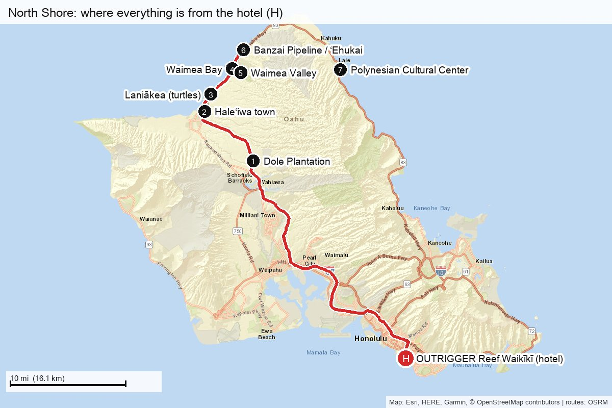</a> <a href="maps/area_oahu_north_sat.jpg">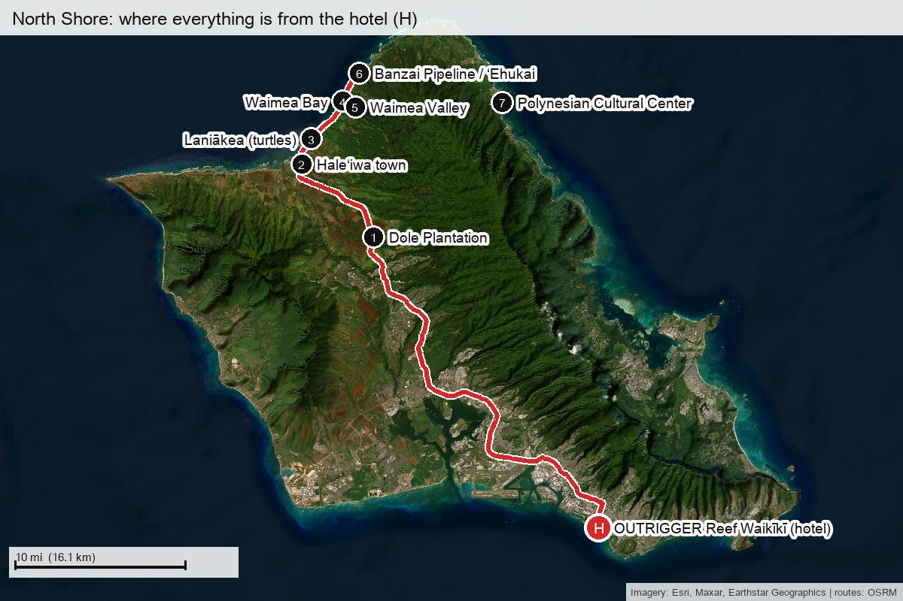</a>

| Pin | Place | From the hotel | Drive (no traffic) | Map |
|:-:|---|---:|---:|---|
| 1 | Dole Plantation | 27.3 mi | 45 min | [▶ directions](https://www.google.com/maps/dir/?api=1&origin=21.27825,-157.83279&destination=21.52591,-158.03780&travelmode=driving) · [pin](https://www.google.com/maps/@?api=1&map_action=map&center=21.52591,-158.03780&zoom=15&basemap=roadmap) |
| 2 | Haleʻiwa town | 34.1 mi | 58 min | [▶ directions](https://www.google.com/maps/dir/?api=1&origin=21.27825,-157.83279&destination=21.58763,-158.10356&travelmode=driving) · [pin](https://www.google.com/maps/@?api=1&map_action=map&center=21.58763,-158.10356&zoom=15&basemap=roadmap) |
| 3 | Laniākea (turtles) | 35.5 mi | 59 min | [▶ directions](https://www.google.com/maps/dir/?api=1&origin=21.27825,-157.83279&destination=21.60918,-158.09485&travelmode=driving) · [pin](https://www.google.com/maps/@?api=1&map_action=map&center=21.60918,-158.09485&zoom=15&basemap=roadmap) |
| 4 | Waimea Bay | 38.3 mi | 66 min | [▶ directions](https://www.google.com/maps/dir/?api=1&origin=21.27825,-157.83279&destination=21.64100,-158.06600&travelmode=driving) · [pin](https://www.google.com/maps/@?api=1&map_action=map&center=21.64100,-158.06600&zoom=15&basemap=roadmap) |
| 5 | Waimea Valley | 39.1 mi | 70 min | [▶ directions](https://www.google.com/maps/dir/?api=1&origin=21.27825,-157.83279&destination=21.63637,-158.05480&travelmode=driving) · [pin](https://www.google.com/maps/@?api=1&map_action=map&center=21.63637,-158.05480&zoom=15&basemap=roadmap) |
| 6 | Banzai Pipeline / ʻEhukai | 40.7 mi | 71 min | [▶ directions](https://www.google.com/maps/dir/?api=1&origin=21.27825,-157.83279&destination=21.66484,-158.05091&travelmode=driving) · [pin](https://www.google.com/maps/@?api=1&map_action=map&center=21.66484,-158.05091&zoom=15&basemap=roadmap) |
| 7 | Polynesian Cultural Center | 34.6 mi | 74 min | [▶ directions](https://www.google.com/maps/dir/?api=1&origin=21.27825,-157.83279&destination=21.64025,-157.92044&travelmode=driving) · [pin](https://www.google.com/maps/@?api=1&map_action=map&center=21.64025,-157.92044&zoom=15&basemap=roadmap) |

<b>Photos</b>

**📸 Haleʻiwa town**

Photos: [Ken Lund from Reno, Nevada, USA](https://commons.wikimedia.org/wiki/File:Liliuokalani_Protestant_Church,_Haleiwa,_Hawaii_(4549284204).jpg), CC BY-SA 2.0 (Wikimedia Commons)

**📸 Waimea Bay, Sunset Beach, Banzai Pipeline**

  

Photos: [Diego Delso](https://commons.wikimedia.org/wiki/File:Sunset_Beach,_Oahu,_Hawaii,_USA4.jpg), CC BY-SA 3.0 · [The Eloquent Peasant](https://commons.wikimedia.org/wiki/File:Sunset_at_Sunset_Beach,_Pupukea,_Oahu,_Hawaii.jpg), CC BY-SA 4.0 · [Travisthurston](https://commons.wikimedia.org/wiki/File:WaimeaBay.jpg), CC BY-SA 3.0 (Wikimedia Commons)

**📸 Laniākea (turtles)**

 

Photos: [BjL1504](https://commons.wikimedia.org/wiki/File:Sea_turtles_at_Laniakea_Beach,_Hawaii.jpg), CC BY-SA 4.0 · [verygreen](https://commons.wikimedia.org/wiki/File:Laniakea_Turtle_Beach_-_panoramio.jpg), CC BY-SA 3.0 (Wikimedia Commons)

**📸 Waimea Valley**

 

Photos: [Shocked-Lemur983](https://commons.wikimedia.org/wiki/File:Waimea_Valley.jpg), CC BY-SA 4.0 · [Daderot.](https://commons.wikimedia.org/wiki/File:Waimea_Valley_Audubon_Center,_Oahu,_Hawaii_-_lake_view.JPG), CC BY-SA 3.0 (Wikimedia Commons)

**📸 Dole Plantation**

 

Photos: [Ramon FVelasquez](https://commons.wikimedia.org/wiki/File:Dolejf2103.JPG), CC BY-SA 3.0 · [Alvesgaspar](https://commons.wikimedia.org/wiki/File:Ananas~May_2008-1.jpg), CC BY-SA 3.0 (Wikimedia Commons)

**📸 Polynesian Cultural Center**

 

Photos: [Daniel Ramirez from Honolulu, USA](https://commons.wikimedia.org/wiki/File:Polynesian_Cultural_Center_-_Canoe_Pageant_(8328375917).jpg), CC BY 2.0 · [JayH](https://commons.wikimedia.org/wiki/File:Polynesian_Cultural_Center_Rower.jpg), Public domain (Wikimedia Commons)

Kaʻaʻawa · [Photo: Andrew Shoemaker](https://www.andrewshoemaker.com/photo/kaaawa-sands-north-shore-oahu-hawaii/)

### Evenings
- **Lūʻau:** Oʻahu has several (beach lūʻau west of Honolulu, hotel lūʻau in Waikīkī). If you want one lūʻau on the trip, doing it on Maui is easier (see [`maui.md`](maui.md)).
- **Sunset cocktails:** Waikīkī beachfront bars with live Hawaiian music most evenings.
- **Halloween on Kalākaua (Oct 31):** big street crowd and costumes.

<b>Photos</b>

**📸 Lūʻau**

  

Photos: [Shawn Lea from Jackson, MS, US](https://commons.wikimedia.org/wiki/File:Luau-hula-SL.jpg), CC BY 2.0 · [Matt](https://commons.wikimedia.org/wiki/File:Luau_Dancer_-_Maui,_Hawaii.jpg), CC BY-SA 2.0 · [Luke H. Gordon from Greenwood Lake, NY, USA](https://commons.wikimedia.org/wiki/File:Old_Lahaina_Luau_2009-07.jpg), CC BY 2.0 (Wikimedia Commons)

---

## 🍽️ Food ideas (no reservations needed unless noted)
- **Breakfast/brunch:** cafés on Kapahulu and Monsarrat Ave near Diamond Head; açaí bowls and malasadas (Portuguese doughnuts) are the local classics.
- **Poke + plate lunch:** grab-and-go poke bowls, loco moco, garlic shrimp.
- **Shave ice:** a must at least once.
- **Lactose intolerance:** malasadas, haupia (coconut) desserts and many plate lunches can contain dairy; ask. Poke and most Japanese food are safe bets.
- **One nicer dinner:** reserve a Waikīkī oceanfront restaurant for Oct 31 or Nov 2 if you want a sunset table.

<b>Photos</b>

**📸 Shave ice**

 

Photos: [_e.t from Saratoga, USA](https://commons.wikimedia.org/wiki/File:Hawaiian_Blizzard_syrup.jpg), CC BY-SA 2.0 · [AlaskaDave](https://commons.wikimedia.org/wiki/File:Hilo_Ice_Shave.JPG), CC BY-SA 3.0 (Wikimedia Commons)

**📸 Malasadas**

 

Photos: [Sherbeey](https://commons.wikimedia.org/wiki/File:Malassadas_from_Leonard%27s_Bakery.jpg), CC0 · [Ken Lund from Las Vegas, Nevada, USA](https://commons.wikimedia.org/wiki/File:Leonard%27s_Bakery,_Honolulu,_Hawaii_(4540006860).jpg), CC BY-SA 2.0 (Wikimedia Commons)

**📸 Poke + plate lunch**

  

Photos: [Andy Li](https://commons.wikimedia.org/wiki/File:Fried_Tofu_Poke_Bowl_(S)_with_kimchi_sauce_-_Kitokito.jpg), CC0 · [christian razukas from Honolulu, Hawaii](https://commons.wikimedia.org/wiki/File:Wardsplatelunch.jpg), CC BY-SA 2.0 · [BrokenSphere](https://commons.wikimedia.org/wiki/File:L%26L_Hawaiian_BBQ_beef_curry_meal.JPG), CC BY-SA 3.0 (Wikimedia Commons)

**📸 Açaí bowl**

Photos: [chahayes](https://commons.wikimedia.org/wiki/File:Acai_bowl_-_A%C3%A7a%C3%AD_na_tigela.jpg), CC BY 2.0 (Wikimedia Commons)

---

## 🌧️ Rain and backup swaps

| If… | Then… |
|---|---|
| Rain on Nov 1 | Swap: Pearl Harbor (if you have tickets for Nov 1, or try the next-day release) and Diamond Head on Nov 2 (re-book the slot) · or Bishop Museum / ʻIolani Palace |
| No USS Arizona tickets | Visit the free visitor-center museums + Battleship Missouri anyway, or book a tour package that includes the Arizona program |
| Diamond Head sold out | Makapuʻu Lighthouse Trail (no reservation) or Lanikai Pillbox, by rideshare/tour |
| Jet-lagged | Keep Oct 31 and the Nov 2 afternoon empty; it's built for that |

---

## 💵 Oʻahu costs (two people)

| Item | Estimate |
|---|---:|
| Hotel, 3 nights | $1,050–1,500 |
| Airport transfers both ways | ~$80–160 |
| Rideshares (Diamond Head, Pearl Harbor) | ~$80–120 |
| Diamond Head + USS Arizona | ~$12 |
| Optional: Bishop Museum | ~$60 |
| Optional: surf lesson | ~$200–300 |
| Meals, 3 days | ~$300–450 |

---

## 🧭 Practical notes
- **Time:** Hawaiʻi Standard Time, no daylight saving. 6 h behind NYC on Oct 31, 5 h from Nov 1.
- **Sunrise/sunset:** roughly 6:35 AM / 6:00 PM in early November.
- **Weather:** high 70s–mid 80s °F, short passing showers, more rain on the windward side.
- **Reef-safe sunscreen:** Hawaiʻi bans oxybenzone and octinoxate.
- **Ocean safety:** swim at lifeguarded beaches; November swells hit north-facing shores hardest. Never turn your back on the ocean.
- **Turtles and monk seals:** stay at least 10 ft from turtles and 50 ft from seals.

## Sources
- [Diamond Head reservations (Hawaiʻi State Parks)](https://gostateparks.hawaii.gov/diamondhead/about) · [Hawaii-Guide: Diamond Head](https://www.hawaii-guide.com/oahu/diamond-head-reservations)
- [Pearl Harbor National Memorial on recreation.gov](https://www.recreation.gov/ticket/facility/233338?tab=info)
- [Hanauma Bay (City & County of Honolulu)](https://www.honolulu.gov/dpr/hanauma-bay-nature-preserve/)
- [Hawaii-Guide: Oʻahu sights](https://www.hawaii-guide.com/oahu/sights) (fees, hours and time needed for the "everything else" tables)
- Flight times from the live search in [`bookings.md`](bookings.md); hotel and budget numbers from [`references.md`](references.md) docs #1, #3, #6.
- Photos: [Andrew Shoemaker, Hawaiʻi landscapes](https://www.andrewshoemaker.com/gallery/paradise-hawaii-landscape-photography/); copyright stays with the photographer. Gallery photos: Wikimedia Commons, credited under each set.
