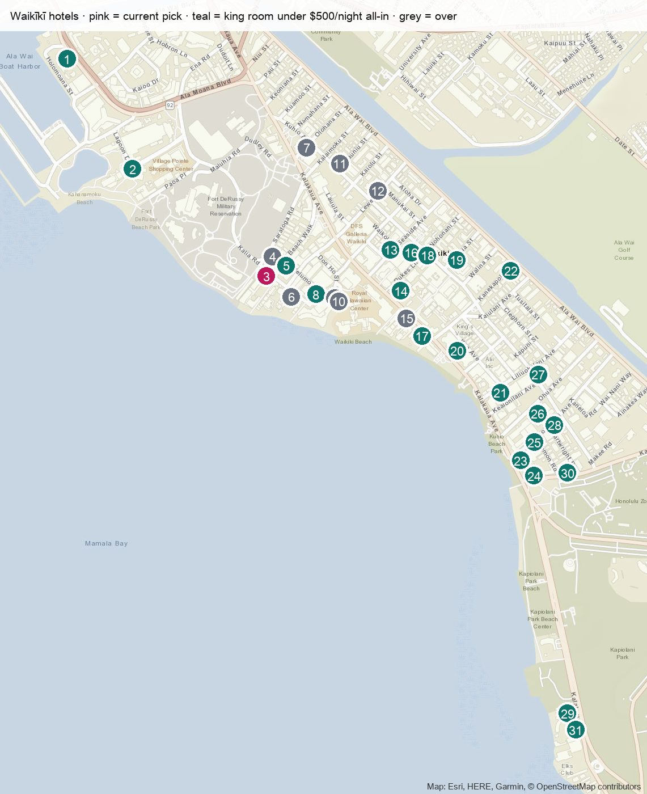

# Oʻahu hotel research (Oct 31 → Nov 3, 2026)

> 34 hotels priced live on Booking.com on **2026-10-18** for 2 adults, 3 nights.
> **All-in = Booking.com 3-night total (includes resort fee) × 1.18712 tax.** Budget cap: $500/night all-in, so $1,500 for 3 nights.
> Open [`index.html`](index.html) in a browser for the interactive map, price chart and sortable table.

## Verdict
**Book OUTRIGGER Reef, Partial Ocean View King: $1,197 on Booking.com → ~$1,421 all-in (~$474/night).**
It's on the sand, has a lanai, and sits on the quiet Kalia Road end on Halloween night. Free cancellation before Oct 28; you pay nothing until Oct 26.
For the cheapest option, the Standard King "Late Escape Deal" is $1,107 → ~$1,314 all-in.

## Shortlist

| # | Hotel (pin) | Room | All-in, 3 nights | Per night | Why |
|---|---|---|---|---|---|
| 1 | **OUTRIGGER Reef** (3) | Partial Ocean View King | **$1,421** | $474 | On the sand, lanai, quiet end, 8.8/10 |
| 2 | Kaimana Beach (29) | Diamond Head View King | $1,161 | $387 | On the sand at the quiet Kapiʻolani Park end; small rooms |
| 3 | Hilton Hawaiian Village (2) | Tapa King Ocean View | $1,184 | $395 | Full resort, lagoon, Friday fireworks; far west end |
| 4 | Hyatt Regency (20) | King Oceanfront | $1,498 | $499 | Right at the cap; faces Kalākaua (Halloween noise) |
| 5 | Halepuna (8) | Standard Waikīkī View King | $1,495 | $498 | No resort fee, 9.1/10; no ocean view |
| 6 | Twin Fin (23) | Premier Oceanfront King | $1,131 | $377 | Value pick; 7.9/10 |

## Map

Pins are numbered west to east. Pink is the current pick, teal has a king room under the cap, and grey is over budget. The Kahala, Turtle Bay and Four Seasons Ko Olina are outside Waikīkī; all three are over budget.

## Before booking
- The **Oct 5 – Dec 18 pool closure is at OUTRIGGER Waikīkī Beach Resort, not the Reef.** That hotel's guests use the Reef's pool, so expect it to be busier. Call the Reef to confirm.
- **Halloween is Sat Oct 31.** There are big crowds on Kalākaua. Hotels facing Kalākaua get loud, while the Reef (on Kalia Rd) is calmer.
- **Marriott balconies:** they were locked for repairs in 2026; confirm they're open.
- **ʻAlohilani "Ocean View"** rooms don't face the water directly.

## Files
| File | What |
|---|---|
| [`index.html`](index.html) | Designed review page: map, chart, shortlist, full table |
| [`hotels.json`](hotels.json) | All 34 hotels: coordinates, rooms and prices, fees, reviews, pros and cons, deals, sources |
| [`notes.md`](notes.md) | Closures, events, deals and how the prices work |
| [`booking_live_2026-10-18.csv`](booking_live_2026-10-18.csv) | Raw Booking.com search snapshot |
| `hotels.js`, `map_*.jpg` | Generated by `tools/basemap.py` then `tools/build.py` |
