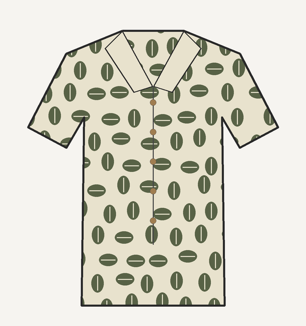
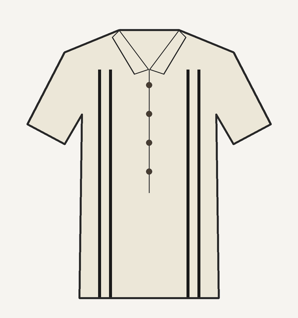
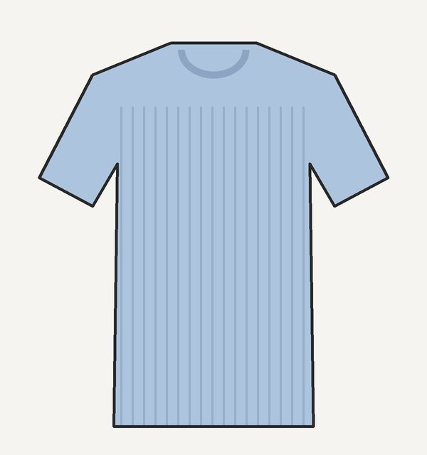
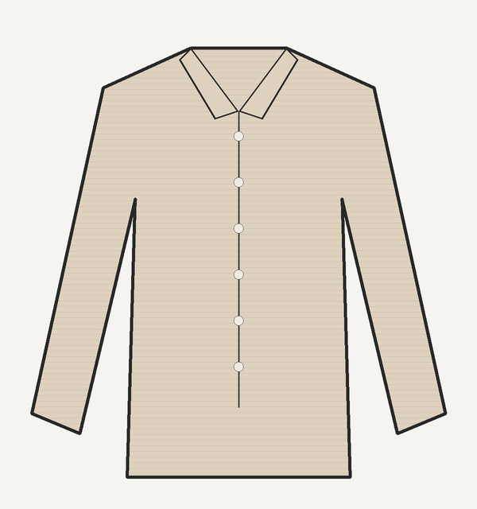
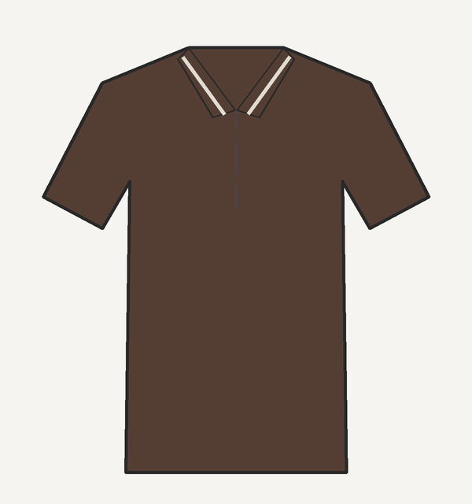
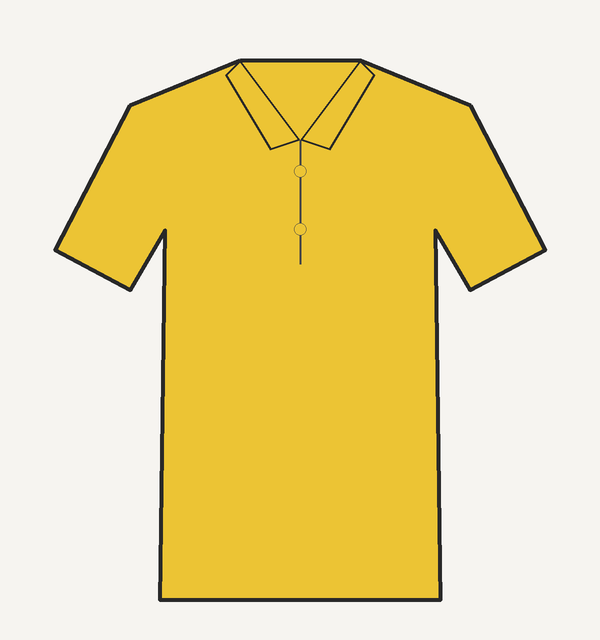
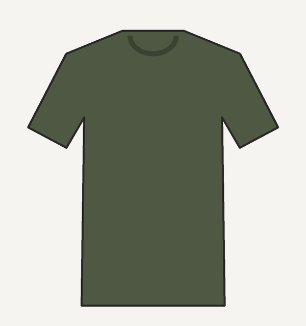
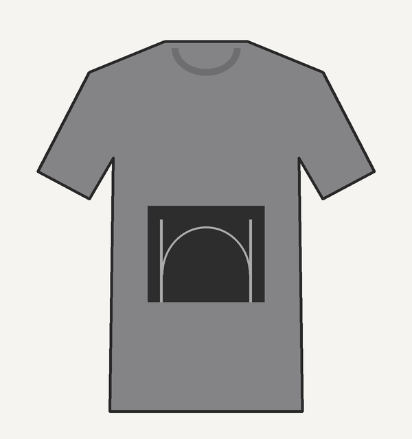

# 🛍️ Clothing shopping (before Oct 31)

> **Wed Oct 28, from ~5:30 PM** · World Trade Center + Brookfield Place, Lower Manhattan · Thu/Fri as backup
> Budget **$300–500** (aim for $350–450 before tax) · estimated waist **36** (try 36 and 38)
> Live checklist with a Status/Paid column: [Hawaiʻi Trip Shopping & Outfits doc](https://claude.ai/artifact/LULsbrd33NXYHvEnLuBF4p). Source: the shopping-plan email of Oct 27. Packing: [`packing.md`](packing.md).

## Strategy
The vacation tops are mostly fine; the gap is **bottoms**, since the old pants and shorts no longer fit comfortably. Buy for fit and breathable fabric, not the size label or a discount. Only buy what you can take home the same day.

## Shopping list
Prices are targets, not confirmed store prices. **Core basket** = 1, 2, 4, 5, 6, 7, 9 (about $230–370); add 3 and 8 only if fit and budget allow.

| # | Item | Color / fit | Try | Target | Where |
|---|---|---|---|---|---|
| 1 | Lightweight dinner trousers | Stone/cream, relaxed or straight | 36, 38 | $60–90 | Banana Republic, J.Crew |
| 2 | Chino shorts | Beige/stone, 7–9" inseam | 36, 38 | $35–55 | J.Crew, UNIQLO |
| 3 | Dark chino shorts | Navy/black | 36, 38 | $30–50 | J.Crew, UNIQLO |
| 4 | Relaxed elastic-waist shorts | Olive/stone | L, XL | $30–45 | UNIQLO |
| 5 | Swim trunks | Black/navy, quick-dry, drawstring | — | $20–35 | Target Tribeca / athletic stores (check stock online first) |
| 6 | Second swim trunks | Aqua/teal or another color | — | $20–35 | same |
| 7 | Performance shorts | Black, hikes and boats | L, XL | $25–35 | UNIQLO |
| 8 | Second evening trousers | Gray/charcoal/navy linen blend | 36, 38 | $50–85 | Banana Republic, J.Crew |
| 9 | Replacement tropical shirt | Olive floral / subtle print, relaxed | XL, XXL | $35–70 | Marine Layer |

**Outside this budget:** rash guard for snorkeling, non-slip walking shoes or sandals, sunglasses and cap, packable rain shell, warm layers for Haleakalā.

## Route
1. **UNIQLO**, World Trade Center (18 Church St): set your size in easy/linen-blend shorts and relaxed pants; compare L vs XL and 36 vs 38.
2. **Banana Republic**, WTC/Oculus: stone/cream linen-blend trousers, matched against the striped knit.
3. **J.Crew**, Brookfield Place (230 Vesey St): chino shorts and refined trousers.
4. **Marine Layer**, Brookfield Place: roomier replacement tropical shirt.
5. Optional: Bonobos Guideshop (may ship instead of hand over, risky before Oct 31).

Reconfirm Wednesday hours before leaving; some shops close around 7–8 PM, so buy the essentials first.

## What you already own
Illustrations of the 8 tops in [`photos/wardrobe/`](photos/wardrobe) ([all on one sheet](photos/wardrobe/00_contact_sheet.png)): simple drawings made from the original photos, matching each garment's color and pattern, with no people or rooms. Tagged sizes are from the labels; fit is judged in person.

| Drawing | Top | Best use |
|---|---|---|
|  | Green tropical short-sleeve shirt (olive/cream) | Hawaiʻi print, but snug through the middle: replace if possible |
|  | Cream/black striped Banana Republic knit (XL) | Birthday dinner |
|  | Light blue ribbed Cofandy knit (XL) | Sunset dinners, with charcoal trousers |
|  | Light beige long-sleeve textured button-down | Worn open over a tee at the beach, or rolled up for evenings |
|  | Brown Banana Republic polo (XL) | Casual / evening |
|  | Yellow Nautica polo (XL) | With navy or dark shorts |
|  | Dark olive Mode One T-shirt | Daytime basic |
|  | Gray graphic T-shirt | Casual backup |

## Outfits
| Occasion | Outfit |
|---|---|
| Waikīkī exploring | Green tropical shirt (or the replacement) + beige chino shorts + sneakers/sandals |
| 🎂 Birthday dinner, Nov 6 | Cream striped Banana Republic knit + stone/cream trousers + loafers or clean minimal shoes (darker stone if too pale) |
| Sunset date | Light blue ribbed knit + charcoal/light gray trousers + clean sneakers |
| Sightseeing | Yellow Nautica polo + navy/dark chino shorts; activewear for real trails |
| Beach / pool | Beige button-down worn open + black swim trunks |
| Alternate dinner | Brown polo or beige button-down + navy/gray trousers |
| Casual day | Olive tee or gray graphic tee + relaxed shorts |
| 🎃 Halloween, Oct 31 | Couples costume (undecided: Obsessed girl and boy, or Monica and Chandler) |

## Fitting-room checklist
- [ ] Bring or photograph the cream striped knit to match trousers
- [ ] Try 36 and 38 in fixed-waist bottoms; L and XL in elastic-waist
- [ ] Sit, stand, walk, bend: nothing pinches the waist or pulls at the thigh
- [ ] Shorts at 7–9" inseam; tropical shirt drapes without buttons pulling
- [ ] Front and side photos to compare cuts
- [ ] Check return/exchange rules; skip final sale; take it home today

> Source: the Oct 27 shopping email and the wardrobe photo package. The drawings are approximations of the real garments; the original photos are not in the repo.
