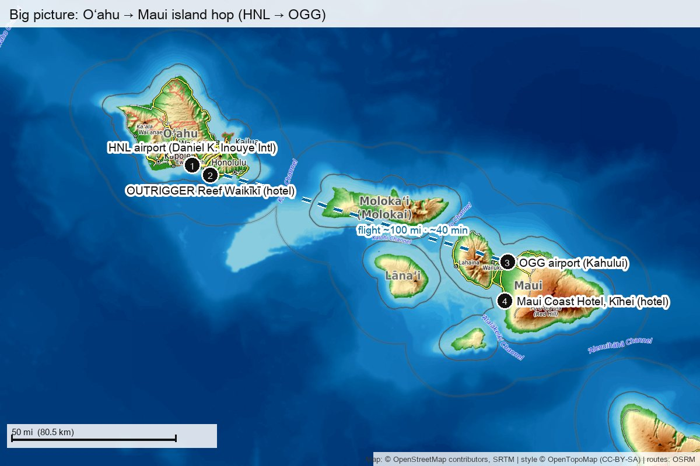
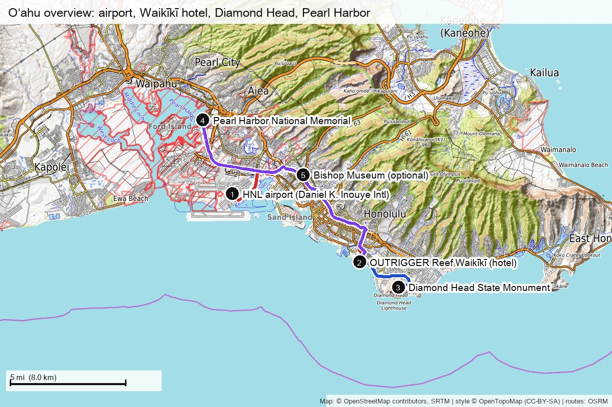
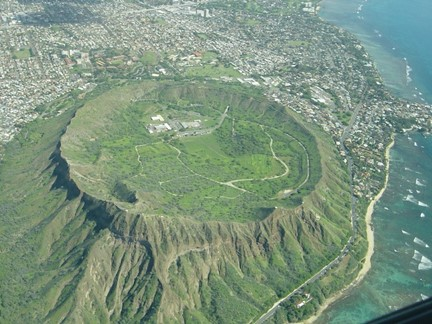
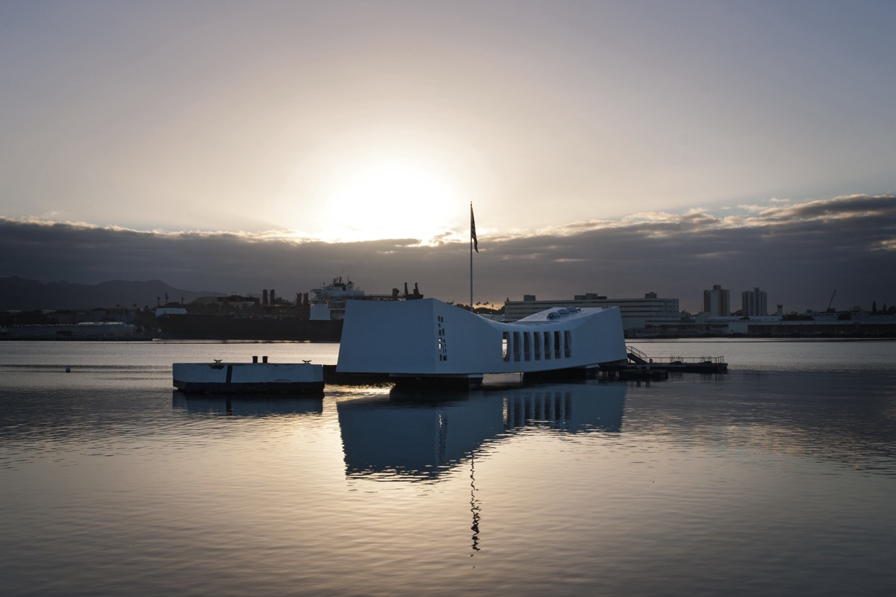
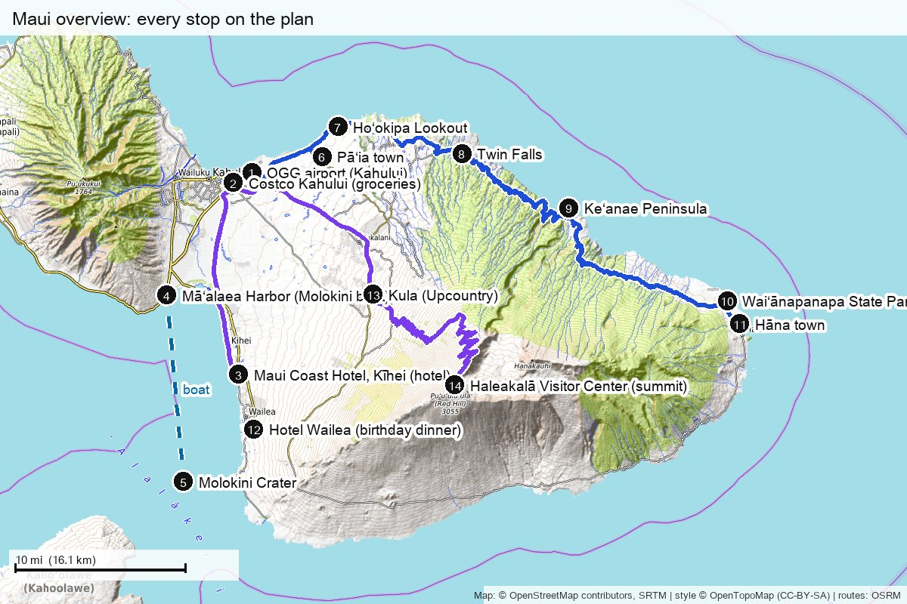
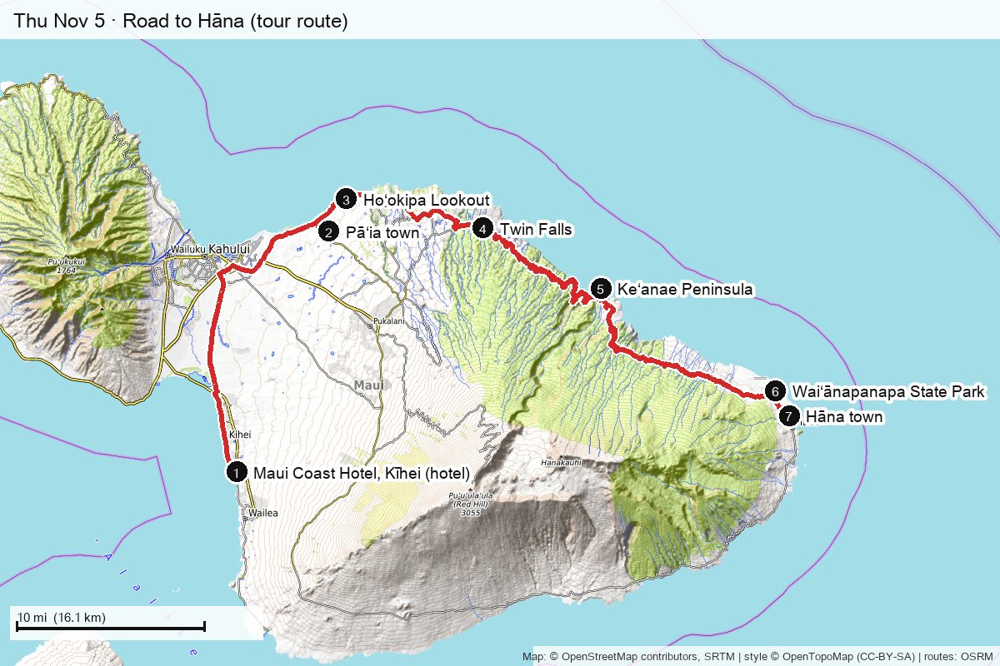

# 🌺 Hawaiʻi 2026: the plan

  

  <b>Sat Oct 31 → Sun Nov 8, 2026</b> · 8 nights · <b>Oʻahu</b> (3 nights, no car) → <b>Maui</b> (5 nights, rental car) 
  🎂 Shivam's birthday on Maui, <b>Fri Nov 6</b> · back in NYC <b>Mon Nov 9</b> · office Tue Nov 10

> **This is the clean, final view of the trip.** It only holds what's decided (✅) or what we're clearly leaning toward and just need to confirm (🟡).
> Every option, the research, and backups live in [`overall_plan.md`](overall_plan.md), [`oahu.md`](oahu.md) and [`maui.md`](maui.md). Maps and drive times are in [`map.md`](map.md). Hotel research is in [`hotels.md`](hotels.md).
> Last updated **2026-10-18** · Status: 🟢 plan agreed · 🔴 **nothing booked yet** (see [`bookings.md`](bookings.md))

## 📑 Contents

- [The trip on one page](#one-page)
- [Booking status](#status)
- [🌺 Oʻahu · Oct 31 – Nov 3](#oahu)
  - [Sat Oct 31 · Aloha, Waikīkī](#oct31)
  - [Sun Nov 1 · Diamond Head sunrise](#nov1)
  - [Mon Nov 2 · Pearl Harbor](#nov2)
- [🌋 Maui · Nov 3 – Nov 8](#maui)
  - [Tue Nov 3 · Island hop to Maui](#nov3)
  - [Wed Nov 4 · Molokini snorkel](#nov4)
  - [Thu Nov 5 · Road to Hāna](#nov5)
  - [Fri Nov 6 · 🎂 Birthday](#nov6)
  - [Sat Nov 7 · Haleakalā sunset](#nov7)
  - [Sun Nov 8 · Fly home](#nov8)
- [Travel at a glance](#travel)
- [Rough cost](#cost)
- [🟡 Still to confirm](#open)

---

## 🗓️ The trip on one page

| | Date | Where we sleep | The day in one line |
|---|---|---|---|
| ✈️ | **Sat Oct 31** | 🌺 OUTRIGGER Reef, Waikīkī | Fly JFK → HNL nonstop, sunset beach walk, early night |
| 🥾 | **Sun Nov 1** | 🌺 OUTRIGGER Reef | **Diamond Head** at opening, brunch, beach afternoon |
| ⚓ | **Mon Nov 2** | 🌺 OUTRIGGER Reef | **Pearl Harbor / USS Arizona**, free afternoon, pack |
| 🛫 | **Tue Nov 3** | 🌋 Maui Coast Hotel, Kīhei | Midday hop HNL → OGG, pick up car, groceries, pool |
| 🤿 | **Wed Nov 4** | 🌋 Maui Coast Hotel | **Molokini + Turtle Arches** snorkel 🟡 |
| 🌿 | **Thu Nov 5** | 🌋 Maui Coast Hotel | **Road to Hāna** guided tour 🟡 (first to drop if tired) |
| 🎂 | **Fri Nov 6** | 🌋 Maui Coast Hotel | **Birthday:** no alarm, beach, spa?, **Hotel Wailea** sunset dinner 🟡 |
| 🌅 | **Sat Nov 7** | 🌋 Maui Coast Hotel | **Haleakalā sunset** at 10,000 ft (self-drive) |
| 🏠 | **Sun Nov 8** | ✈️ overnight flight | Slow morning, return car, OGG → NYC |
| 🗽 | **Mon Nov 9** | Home | Land NYC in the morning · office Nov 10 |

## 📋 Booking status

| | What | Status | Book by |
|---|---|---|---|
| ✈️ | JFK → HNL, Oct 31 | ⬜ to book | **Oct 19** |
| ✈️ | HNL → OGG, Nov 3 | ⬜ to book | **Oct 19** |
| ✈️ | OGG → NYC, Nov 8 (lands Nov 9) | ⬜ to book | **Oct 19** |
| 🏨 | OUTRIGGER Reef, Oct 31 → Nov 3 | ⬜ to book | **Oct 19** |
| 🏨 | Maui Coast Hotel, Nov 3 → Nov 8 | ⬜ to book | **Oct 19** |
| 🚗 | Maui rental car, OGG Nov 3 → 8 | ⬜ to book | **Oct 19** |
| 🚐 | HNL → Waikīkī transfer | ⬜ to book | Oct 24 |
| 🎟️ | Diamond Head timed entry, Nov 1 | ⬜ to book | **Now** (sells out) |
| 🎟️ | USS Arizona program, Nov 2 | ⬜ to book | **Now**, or the next-day release Nov 1 at 3 PM HST |
| 🎟️ | Molokini snorkel, Nov 4 | ⬜ to book | Oct 24 |
| 🎟️ | Hāna guided tour, Nov 5 | ⬜ to book | Oct 24 |
| 🍽️ | Hotel Wailea birthday dinner, Nov 6 | ⬜ to book | Oct 24 |

**0 of 12 booked.** When something is booked, change ⬜ to ✅, and put the confirmation number in [`bookings.md`](bookings.md).

---

## 🌺 Oʻahu · Oct 31 – Nov 3

  
   Waikīkī · <a href="https://www.andrewshoemaker.com/photo/waikiki-blue-beach-abstract-panorama/">Photo: Andrew Shoemaker</a>

| 🏨 Hotel | 🚶 Getting around | 💵 Budget rule |
|---|---|---|
| **OUTRIGGER Reef Waikīkī Beach Resort**, on the sand, 3 nights Fallbacks: Prince Waikīkī, OUTRIGGER Waikīkī | **No car.** Walk, prebooked airport transfer, rideshare to Diamond Head and Pearl Harbor | Under **$500/night** including taxes and resort fees · ~$1,050–1,500 total |

🗺️ Oʻahu map

### ✈️ Sat Oct 31 · Aloha, Waikīkī

> Long travel day. Land, check in, put your feet in the sand. Nothing time-sensitive.

| 🌅 Morning | ☀️ Afternoon | 🌙 Evening |
|---|---|---|
| ✈️ JFK → HNL nonstop: Delta 10:00 AM → 2:58 PM, or Alaska 8:55 AM → 2:10 PM | 🚐 Transfer to Waikīkī (30–45 min), check in, shower | 🌅 Sunset ~6 PM, beach walk, easy dinner near the hotel |

- 🎃 **It's Halloween.** Kalākaua Ave fills with costumes. Fun for an hour, skip it if you're tired.
- 🎒 In the carry-on: swimsuits, meds, a change of clothes, chargers.
- 🕐 Hawaiʻi is **6 hours behind NYC** today.

### 🥾 Sun Nov 1 · Diamond Head sunrise

> Jet lag helps: your body thinks 6 AM is noon. Hike the crater early, then slow down.

| 🌅 Morning | ☀️ Afternoon | 🌙 Evening |
|---|---|---|
| 🚕 6:00–6:30 rideshare (15 min) → **Diamond Head** hike, 1.6 mi round trip, 560 ft up, 1.5–2 h · 🥞 brunch on Monsarrat / Kapahulu Ave | 🏖️ Beach and pool. Optional beginner surf lesson (~$200–300 for two) | 🌅 Sunset on the beach by the Duke statue, dinner |

- 🎟️ **Timed entry**, $5/person on [gostateparks.hawaii.gov](https://gostateparks.hawaii.gov/diamondhead). Arrive within 30 min of your slot.
- 🧴 Little shade: water, hat, reef-safe sunscreen.
- 🕐 NYC falls back today, so Hawaiʻi is now **5 hours behind NYC**.

  
   Lēʻahi / Diamond Head · Photo: Hawaiʻi DLNR via <a href="https://www.usgs.gov/media/images/aerial-view-leahi-also-known-diamond-head-island-oahu-state-hawaii">USGS</a> (public domain)

### ⚓ Mon Nov 2 · Pearl Harbor

> A quiet, moving morning, then a free afternoon to pack for Maui.

| 🌅 Morning | ☀️ Afternoon | 🌙 Evening |
|---|---|---|
| 🚕 Rideshare (30–40 min) → **Pearl Harbor / USS Arizona**, arrive an hour before your slot | Pool, nap, shopping, or the optional Bishop Museum | 🧳 Pack, last Waikīkī dinner |

- 🎟️ **USS Arizona program**, $1/person on [recreation.gov](https://www.recreation.gov/ticket/facility/233338). If it's sold out, a second batch releases **Nov 1 at 3 PM HST**.
- 🎒 **No bags allowed**: only wallets, phones, cameras and clear water bottles. Leave bags at the hotel, or pay for storage by the entrance.
- ❌ North Shore tour is dropped: November surf is for watching, not swimming.

  
   USS Arizona Memorial · Photo: <a href="https://npgallery.nps.gov/AssetDetail/012586a0-1dd8-b71b-0bd8-6dfeaa2fee1c">National Park Service</a> (public domain)

---

## 🌋 Maui · Nov 3 – Nov 8

  
   Wailea Beach Path · <a href="https://www.andrewshoemaker.com/photo/wailea-essence-maui-beach-path/">Photo: Andrew Shoemaker</a>

| 🏨 Hotel | 🚗 Getting around | 📍 Why Kīhei |
|---|---|---|
| **Maui Coast Hotel, Kīhei**, Kai Tower king, 5 nights · ~$1,695 all-in | **Rental car** from OGG, Nov 3 → 8 | 22 min to the Molokini boat, 13 min to Hotel Wailea, the closest base for Haleakalā |

🗺️ Maui map

### 🛫 Tue Nov 3 · Island hop to Maui

> A travel day, kept light on purpose. Budget 4–6 hours door to door.

| 🌅 Morning | ☀️ Afternoon | 🌙 Evening |
|---|---|---|
| Breakfast, check out, 🚕 to HNL (leave ~2.5 h before the flight) | ✈️ Midday HNL → OGG (~$138 for two) · 🚗 pick up the car · 🛒 groceries in Kahului · check in | 🏊 Pool, Kamaʻole beach walk, casual dinner in Kīhei |

- ⚠️ The island hop is a separate ticket, so a delay on another flight isn't protected. Leave a buffer.
- 🛒 Buy water, snacks for Hāna and Haleakalā, and breakfast things.

### 🤿 Wed Nov 4 · Molokini snorkel 🟡

> Morning on the water inside a sunken volcanic crater, then nothing.

| 🌅 Morning | ☀️ Afternoon | 🌙 Evening |
|---|---|---|
| 🚗 Drive to Māʻalaea Harbor (25–40 min) · 🤿 **PacWhale Molokini + Turtle Arches**, ~5 h | Lunch, shower, nap, pool | Easy dinner nearby |

- 🎟️ ~$440 for two. There's **no hotel pickup**, so take the car and check in ~45 min early.
- 🦺 Ask for flotation vests if you're new to snorkeling. Turtles aren't guaranteed.
- 🌧️ If it's cancelled for weather, move it to Nov 5 or the morning of Nov 7.

  
   Molokini · <a href="https://www.andrewshoemaker.com/photo/molokini-blue-maui-hawaii-aerial-crater/">Photo: Andrew Shoemaker</a>

### 🌿 Thu Nov 5 · Road to Hāna 🟡

> 600 curves, 59 bridges, waterfalls and a black sand beach. Somebody else drives.

| 🌅 Morning | ☀️ Afternoon | 🌙 Evening |
|---|---|---|
| 🚐 Hotel pickup ~6:30–7:00 · Twin Falls, rainbow eucalyptus, Keʻanae | Waiʻānapanapa black sand beach, Hāna town | Back late, simple dinner |

- 🎟️ **Guided tour with hotel pickup**, ~$590–650 for two (e.g. [Tour Maui](https://www.tourmaui.com/tours/road-to-hana-tour/)). **Check that it includes Waiʻānapanapa.**
- 🎒 Layers, rain jacket, swimsuit, motion-sickness tablets, snacks. It's a 10–12 hour day.
- 🪫 **If the week feels too full, drop this day first.** Make it a slow Wailea beach day instead.

### 🎂 Fri Nov 6 · Birthday

> No alarm, no summit, no schedule. Just the beach, and a sunset dinner on the hill.

| 🌅 Morning | ☀️ Afternoon | 🌙 Evening |
|---|---|---|
| 😴 Sleep in, slow breakfast · 🏖️ Wailea Beach (calm) or Big Beach (wild) | 🏊 Pool, nap, optional couples spa 🟡, time to get ready | 🌅 Sunset stroll on the Wailea Beach Path → 🍽️ **The Restaurant at Hotel Wailea** 🟡 |

- 🍽️ Book a **5:15–5:45 PM** seating to catch the light (sunset ~5:47). When booking, mention **the birthday** and **lactose intolerance**, and ask for a dairy-free dessert.
- 🚕 13 min from the hotel. Take a rideshare if you're drinking.
- 💆 The spa is optional (~$400–700). If you want it, book by Oct 24.

  
   Mākena sunset · <a href="https://www.andrewshoemaker.com/photo/continuum-makena-maui-sunset/">Photo: Andrew Shoemaker</a>

### 🌅 Sat Nov 7 · Haleakalā sunset

> Above the clouds at 10,000 ft. The best sunset of the trip, and the coldest.

| 🌅 Morning | ☀️ Afternoon | 🌙 Evening |
|---|---|---|
| Slow morning, beach. Eat a real lunch and fill the tank | 🚗 **Leave Kīhei ~noon** and be inside the park by **2:30–3:00 PM** · viewpoints and short walks | 🌅 Sunset ~5:50 at the summit · drive down slowly in the dark · late dinner |

- 🎟️ $30 per car at the gate. **No reservation needed for sunset**, but there are capacity limits, so arrive ~3 hours early.
- 🧥 **It's 35–45 °F and windy up there.** Bring warm layers, hats, a wind jacket, water and snacks. There's no food or fuel in the park.
- ☁️ If the summit is closed: a South Maui beach day, or Upcountry (Kula, Makawao) in daylight.

  
   Haleakalā · <a href="https://bluehawaiianconcierge.com/activities/haleakala-sunset-tour/">Photo: Blue Hawaiian Concierge</a>

### 🏠 Sun Nov 8 · Fly home

> One last swim, then the overnight flight home.

| 🌅 Morning | ☀️ Afternoon | 🌙 Evening |
|---|---|---|
| Check out (ask for late checkout, or luggage storage + a shower) · pool or beach | Early dinner · ⛽ fill up · 🚗 return the car at OGG (30–45 min) | ✈️ Alaska 2:08 PM via HNL or AA 2:31 PM via LAX → **lands JFK Nov 9, morning** |

---

## 🧳 Travel at a glance

| | Leg | Plan | Notes |
|---|---|---|---|
| ✈️ | **Oct 31** JFK → HNL | Delta 10:00 AM → 2:58 PM, or Alaska 8:55 AM → 2:10 PM (nonstop) | Book on the airline's site |
| 🚐 | **Oct 31** HNL → Waikīkī | Prebooked transfer | 30–45 min with bags |
| ✈️ | **Nov 3** HNL → OGG | Midday, Southwest or Hawaiian, ~$138 for two | Separate ticket: leave buffer |
| 🚗 | **Nov 3 → 8** Maui | Rental car, pick up and return at OGG | Check card coverage |
| ✈️ | **Nov 8** OGG → JFK | Alaska 2:08 PM (via HNL) or AA 2:31 PM (via LAX) | **Must land Nov 9** |

| ⏰ Times to know | |
|---|---|
| Sunset, Waikīkī | ~6:00 PM |
| Sunset, Maui coast | ~5:45–5:50 PM |
| Sunset, Haleakalā summit | ~5:50 PM |
| Time zone | Hawaiʻi is **6 h behind NYC on Oct 31**, then **5 h behind** from Nov 1 (NYC falls back) |

## 💵 Rough cost (for two)

| | Estimate |
|---|---:|
| ✈️ Flights (all three legs) | $1,981–2,168 |
| 🏨 OUTRIGGER Reef, 3 nights | $1,050–1,500 |
| 🏨 Maui Coast Hotel, 5 nights | ~$1,695 |
| 🚗 Rental car + transfers + rides | $450–750 |
| 🎟️ Diamond Head, Arizona, Molokini, Hāna, Haleakalā | ~$1,070–1,130 |
| 🍽️ Birthday dinner | $220–400 |
| 🍽️ Other meals and groceries | $780–1,150 |
| 🧾 Tips, bags, souvenirs, buffer | $640–1,330 |
| **Total** | **≈ $7,900–10,100** |
| 💆 Optional birthday spa | + $400–700 |

Estimates are Oct 12 snapshots; [`budget.md`](budget.md) tracks actual spend and the split.

## 🟡 Still to confirm

These are in the plan above as our current leaning. Confirm by **Oct 21**, then change 🟡 to ✅ here and in [`overall_plan.md`](overall_plan.md).

- [ ] 🤿 **Nov 4:** Molokini guided snorkel, or a shore snorkel lesson instead
- [ ] 🌿 **Nov 5:** guided Hāna tour, or drop it for a slow Wailea day
- [ ] 🍽️ **Nov 6:** Hotel Wailea, or Monkeypod Wailea / Mama's Fish House
- [ ] 💆 **Nov 6:** couples spa, yes or no
- [ ] 🗓️ **8 nights:** the partner's PTO through Nov 9
